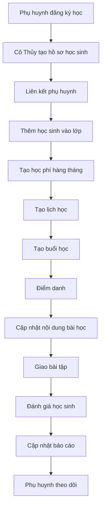
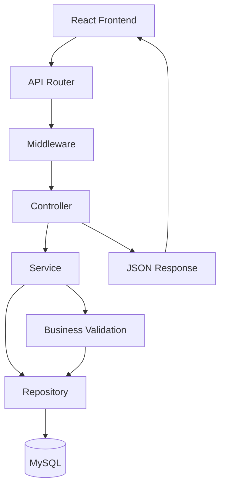
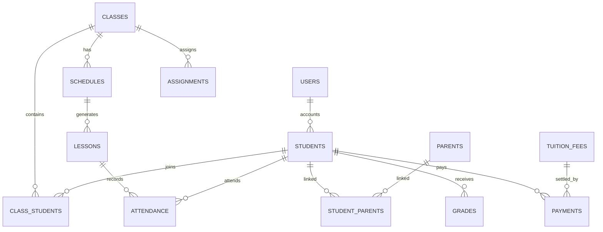

<!-- SECTION 1 -->

---

# PHẦN V. FRONTEND – REACT + VITE

## 16. Thiết kế giao diện

Tao đề xuất phong cách:

- Màu chủ đạo: tím pastel, xanh dương nhạt và trắng.
- Font: Be Vietnam Pro.
- Bo góc vừa phải.
- Card có shadow nhẹ.
- Sidebar cố định trên desktop.
- Mobile có bottom navigation hoặc menu thu gọn.
- Bảng dữ liệu rõ ràng, dễ thao tác.
- Không sử dụng quá nhiều hiệu ứng gây rối mắt.

<grid columns={2} gap={2}>
  <grid-item>
    <AsyncImage query="modern purple pastel education dashboard admin desktop web UI" aspectRatio="5:4"/>
    **Admin Dashboard**
    <text color="secondary" size="xs">Giao diện cô Thủy</text>
  </grid-item>
  <grid-item>
    <AsyncImage query="pastel education parent portal mobile dashboard student progress UI" aspectRatio="5:4"/>
    **Parent Portal**
    <text color="secondary" size="xs">Giao diện phụ huynh</text>
  </grid-item>
  <grid-item>
    <AsyncImage query="modern student attendance teacher dashboard table UI design" aspectRatio="5:4"/>
    **Attendance**
    <text color="secondary" size="xs">Điểm danh học sinh</text>
  </grid-item>
  <grid-item>
    <AsyncImage query="modern education student profile learning progress report dashboard UI" aspectRatio="5:4"/>
    **Student Profile**
    <text color="secondary" size="xs">Hồ sơ học sinh</text>
  </grid-item>
</grid>

## 17. Cấu trúc thư mục Frontend

Tên project: `thuy-english-frontend`

```text
thuy-english-frontend/
│
├── public/
│   ├── favicon.ico
│   ├── logo.svg
│   └── images/
│
├── src/
│   │
│   ├── assets/
│   │   ├── images/
│   │   └── styles/
│   │
│   ├── components/
│   │   ├── common/
│   │   │   ├── Button.jsx
│   │   │   ├── Input.jsx
│   │   │   ├── Modal.jsx
│   │   │   ├── DataTable.jsx
│   │   │   ├── Pagination.jsx
│   │   │   ├── Loading.jsx
│   │   │   └── ConfirmDialog.jsx
│   │   │
│   │   ├── layout/
│   │   │   ├── AdminLayout.jsx
│   │   │   ├── ParentLayout.jsx
│   │   │   ├── Sidebar.jsx
│   │   │   ├── Header.jsx
│   │   │   └── MobileNavigation.jsx
│   │   │
│   │   └── charts/
│   │
│   ├── pages/
│   │   │
│   │   ├── auth/
│   │   │   ├── Login.jsx
│   │   │   └── ForgotPassword.jsx
│   │   │
│   │   ├── admin/
│   │   │   ├── Dashboard.jsx
│   │   │   ├── students/
│   │   │   ├── parents/
│   │   │   ├── classes/
│   │   │   ├── schedules/
│   │   │   ├── lessons/
│   │   │   ├── attendance/
│   │   │   ├── assessments/
│   │   │   ├── assignments/
│   │   │   ├── materials/
│   │   │   ├── tuition/
│   │   │   ├── payments/
│   │   │   ├── notifications/
│   │   │   ├── reports/
│   │   │   └── settings/
│   │   │
│   │   ├── parent/
│   │   │   ├── Dashboard.jsx
│   │   │   ├── Children.jsx
│   │   │   ├── Attendance.jsx
│   │   │   ├── Schedule.jsx
│   │   │   ├── Assignments.jsx
│   │   │   ├── Materials.jsx
│   │   │   ├── Assessments.jsx
│   │   │   ├── Tuition.jsx
│   │   │   └── Notifications.jsx
│   │   │
│   │   └── NotFound.jsx
│   │
│   ├── services/
│   │   ├── api.js
│   │   ├── authService.js
│   │   ├── studentService.js
│   │   ├── attendanceService.js
│   │   ├── tuitionService.js
│   │   └── ...
│   │
│   ├── hooks/
│   ├── contexts/
│   │   └── AuthContext.jsx
│   │
│   ├── routes/
│   │   ├── AppRouter.jsx
│   │   ├── ProtectedRoute.jsx
│   │   └── RoleRoute.jsx
│   │
│   ├── utils/
│   │   ├── formatCurrency.js
│   │   ├── formatDate.js
│   │   └── validators.js
│   │
│   ├── App.jsx
│   ├── main.jsx
│   └── index.css
│
├── .env.example
├── package.json
└── vite.config.js
```

## 18. Các trang cần thiết

| Trang | URL |
|---|---|
| Đăng nhập | `/login` |
| Admin Dashboard | `/admin/dashboard` |
| Học sinh | `/admin/students` |
| Chi tiết học sinh | `/admin/students/:id` |
| Phụ huynh | `/admin/parents` |
| Lớp học | `/admin/classes` |
| Lịch học | `/admin/schedules` |
| Buổi học | `/admin/lessons` |
| Điểm danh | `/admin/attendance` |
| Đánh giá | `/admin/assessments` |
| Bài tập | `/admin/assignments` |
| Tài liệu | `/admin/materials` |
| Học phí | `/admin/tuition` |
| Báo cáo | `/admin/reports` |
| Parent Dashboard | `/parent/dashboard` |
| Hồ sơ con | `/parent/children` |
| Điểm danh con | `/parent/attendance` |
| Học phí con | `/parent/tuition` |

---

# PHẦN VI. DEPLOY ONLINE

## 19. Kiến trúc triển khai

Tao đề xuất triển khai theo mô hình:

<box border radius="xl" padding={3} gap={2}>
  <box background="surface-secondary" padding={3} radius="lg" align="center">
    <icon name="monitor-smartphone" size="2xl"/>
    **Người dùng**
    <text color="secondary" size="xs">Máy tính – iPhone – Android</text>
  </box>
  <box align="center">
    <icon name="arrow-down" color="secondary" size="lg"/>
  </box>
  <box border radius="lg" padding={3} align="center">
    **thuyenglish.vn**
    <text color="secondary" size="xs">Frontend React + Vite – HTTPS</text>
  </box>
  <box align="center">
    <icon name="arrow-down" color="secondary" size="lg"/>
    <text color="secondary" size="xs">HTTPS REST API</text>
  </box>
  <box border radius="lg" padding={3} align="center">
    **api.thuyenglish.vn**
    <text color="secondary" size="xs">PHP REST API – Authentication – Business Logic</text>
  </box>
  <box align="center">
    <icon name="arrow-down" color="secondary" size="lg"/>
  </box>
  <box background="surface-secondary" padding={3} radius="lg" align="center">
    <icon name="database" size="2xl"/>
    **MySQL Database**
    <text color="secondary" size="xs">Lưu trữ dữ liệu học sinh, phụ huynh, học phí</text>
  </box>
  <box align="center">
    <icon name="arrow-down" color="secondary" size="lg"/>
  </box>
  <box border radius="lg" padding={3} align="center">
    <icon name="hard-drive" size="xl"/>
    **Storage + Backup**
    <text color="secondary" size="xs">File học tập, ảnh và bản sao lưu</text>
  </box>
</box>

### Công nghệ triển khai

| Thành phần | Đề xuất |
|---|---|
| Frontend | Vercel |
| Backend | VPS hoặc hosting hỗ trợ PHP |
| Database | MySQL trên server |
| Domain | Domain riêng |
| SSL | HTTPS |
| File storage | Private storage |
| Backup | Tự động hàng ngày |

Không nên để file bài tập, hình ảnh học sinh ở thư mục public có thể truy cập tự do. File riêng tư nên được tải thông qua API có kiểm tra quyền.

## 20. Biến môi trường

Frontend `.env.example`:

```env
VITE_API_URL=https://api.thuyenglish.vn/api/v1
```

Backend `.env.example`:

```env
APP_ENV=production
APP_DEBUG=false
APP_URL=https://api.thuyenglish.vn

DB_HOST=localhost
DB_PORT=3306
DB_DATABASE=thuy_english_db
DB_USERNAME=your_username
DB_PASSWORD=your_password

APP_TIMEZONE=Asia/Ho_Chi_Minh
```

Không commit `.env` chứa mật khẩu thật lên GitHub.

---

# PHẦN VII. KẾ HOẠCH TRIỂN KHAI THỰC TẾ

## 21. Thứ tự phát triển

Tao đề xuất không code frontend và backend một cách rời rạc. Mỗi chức năng phải hoàn thành theo quy trình:

Database → API → Frontend → Kiểm thử.

<box border radius="xl" padding={3} gap={3}>
  <title size="lg">Development Roadmap</title>
  <list connector="solid" marker="number" gap={3}>
    <list-item>
      **Sprint 1 – Khởi tạo dự án**

      - Tạo GitHub repository.
      - Khởi tạo React + Vite.
      - Khởi tạo PHP API.
      - Cấu hình MySQL.
      - Cấu hình môi trường local.
      - Xây dựng đăng nhập và phân quyền.

      <badge color="success">Nền tảng</badge>
    </list-item>
    <list-item>
      **Sprint 2 – Quản lý học sinh**

      - CRUD học sinh.
      - Quản lý phụ huynh.
      - Liên kết phụ huynh và học sinh.
      - Quản lý lớp.
      - Hồ sơ học sinh.

      <badge color="success">MVP</badge>
    </list-item>
    <list-item>
      **Sprint 3 – Lịch học và điểm danh**

      - Lịch học hàng tuần.
      - Tạo buổi học.
      - Điểm danh.
      - Lịch sử chuyên cần.
      - Báo cáo chuyên cần.

      <badge color="success">MVP</badge>
    </list-item>
    <list-item>
      **Sprint 4 – Học phí**

      - Tạo học phí theo tháng.
      - Xác nhận thanh toán.
      - Quản lý công nợ.
      - Lịch sử giao dịch.
      - Báo cáo doanh thu.

      <badge color="success">MVP</badge>
    </list-item>
    <list-item>
      **Sprint 5 – Học tập**

      - Đánh giá học sinh.
      - Quản lý điểm số.
      - Nhận xét.
      - Bài tập.
      - Tài liệu.

    </list-item>
    <list-item>
      **Sprint 6 – Parent Portal**

      - Đăng nhập phụ huynh.
      - Dashboard.
      - Theo dõi điểm danh.
      - Xem kết quả.
      - Xem học phí.
      - Nộp bài tập.

    </list-item>
    <list-item>
      **Sprint 7 – Hoàn thiện và triển khai**

      - Thông báo.
      - Báo cáo PDF.
      - Kiểm thử phân quyền.
      - Kiểm thử dữ liệu.
      - Deploy online.
      - Backup và bảo mật.

    </list-item>
  </list>
  <divider color="subtle"/>
  <title size="xl" color="success">Khoảng 4–6 tuần</title>
  <text color="secondary" size="xs">Thời gian ước tính cho một người phát triển bán thời gian hoặc toàn thời gian tùy mức độ tập trung; đây là kế hoạch dự án, không phải cam kết thời hạn.</text>
</box>

## 22. Tiêu chí nghiệm thu

Trước khi đưa cho cô Thủy sử dụng, phải kiểm tra được các trường hợp sau:

| Mã | Tiêu chí | Kết quả cần đạt |
|---|---|---|
| TC01 | Admin đăng nhập | Thành công |
| TC02 | Phụ huynh đăng nhập | Thành công |
| TC03 | Thêm học sinh | Lưu đúng database |
| TC04 | Liên kết phụ huynh | Đúng học sinh |
| TC05 | Điểm danh | Không tạo bản ghi trùng |
| TC06 | Xem lịch sử điểm danh | Chính xác |
| TC07 | Tạo học phí | Không trùng tháng |
| TC08 | Thanh toán nhiều lần | Công nợ chính xác |
| TC09 | Đánh giá học sinh | Hiển thị đúng |
| TC10 | Giao bài tập | Phụ huynh xem được |
| TC11 | Nộp bài | Admin nhận được |
| TC12 | Phụ huynh xem dữ liệu | Chỉ xem được con mình |
| TC13 | Đăng nhập trên điện thoại | Responsive |
| TC14 | Sao lưu database | Có thể khôi phục |

---

# PHẦN VIII. NHỮNG ĐIỂM CẦN CHỐT THÊM VỀ NGHIỆP VỤ

Có 4 quyết định tao chưa muốn tự đặt ra vì nó ảnh hưởng đến cách tính học phí và vận hành thực tế.

{@body const [fee,setFee] = DIL.useState("fixed")}
{@body const [absence,setAbsence] = DIL.useState("keep")}
{@body const [payment,setPayment] = DIL.useState("manual")}
{@body const [register,setRegister] = DIL.useState("admin")}
<box border radius="2xl" padding={3} gap={3}>
  <title size="xl">Business Rules Confirmation</title>
  **1. Học phí hàng tháng tính như thế nào?**
  <radio-group direction="col" value={fee} onChange={setFee}>
    <radio value="fixed">Cố định hàng tháng, ví dụ 500.000đ/bé</radio>
    <radio value="sessions">Tính theo số buổi học thực tế</radio>
    <radio value="custom">Cố định nhưng cô Thủy được tùy chỉnh từng bé</radio>
  </radio-group>
  <divider color="subtle"/>
  **2. Học sinh nghỉ học có được trừ học phí không?**
  <radio-group direction="col" value={absence} onChange={setAbsence}>
    <radio value="keep">Không trừ, vẫn giữ nguyên học phí tháng</radio>
    <radio value="deduct">Có trừ theo số buổi nghỉ</radio>
    <radio value="makeup">Cho phép học bù, không trừ học phí</radio>
    <radio value="custom">Cô Thủy quyết định từng trường hợp</radio>
  </radio-group>
  <divider color="subtle"/>
  **3. Phương thức thanh toán?**
  <radio-group direction="col" value={payment} onChange={setPayment}>
    <radio value="manual">Phụ huynh chuyển khoản/tiền mặt, cô Thủy xác nhận</radio>
    <radio value="bank">Tích hợp thanh toán ngân hàng tự động</radio>
    <radio value="both">Cả hai</radio>
  </radio-group>
  <divider color="subtle"/>
  **4. Phụ huynh tạo tài khoản như thế nào?**
  <radio-group direction="col" value={register} onChange={setRegister}>
    <radio value="admin">Cô Thủy tạo và cấp tài khoản</radio>
    <radio value="invite">Cô Thủy gửi link mời, phụ huynh tự đặt mật khẩu</radio>
    <radio value="self">Phụ huynh tự đăng ký, cô Thủy duyệt</radio>
  </radio-group>
  <button block onClick={()=>GenUI.issueNewTurn("Chốt nghiệp vụ THUY ENGLISH:\nHọc phí: "+fee+"\nNghỉ học: "+absence+"\nThanh toán: "+payment+"\nTạo tài khoản phụ huynh: "+register+"\nHãy cập nhật PRD và database theo các lựa chọn này, sau đó bắt đầu hướng dẫn tạo project và code từng bước trên MacBook.")}>Xác nhận nghiệp vụ <icon name="check" size="sm"/></button>
</box>

---

# 23. Việc đầu tiên cần làm ngay

Sau khi chốt 4 nghiệp vụ trên, tao đề xuất triển khai theo đúng thứ tự này:

1. Tạo repository GitHub `thuy-english`.
2. Tạo cấu trúc frontend React + Vite.
3. Tạo backend PHP REST API.
4. Tạo database MySQL.
5. Viết authentication.
6. Thiết kế giao diện Admin Dashboard.
7. Xây dựng quản lý học sinh đầu tiên.

**Lưu ý kiến trúc:** Dù hiện tại chỉ có một lớp và một admin, vẫn giữ cấu trúc hỗ trợ nhiều lớp và nhiều phụ huynh. Không cần triển khai tính năng quản lý nhiều giáo viên trong phiên bản đầu.

Mục tiêu cuối cùng là khi bàn giao, cô Thủy chỉ cần mở website trên điện thoại hoặc máy tính, đăng nhập, điểm danh, quản lý học phí và theo dõi toàn bộ học sinh; phụ huynh cũng có tài khoản để xem tình hình học tập của con bất cứ lúc nào.

<!-- SECTION 2 -->

Dựa trên cấu hình đã chốt, tao sẽ thiết kế **THUY ENGLISH thành một hệ thống quản lý lớp học trực tuyến hoàn chỉnh**, tối ưu cho mô hình hiện tại: một cô giáo quản lý một lớp tiếng Anh, có phụ huynh đăng nhập để theo dõi toàn bộ quá trình học tập của con.

Điểm quan trọng là không xây dựng hệ thống quá phức tạp như một trung tâm ngoại ngữ lớn. Tuy nhiên, database và kiến trúc phải đủ tốt để sau này có thể thêm lớp học, giáo viên và học sinh mà không phải viết lại từ đầu.

(Đã chốt cấu hình) Project specification v1.0

# THUY ENGLISH

**English Class Management System**

image_group{"query":["premium modern pastel lavender blue education management SaaS dashboard interface laptop student attendance cards analytics"],"aspect_ratio":"16:9","layout":"carousel","num_per_query":1}

| Hạng mục | Cấu hình |
|--------|--------|
| Quy mô | 1 lớp học |
| Quản trị | Cô Thủy |
| Người dùng | Cô Thủy và phụ huynh |
| Học phí | Theo tháng |
| Phụ huynh | Tài khoản riêng, đầy đủ chức năng |
| Triển khai | Website online |
| Frontend | React + Vite |
| Backend | PHP REST API |
| Database | MySQL |
| Ngôn ngữ | Tiếng Việt |

# PHẦN I. PRD – PRODUCT REQUIREMENTS DOCUMENT

## 1\. Thông tin sản phẩm

**Tên sản phẩm\:** THUY ENGLISH MANAGEMENT

**Mục tiêu\:** Số hóa toàn bộ quy trình quản lý lớp học tiếng Anh của cô Thủy.

Hệ thống giải quyết 6 vấn đề\:

1. Không phải quản lý danh sách học sinh bằng Excel hoặc sổ tay.
2. Điểm danh nhanh chóng sau mỗi buổi học.
3. Theo dõi học phí và công nợ từng học sinh.
4. Theo dõi tiến bộ học tập của từng bé.
5. Giao bài tập và quản lý tài liệu học tập.
6. Giúp phụ huynh chủ động theo dõi tình hình học tập của con.

## 2\. Đối tượng sử dụng và phân quyền

Chỉ có 2 vai trò chính.

| Chức năng | Admin – Cô Thủy | Parent – Phụ huynh |
|--------|--------|--------|
| Dashboard | (Toàn quyền) | Dashboard riêng |
| Quản lý học sinh | Có | Xem con mình |
| Quản lý lớp | Có | Xem lớp con |
| Điểm danh | Có | Xem |
| Lịch học | Thêm/sửa | Xem |
| Điểm số | Thêm/sửa | Xem |
| Nhận xét | Thêm/sửa | Xem |
| Bài tập | Tạo/quản lý | Xem/nộp bài |
| Tài liệu | Quản lý | Xem/tải |
| Học phí | Quản lý | Xem |
| Thanh toán | Xác nhận | Xem lịch sử |
| Thông báo | Gửi | Nhận |
| Báo cáo | Toàn bộ | Báo cáo con mình |
| Cài đặt | Có | Không |

**Quy tắc bảo mật\:** Phụ huynh chỉ được xem dữ liệu của học sinh đã liên kết với tài khoản của mình. Không được phép truy cập hồ sơ của học sinh khác bằng cách thay ID trên URL hoặc API.

## 3\. Phân hệ chức năng

### 3.1. Admin Dashboard
image_group{"query":["modern teacher admin education dashboard student statistics attendance finance calendar pastel purple white web app"],"aspect_ratio":"16:9","layout":"carousel","num_per_query":1}

Dashboard có các chỉ số\:

- Tổng học sinh đang học.
- Số học sinh mới.
- Lịch dạy hôm nay.
- Buổi học đã hoàn thành.
- Tỷ lệ chuyên cần tháng này.
- Tổng học phí phải thu.
- Học phí đã thu.
- Học phí chưa thu.
- Danh sách học sinh cần chú ý.

Các biểu đồ\:

- Chuyên cần theo tháng.
- Doanh thu học phí.
- Tình hình thanh toán.
- Tiến độ học tập.

### 3.2. Quản lý học sinh

Mỗi học sinh có một hồ sơ riêng.

**Thông tin cá nhân**

- Mã học sinh tự động.
- Họ tên.
- Ngày sinh.
- Giới tính.
- Ảnh đại diện.
- Địa chỉ.
- Ngày nhập học.
- Trạng thái học tập.

**Thông tin phụ huynh**

- Họ tên.
- Số điện thoại.
- Email.
- Mối quan hệ với học sinh.
- Địa chỉ liên hệ.

**Hồ sơ học tập**

- Trình độ đầu vào.
- Khả năng nghe.
- Khả năng nói.
- Khả năng đọc.
- Khả năng viết.
- Từ vựng.
- Lịch sử đánh giá.
- Nhận xét của cô Thủy.

Các thao tác: thêm, sửa, tìm kiếm, xem hồ sơ, chuyển trạng thái, xuất Excel.

### 3.3. Quản lý lớp học

Trong phiên bản đầu chỉ có một lớp, nhưng vẫn tạo bảng lớp học riêng.

Thông tin\:

- Tên lớp.
- Độ tuổi.
- Giáo viên phụ trách.
- Sĩ số tối đa.
- Học phí hàng tháng.
- Ngày bắt đầu.
- Địa điểm.
- Trạng thái.

Cho phép thêm học sinh vào lớp và lưu lịch sử chuyển lớp.

### 3.4. Quản lý lịch học và buổi học

Có hai loại dữ liệu cần phân biệt\:

- **Lịch học\:** Lịch dự kiến lặp lại hàng tuần, ví dụ thứ 2, 4, 6.
- **Buổi học\:** Một buổi cụ thể diễn ra vào một ngày nhất định.

Mỗi buổi học có\:

- Ngày học.
- Giờ bắt đầu.
- Giờ kết thúc.
- Nội dung bài học.
- Giáo viên.
- Trạng thái: dự kiến, đã hoàn thành, hủy.
- Danh sách điểm danh.

Không tự động đánh dấu học sinh vắng mặt chỉ vì chưa điểm danh. Cô Thủy phải xác nhận điểm danh và hoàn thành buổi học.

### 3.5. Điểm danh

(MVP bắt buộc)

Quy trình\:

1. Chọn buổi học.
2. Hiển thị danh sách học sinh.
3. Mặc định trạng thái chưa điểm danh.
4. Chọn có mặt, nghỉ có phép, nghỉ không phép hoặc đi muộn.
5. Nhập ghi chú.
6. Lưu toàn bộ danh sách.
7. Xem báo cáo chuyên cần.

Quy tắc\:

- Mỗi học sinh chỉ có một bản ghi điểm danh trong một buổi.
- Không được tạo điểm danh cho học sinh không thuộc lớp.
- Lưu người thực hiện và thời điểm cập nhật.
- Có thể sửa điểm danh nhưng phải ghi lại lịch sử thay đổi.
- Hủy buổi học không tính vào số buổi nghỉ của học sinh.

### 3.6. Quản lý học phí hàng tháng

Đây là nghiệp vụ cần thiết kế cẩn thận.

Mỗi tháng hệ thống tạo một khoản học phí cho từng học sinh đang theo học.

Ví dụ\:

| Học sinh | Tháng | Phải đóng | Đã đóng | Còn nợ |
|--------|--------|--------|--------|--------|
| Minh Anh | 11/2026 | 500.000 | 500.000 | 0 |
| Gia Bảo | 11/2026 | 500.000 | 300.000 | 200.000 |
| Khánh Linh | 11/2026 | 500.000 | 0 | 500.000 |

Chức năng\:

- Cấu hình học phí mặc định.
- Tạo học phí tháng.
- Điều chỉnh khoản thu riêng cho từng học sinh.
- Ghi nhận thanh toán một hoặc nhiều lần.
- Theo dõi công nợ.
- Xem lịch sử giao dịch.
- Xuất phiếu thu.
- Báo cáo doanh thu.

Trạng thái\:

- Chưa thanh toán.
- Thanh toán một phần.
- Đã thanh toán.
- Miễn giảm.
- Quá hạn.

**Lưu ý\:** Hệ thống không tự động ghi nhận tiền đã nhận chỉ vì phụ huynh nhấn nút thanh toán. Phiên bản đầu cô Thủy xác nhận khoản thu thực tế.

### 3.7. Quản lý kết quả học tập

Đánh giá theo 5 tiêu chí\:

| Kỹ năng | Nội dung |
|--------|--------|
| Listening | Nghe hiểu |
| Speaking | Phát âm, giao tiếp |
| Reading | Nhận biết và đọc |
| Writing | Tô chữ, viết |
| Vocabulary | Ghi nhớ từ vựng |

Mỗi lần đánh giá gồm\:

- Học sinh.
- Ngày đánh giá.
- Kỹ năng.
- Điểm số từ 0–100.
- Mức độ hoàn thành.
- Nhận xét.
- Người đánh giá.

Có thể tạo báo cáo theo tháng để phụ huynh biết con đang tiến bộ như thế nào.

### 3.8. Bài tập và tài liệu

Cô Thủy có thể\:

- Tạo bài tập theo lớp.
- Giao bài riêng.
- Đính kèm PDF, hình ảnh, audio.
- Đặt hạn nộp.
- Xem bài đã nộp.
- Đánh giá và nhận xét.

Phụ huynh có thể\:

- Xem bài tập.
- Tải tài liệu.
- Nộp bài cho con.
- Xem kết quả chấm bài.

### 3.9. Cổng phụ huynh
image_group{"query":["parent portal education student dashboard mobile interface pastel","mobile education app attendance history student profile","student learning progress report parent app mobile interface"],"aspect_ratio":"3:4"}

Trang phụ huynh gồm\:

1. Tổng quan.
2. Hồ sơ của con.
3. Lịch học.
4. Điểm danh.
5. Bài tập.
6. Tài liệu.
7. Điểm số.
8. Nhận xét.
9. Học phí.
10. Lịch sử thanh toán.
11. Thông báo.
12. Báo cáo học tập.

Phụ huynh có thể có nhiều con trong cùng hệ thống. Một tài khoản phụ huynh có thể liên kết với nhiều học sinh.

### 3.10. Thông báo

Các loại thông báo\:

- Lịch học sắp tới.
- Thay đổi lịch học.
- Học sinh nghỉ học.
- Học phí đến hạn.
- Bài tập mới.
- Kết quả học tập mới.
- Báo cáo tháng.

Phiên bản đầu sử dụng thông báo trong website. Sau đó có thể tích hợp email hoặc Zalo OA.

## 4\. Yêu cầu phi chức năng

| Tiêu chí | Yêu cầu |
|--------|--------|
| Responsive | PC, tablet, điện thoại |
| Bảo mật | HTTPS, mật khẩu hash |
| Phân quyền | RBAC, kiểm tra quyền ở backend |
| Tốc độ | API thông thường mục tiêu dưới 1 giây |
| Dữ liệu | MySQL, InnoDB, utf8mb4 |
| Backup | Sao lưu tự động hàng ngày |
| Upload | Kiểm tra loại và dung lượng file |
| Nhật ký | Lưu thao tác quan trọng |
| SEO | Có trang giới thiệu công khai |
| Khả dụng | Có thể truy cập online |

Vì hệ thống lưu thông tin trẻ em, cần giới hạn dữ liệu thu thập, bảo vệ thông tin phụ huynh và học sinh, không công khai hồ sơ hay hình ảnh của trẻ nếu chưa được đồng ý phù hợp.

---

# PHẦN II. NGHIỆP VỤ HỆ THỐNG – BUSINESS LOGIC

## 5\. Quy trình hoạt động tổng thể



## 6\. Nghiệp vụ điểm danh

Ví dụ lớp học có 10 học sinh, buổi học ngày 23/11/2026.

Cô Thủy mở buổi học, hệ thống tải 10 học sinh.

Cô đánh dấu\:

- 8 học sinh có mặt.
- 1 học sinh nghỉ có phép.
- 1 học sinh đi muộn.

Hệ thống lưu 10 bản ghi điểm danh.

Công thức\:

\[
\text{Tỷ lệ chuyên cần} =
\frac{\text{Số buổi có mặt + đi muộn}}
{\text{Số buổi được tổ chức và có điểm danh}}
\times 100\%
\]

Buổi bị hủy và buổi chưa điểm danh không được tính vào mẫu số.

## 7\. Nghiệp vụ học phí

Đề xuất công thức\:

\[
\text{Còn nợ} = \text{Phải đóng} - \text{Tổng đã thanh toán}
\]

Ví dụ\:

- Học phí: 500.000đ.
- Đóng lần 1: 200.000đ.
- Đóng lần 2: 100.000đ.
- Còn nợ: 200.000đ.

Quy tắc tạo khoản thu\:

- Mỗi học sinh có tối đa một khoản học phí cho một tháng và một loại học phí.
- Học sinh mới nhập học giữa tháng có thể được áp dụng mức phí riêng.
- Học sinh bảo lưu hoặc nghỉ học không tự động bị tạo học phí mới.
- Khoản học phí cũ vẫn giữ nguyên lịch sử.
- Mọi khoản điều chỉnh phải có lý do.
- Không xóa giao dịch đã xác nhận; nếu sai phải tạo nghiệp vụ hoàn/điều chỉnh có lưu dấu vết.

## 8\. Nghiệp vụ tài khoản phụ huynh

1. Cô Thủy tạo tài khoản hoặc gửi lời mời.
2. Phụ huynh nhận thông tin đăng nhập.
3. Phụ huynh đăng nhập và đổi mật khẩu.
4. Backend kiểm tra liên kết phụ huynh – học sinh.
5. Phụ huynh chỉ xem được hồ sơ được cấp quyền.
6. Nếu có nhiều con, phụ huynh chọn hồ sơ muốn xem.

Tao đề xuất không cho phụ huynh tự tạo hồ sơ học sinh và tự liên kết con mà không có xác nhận của cô Thủy.

---

# PHẦN III. DATABASE DESIGN – MYSQL

## 9\. Nguyên tắc thiết kế database

Tao đề xuất database tên\:

`thuy_english_db`

Các nguyên tắc\:

- Dùng MySQL 8.0 trở lên.
- Engine InnoDB.
- Charset utf8mb4.
- Khóa chính dùng BIGINT UNSIGNED.
- Tiền tệ lưu bằng BIGINT (VND), không dùng FLOAT.
- Ngày tháng dùng DATE, thời gian dùng DATETIME hoặc TIME phù hợp.
- Có `created_at`, `updated_at`\.
- Dữ liệu quan trọng sử dụng soft delete hoặc trạng thái thay vì xóa cứng.
- Có unique constraint và foreign key.
- Các thao tác thanh toán phải chạy trong database transaction.

## 10\. Danh sách bảng database

Tao chia thành 6 nhóm\:

| Nhóm | Các bảng |
|--------|--------|
| Tài khoản | users, roles |
| Học sinh | students, parents, student\_parents |
| Lớp học | classes, class\_students, schedules, lessons |
| Giảng dạy | attendance, assignments, assignment\_submissions, materials |
| Kết quả | assessments, grades, comments |
| Tài chính | tuition\_fees, payments |
| Hệ thống | notifications, audit\_logs, settings |

Tổng cộng 21 bảng trong thiết kế phiên bản đầu.

## 11\. Database SQL chi tiết

Đây là cấu trúc khởi tạo. Có thể sử dụng trực tiếp trong MySQL Workbench hoặc phpMyAdmin.

```sql

CREATE DATABASE thuy_english_db
CHARACTER SET utf8mb4
COLLATE utf8mb4_unicode_ci;

USE thuy_english_db;

-- 1. ROLES
CREATE TABLE roles (
    id BIGINT UNSIGNED AUTO_INCREMENT PRIMARY KEY,
    name VARCHAR(50) NOT NULL UNIQUE,
    description VARCHAR(255),
    created_at TIMESTAMP DEFAULT CURRENT_TIMESTAMP
) ENGINE=InnoDB;

INSERT INTO roles (name, description) VALUES
('admin', 'Co Thuy quan tri'),
('parent', 'Phu huynh hoc sinh');

-- 2. USERS
CREATE TABLE users (
    id BIGINT UNSIGNED AUTO_INCREMENT PRIMARY KEY,
    role_id BIGINT UNSIGNED NOT NULL,
    full_name VARCHAR(150) NOT NULL,
    email VARCHAR(150) UNIQUE,
    phone VARCHAR(20) UNIQUE,
    password_hash VARCHAR(255) NOT NULL,
    avatar VARCHAR(500),
    status ENUM('active','inactive','locked')
        DEFAULT 'active',
    last_login_at DATETIME NULL,
    created_at TIMESTAMP DEFAULT CURRENT_TIMESTAMP,
    updated_at TIMESTAMP DEFAULT CURRENT_TIMESTAMP
        ON UPDATE CURRENT_TIMESTAMP,
    FOREIGN KEY (role_id) REFERENCES roles(id)
) ENGINE=InnoDB;

-- 3. PARENTS
CREATE TABLE parents (
    id BIGINT UNSIGNED AUTO_INCREMENT PRIMARY KEY,
    user_id BIGINT UNSIGNED NOT NULL UNIQUE,
    address TEXT,
    occupation VARCHAR(150),
    created_at TIMESTAMP DEFAULT CURRENT_TIMESTAMP,
    updated_at TIMESTAMP DEFAULT CURRENT_TIMESTAMP
        ON UPDATE CURRENT_TIMESTAMP,
    FOREIGN KEY (user_id) REFERENCES users(id)
) ENGINE=InnoDB;

-- 4. STUDENTS
CREATE TABLE students (
    id BIGINT UNSIGNED AUTO_INCREMENT PRIMARY KEY,
    student_code VARCHAR(30) NOT NULL UNIQUE,
    full_name VARCHAR(150) NOT NULL,
    date_of_birth DATE,
    gender ENUM('male','female','other'),
    avatar VARCHAR(500),
    address TEXT,
    enrollment_date DATE NOT NULL,
    initial_level VARCHAR(100),
    status ENUM('studying','reserved','withdrawn')
        DEFAULT 'studying',
    note TEXT,
    created_at TIMESTAMP DEFAULT CURRENT_TIMESTAMP,
    updated_at TIMESTAMP DEFAULT CURRENT_TIMESTAMP
        ON UPDATE CURRENT_TIMESTAMP
) ENGINE=InnoDB;

-- 5. STUDENT_PARENTS
CREATE TABLE student_parents (
    id BIGINT UNSIGNED AUTO_INCREMENT PRIMARY KEY,
    student_id BIGINT UNSIGNED NOT NULL,
    parent_id BIGINT UNSIGNED NOT NULL,
    relationship VARCHAR(50),
    is_primary BOOLEAN DEFAULT FALSE,
    created_at TIMESTAMP DEFAULT CURRENT_TIMESTAMP,
    UNIQUE KEY uq_student_parent (student_id, parent_id),
    FOREIGN KEY (student_id) REFERENCES students(id),
    FOREIGN KEY (parent_id) REFERENCES parents(id)
) ENGINE=InnoDB;

-- 6. CLASSES
CREATE TABLE classes (
    id BIGINT UNSIGNED AUTO_INCREMENT PRIMARY KEY,
    class_code VARCHAR(30) NOT NULL UNIQUE,
    name VARCHAR(150) NOT NULL,
    age_group VARCHAR(100),
    teacher_name VARCHAR(150) DEFAULT 'Ms. Thuy',
    location VARCHAR(255),
    max_students INT DEFAULT 10,
    monthly_fee BIGINT UNSIGNED DEFAULT 0,
    start_date DATE,
    status ENUM('active','inactive','completed')
        DEFAULT 'active',
    description TEXT,
    created_at TIMESTAMP DEFAULT CURRENT_TIMESTAMP,
    updated_at TIMESTAMP DEFAULT CURRENT_TIMESTAMP
        ON UPDATE CURRENT_TIMESTAMP
) ENGINE=InnoDB;

-- 7. CLASS_STUDENTS
CREATE TABLE class_students (
    id BIGINT UNSIGNED AUTO_INCREMENT PRIMARY KEY,
    class_id BIGINT UNSIGNED NOT NULL,
    student_id BIGINT UNSIGNED NOT NULL,
    joined_at DATE NOT NULL,
    left_at DATE NULL,
    status ENUM('active','transferred','withdrawn')
        DEFAULT 'active',
    created_at TIMESTAMP DEFAULT CURRENT_TIMESTAMP,
    UNIQUE KEY uq_class_student_join (class_id, student_id, joined_at),
    INDEX idx_student_status (student_id, status),
    FOREIGN KEY (class_id) REFERENCES classes(id),
    FOREIGN KEY (student_id) REFERENCES students(id)
) ENGINE=InnoDB;

-- 8. SCHEDULES
CREATE TABLE schedules (
    id BIGINT UNSIGNED AUTO_INCREMENT PRIMARY KEY,
    class_id BIGINT UNSIGNED NOT NULL,
    day_of_week TINYINT UNSIGNED NOT NULL,
    start_time TIME NOT NULL,
    end_time TIME NOT NULL,
    effective_from DATE NOT NULL,
    effective_to DATE NULL,
    status ENUM('active','inactive') DEFAULT 'active',
    created_at TIMESTAMP DEFAULT CURRENT_TIMESTAMP,
    FOREIGN KEY (class_id) REFERENCES classes(id)
) ENGINE=InnoDB;

-- day_of_week: 1 = Monday, 7 = Sunday

-- 9. LESSONS
CREATE TABLE lessons (
    id BIGINT UNSIGNED AUTO_INCREMENT PRIMARY KEY,
    class_id BIGINT UNSIGNED NOT NULL,
    schedule_id BIGINT UNSIGNED NULL,
    lesson_date DATE NOT NULL,
    start_time TIME NOT NULL,
    end_time TIME NOT NULL,
    topic VARCHAR(255),
    content TEXT,
    homework_note TEXT,
    status ENUM('scheduled','completed','cancelled')
        DEFAULT 'scheduled',
    created_at TIMESTAMP DEFAULT CURRENT_TIMESTAMP,
    updated_at TIMESTAMP DEFAULT CURRENT_TIMESTAMP
        ON UPDATE CURRENT_TIMESTAMP,
    UNIQUE KEY uq_class_lesson (class_id, lesson_date, start_time),
    FOREIGN KEY (class_id) REFERENCES classes(id),
    FOREIGN KEY (schedule_id) REFERENCES schedules(id)
) ENGINE=InnoDB;

-- 10. ATTENDANCE
CREATE TABLE attendance (
    id BIGINT UNSIGNED AUTO_INCREMENT PRIMARY KEY,
    lesson_id BIGINT UNSIGNED NOT NULL,
    student_id BIGINT UNSIGNED NOT NULL,
    status ENUM(
        'present',
        'absent_excused',
        'absent_unexcused',
        'late'
    ) NOT NULL DEFAULT 'present',
    note TEXT,
    marked_by BIGINT UNSIGNED NULL,
    marked_at DATETIME NULL,
    created_at TIMESTAMP DEFAULT CURRENT_TIMESTAMP,
    updated_at TIMESTAMP DEFAULT CURRENT_TIMESTAMP
        ON UPDATE CURRENT_TIMESTAMP,
    UNIQUE KEY uq_lesson_student (lesson_id, student_id),
    FOREIGN KEY (lesson_id) REFERENCES lessons(id),
    FOREIGN KEY (student_id) REFERENCES students(id),
    FOREIGN KEY (marked_by) REFERENCES users(id)
) ENGINE=InnoDB;

-- 11. ASSESSMENTS
CREATE TABLE assessments (
    id BIGINT UNSIGNED AUTO_INCREMENT PRIMARY KEY,
    student_id BIGINT UNSIGNED NOT NULL,
    assessment_date DATE NOT NULL,
    period_label VARCHAR(100),
    overall_score DECIMAL(5,2),
    general_comment TEXT,
    created_by BIGINT UNSIGNED NULL,
    created_at TIMESTAMP DEFAULT CURRENT_TIMESTAMP,
    FOREIGN KEY (student_id) REFERENCES students(id),
    FOREIGN KEY (created_by) REFERENCES users(id)
) ENGINE=InnoDB;

-- 12. GRADES
CREATE TABLE grades (
    id BIGINT UNSIGNED AUTO_INCREMENT PRIMARY KEY,
    assessment_id BIGINT UNSIGNED NOT NULL,
    skill ENUM(
        'listening',
        'speaking',
        'reading',
        'writing',
        'vocabulary'
    ) NOT NULL,
    score DECIMAL(5,2) NOT NULL,
    comment TEXT,
    created_at TIMESTAMP DEFAULT CURRENT_TIMESTAMP,
    UNIQUE KEY uq_assessment_skill (assessment_id, skill),
    FOREIGN KEY (assessment_id) REFERENCES assessments(id)
) ENGINE=InnoDB;

-- 13. COMMENTS
CREATE TABLE comments (
    id BIGINT UNSIGNED AUTO_INCREMENT PRIMARY KEY,
    student_id BIGINT UNSIGNED NOT NULL,
    lesson_id BIGINT UNSIGNED NULL,
    parent_visible BOOLEAN DEFAULT TRUE,
    content TEXT NOT NULL,
    created_by BIGINT UNSIGNED NULL,
    created_at TIMESTAMP DEFAULT CURRENT_TIMESTAMP,
    FOREIGN KEY (student_id) REFERENCES students(id),
    FOREIGN KEY (lesson_id) REFERENCES lessons(id),
    FOREIGN KEY (created_by) REFERENCES users(id)
) ENGINE=InnoDB;

-- 14. ASSIGNMENTS
CREATE TABLE assignments (
    id BIGINT UNSIGNED AUTO_INCREMENT PRIMARY KEY,
    class_id BIGINT UNSIGNED NOT NULL,
    lesson_id BIGINT UNSIGNED NULL,
    title VARCHAR(255) NOT NULL,
    description TEXT,
    attachment VARCHAR(500),
    due_date DATETIME NULL,
    status ENUM('draft','published','closed')
        DEFAULT 'draft',
    created_at TIMESTAMP DEFAULT CURRENT_TIMESTAMP,
    FOREIGN KEY (class_id) REFERENCES classes(id),
    FOREIGN KEY (lesson_id) REFERENCES lessons(id)
) ENGINE=InnoDB;

-- 15. ASSIGNMENT_SUBMISSIONS
CREATE TABLE assignment_submissions (
    id BIGINT UNSIGNED AUTO_INCREMENT PRIMARY KEY,
    assignment_id BIGINT UNSIGNED NOT NULL,
    student_id BIGINT UNSIGNED NOT NULL,
    file_path VARCHAR(500),
    answer_text TEXT,
    submitted_at DATETIME NULL,
    score DECIMAL(5,2) NULL,
    teacher_feedback TEXT,
    status ENUM('pending','submitted','graded','late')
        DEFAULT 'pending',
    graded_at DATETIME NULL,
    UNIQUE KEY uq_assignment_student (assignment_id, student_id),
    FOREIGN KEY (assignment_id) REFERENCES assignments(id),
    FOREIGN KEY (student_id) REFERENCES students(id)
) ENGINE=InnoDB;

-- 16. MATERIALS
CREATE TABLE materials (
    id BIGINT UNSIGNED AUTO_INCREMENT PRIMARY KEY,
    class_id BIGINT UNSIGNED NULL,
    title VARCHAR(255) NOT NULL,
    description TEXT,
    file_path VARCHAR(500) NOT NULL,
    file_type VARCHAR(50),
    parent_visible BOOLEAN DEFAULT TRUE,
    uploaded_by BIGINT UNSIGNED NULL,
    created_at TIMESTAMP DEFAULT CURRENT_TIMESTAMP,
    FOREIGN KEY (class_id) REFERENCES classes(id),
    FOREIGN KEY (uploaded_by) REFERENCES users(id)
) ENGINE=InnoDB;

-- 17. TUITION_FEES
CREATE TABLE tuition_fees (
    id BIGINT UNSIGNED AUTO_INCREMENT PRIMARY KEY,
    student_id BIGINT UNSIGNED NOT NULL,
    class_id BIGINT UNSIGNED NOT NULL,
    billing_month TINYINT UNSIGNED NOT NULL,
    billing_year SMALLINT UNSIGNED NOT NULL,
    amount BIGINT UNSIGNED NOT NULL,
    discount_amount BIGINT UNSIGNED DEFAULT 0,
    due_date DATE NULL,
    description VARCHAR(255),
    status ENUM(
        'unpaid',
        'partial',
        'paid',
        'waived',
        'cancelled'
    ) DEFAULT 'unpaid',
    created_at TIMESTAMP DEFAULT CURRENT_TIMESTAMP,
    updated_at TIMESTAMP DEFAULT CURRENT_TIMESTAMP
        ON UPDATE CURRENT_TIMESTAMP,
    UNIQUE KEY uq_student_month (
        student_id, billing_month, billing_year
    ),
    FOREIGN KEY (student_id) REFERENCES students(id),
    FOREIGN KEY (class_id) REFERENCES classes(id)
) ENGINE=InnoDB;

-- 18. PAYMENTS
CREATE TABLE payments (
    id BIGINT UNSIGNED AUTO_INCREMENT PRIMARY KEY,
    tuition_fee_id BIGINT UNSIGNED NOT NULL,
    transaction_code VARCHAR(50) NOT NULL UNIQUE,
    amount BIGINT UNSIGNED NOT NULL,
    payment_method ENUM(
        'cash',
        'bank_transfer',
        'other'
    ) DEFAULT 'cash',
    payment_date DATETIME NOT NULL,
    note TEXT,
    received_by BIGINT UNSIGNED NULL,
    status ENUM('confirmed','reversed') DEFAULT 'confirmed',
    created_at TIMESTAMP DEFAULT CURRENT_TIMESTAMP,
    FOREIGN KEY (tuition_fee_id) REFERENCES tuition_fees(id),
    FOREIGN KEY (received_by) REFERENCES users(id)
) ENGINE=InnoDB;

-- 19. NOTIFICATIONS
CREATE TABLE notifications (
    id BIGINT UNSIGNED AUTO_INCREMENT PRIMARY KEY,
    user_id BIGINT UNSIGNED NOT NULL,
    title VARCHAR(255) NOT NULL,
    content TEXT,
    type VARCHAR(50),
    related_type VARCHAR(50),
    related_id BIGINT UNSIGNED NULL,
    is_read BOOLEAN DEFAULT FALSE,
    read_at DATETIME NULL,
    created_at TIMESTAMP DEFAULT CURRENT_TIMESTAMP,
    INDEX idx_user_read (user_id, is_read),
    FOREIGN KEY (user_id) REFERENCES users(id)
) ENGINE=InnoDB;

-- 20. SETTINGS
CREATE TABLE settings (
    id BIGINT UNSIGNED AUTO_INCREMENT PRIMARY KEY,
    setting_key VARCHAR(100) NOT NULL UNIQUE,
    setting_value TEXT,
    description VARCHAR(255),
    updated_at TIMESTAMP DEFAULT CURRENT_TIMESTAMP
        ON UPDATE CURRENT_TIMESTAMP
) ENGINE=InnoDB;

-- 21. AUDIT_LOGS
CREATE TABLE audit_logs (
    id BIGINT UNSIGNED AUTO_INCREMENT PRIMARY KEY,
    user_id BIGINT UNSIGNED NULL,
    action VARCHAR(100) NOT NULL,
    entity_type VARCHAR(100) NOT NULL,
    entity_id BIGINT UNSIGNED NULL,
    old_values JSON NULL,
    new_values JSON NULL,
    ip_address VARCHAR(45),
    created_at TIMESTAMP DEFAULT CURRENT_TIMESTAMP,
    FOREIGN KEY (user_id) REFERENCES users(id)
) ENGINE=InnoDB;
```

## 12\. Các ràng buộc cần bổ sung khi triển khai

SQL trên là nền tảng khởi tạo. Khi viết backend cần bổ sung kiểm tra nghiệp vụ\:

| Quy tắc | Nơi xử lý |
|--------|--------|
| Không thêm học sinh trùng vào lớp cùng thời gian | Backend |
| Không điểm danh học sinh ngoài lớp | Backend + transaction |
| Điểm từ 0 đến 100 | Backend + CHECK |
| Tháng học phí từ 1 đến 12 | Backend + CHECK |
| Không thanh toán vượt số tiền còn nợ | Backend + transaction |
| Không có hai khoản học phí cùng tháng cho học sinh | Unique constraint |
| Phụ huynh chỉ xem con mình | Backend |
| Không truy cập tài khoản bị khóa | Authentication middleware |

Một điểm cần lưu ý: `uq_student_month` hiện giới hạn một khoản học phí cho mỗi học sinh mỗi tháng. Đây là thiết kế phù hợp với phiên bản đầu. Nếu sau này có nhiều loại khoản thu trong cùng tháng, sẽ mở rộng unique key bằng trường `fee_type`\.

Cần bổ sung bảng `student_parents` để kiểm tra quyền truy cập bằng `parent_id` lấy từ phiên đăng nhập, tuyệt đối không tin `parent_id` do trình duyệt gửi lên.

---

# PHẦN IV. BACKEND – PHP REST API

## 13\. Kiến trúc backend

Tao đề xuất PHP thuần theo mô hình MVC kết hợp Service Layer, sử dụng Composer và PDO.

Không viết toàn bộ SQL và nghiệp vụ trực tiếp trong file API.

Luồng xử lý\:



**Vai trò từng tầng\:**

- Router: nhận URL và điều hướng.
- Middleware: xác thực, phân quyền.
- Controller: nhận request, trả response.
- Service: xử lý nghiệp vụ.
- Repository: truy vấn MySQL.
- Validator: kiểm tra dữ liệu.
- Response: chuẩn hóa JSON.

## 14\. Danh sách API

Tất cả API có prefix\:

`/api/v1`

| Module | API chính |
|--------|--------|
| Auth | POST `/auth/login` |
| Auth | POST `/auth/logout` |
| Auth | GET `/auth/me` |
| Students | GET, POST `/students` |
| Students | GET, PUT `/students/{id}` |
| Parents | GET, POST `/parents` |
| Parents | GET, PUT `/parents/{id}` |
| Classes | GET `/classes` |
| Classes | POST `/classes` |
| Classes | POST `/classes/{id}/students` |
| Schedules | GET, POST `/schedules` |
| Lessons | GET, POST `/lessons` |
| Lessons | PUT `/lessons/{id}` |
| Attendance | GET `/lessons/{id}/attendance` |
| Attendance | POST `/lessons/{id}/attendance/bulk` |
| Grades | GET, POST `/students/{id}/assessments` |
| Assignments | GET, POST `/assignments` |
| Submissions | POST `/assignments/{id}/submissions` |
| Tuition | GET `/tuition` |
| Tuition | POST `/tuition/generate-monthly` |
| Payments | POST `/tuition/{id}/payments` |
| Notifications | GET `/notifications` |
| Notifications | PATCH `/notifications/{id}/read` |
| Reports | GET `/reports/attendance` |
| Reports | GET `/reports/revenue` |
| Reports | GET `/reports/student/{id}` |
| Parent Portal | GET `/parent/children` |
| Parent Portal | GET `/parent/children/{id}/overview` |

Ví dụ response thống nhất\:

```json
{
  "success": true,
  "message": "Lấy danh sách học sinh thành công",
  "data": [],
  "meta": {
    "page": 1,
    "limit": 20,
    "total": 0
  }
}
```

Lỗi\:

```json
{
  "success": false,
  "message": "Bạn không có quyền truy cập dữ liệu này",
  "errors": []
}
```

## 15\. Authentication và bảo mật

Tao đề xuất\:

- PHP password\_hash với PASSWORD\_DEFAULT.
- password\_verify khi đăng nhập.
- Session/token được quản lý an toàn.
- Nếu dùng cookie: HttpOnly, Secure, SameSite phù hợp và có CSRF protection.
- Nếu dùng Bearer token: token có thời hạn, cơ chế thu hồi và lưu trữ an toàn.
- PDO prepared statements chống SQL Injection.
- Kiểm tra quyền tại từng endpoint.
- Giới hạn số lần đăng nhập sai.
- Validate toàn bộ dữ liệu đầu vào.
- Không trả password\_hash về frontend.
- Không cho phép frontend tự quyết định role.

Với dự án có hai loại người dùng, tao ưu tiên cookie phiên đăng nhập bảo mật nếu frontend và API được triển khai cùng một site hoặc cấu hình được cùng site.

---

# PHẦN V. FRONTEND – REACT + VITE

## 16\. Thiết kế giao diện

Tao đề xuất phong cách\:

- Màu chủ đạo: tím pastel, xanh dương nhạt và trắng.
- Font: Be Vietnam Pro.
- Bo góc vừa phải.
- Card có shadow nhẹ.
- Sidebar cố định trên desktop.
- Mobile có bottom navigation hoặc menu thu gọn.
- Bảng dữ liệu rõ ràng, dễ thao tác.
- Không sử dụng quá nhiều hiệu ứng gây rối mắt.

image_group{"query":["modern purple pastel education dashboard admin desktop web UI"],"aspect_ratio":"5:4","layout":"carousel","num_per_query":1}

**Admin Dashboard**

Giao diện cô Thủy

image_group{"query":["pastel education parent portal mobile dashboard student progress UI"],"aspect_ratio":"5:4","layout":"carousel","num_per_query":1}

**Parent Portal**

Giao diện phụ huynh

image_group{"query":["modern student attendance teacher dashboard table UI design"],"aspect_ratio":"5:4","layout":"carousel","num_per_query":1}

**Attendance**

Điểm danh học sinh

image_group{"query":["modern education student profile learning progress report dashboard UI"],"aspect_ratio":"5:4","layout":"carousel","num_per_query":1}

**Student Profile**

Hồ sơ học sinh

## 17\. Cấu trúc thư mục Frontend

Tên project: `thuy-english-frontend`

```text
thuy-english-frontend/
│
├── public/
│   ├── favicon.ico
│   ├── logo.svg
│   └── images/
│
├── src/
│   │
│   ├── assets/
│   │   ├── images/
│   │   └── styles/
│   │
│   ├── components/
│   │   ├── common/
│   │   │   ├── Button.jsx
│   │   │   ├── Input.jsx
│   │   │   ├── Modal.jsx
│   │   │   ├── DataTable.jsx
│   │   │   ├── Pagination.jsx
│   │   │   ├── Loading.jsx
│   │   │   └── ConfirmDialog.jsx
│   │   │
│   │   ├── layout/
│   │   │   ├── AdminLayout.jsx
│   │   │   ├── ParentLayout.jsx
│   │   │   ├── Sidebar.jsx
│   │   │   ├── Header.jsx
│   │   │   └── MobileNavigation.jsx
│   │   │
│   │   └── charts/
│   │
│   ├── pages/
│   │   │
│   │   ├── auth/
│   │   │   ├── Login.jsx
│   │   │   └── ForgotPassword.jsx
│   │   │
│   │   ├── admin/
│   │   │   ├── Dashboard.jsx
│   │   │   ├── students/
│   │   │   ├── parents/
│   │   │   ├── classes/
│   │   │   ├── schedules/
│   │   │   ├── lessons/
│   │   │   ├── attendance/
│   │   │   ├── assessments/
│   │   │   ├── assignments/
│   │   │   ├── materials/
│   │   │   ├── tuition/
│   │   │   ├── payments/
│   │   │   ├── notifications/
│   │   │   ├── reports/
│   │   │   └── settings/
│   │   │
│   │   ├── parent/
│   │   │   ├── Dashboard.jsx
│   │   │   ├── Children.jsx
│   │   │   ├── Attendance.jsx
│   │   │   ├── Schedule.jsx
│   │   │   ├── Assignments.jsx
│   │   │   ├── Materials.jsx
│   │   │   ├── Assessments.jsx
│   │   │   ├── Tuition.jsx
│   │   │   └── Notifications.jsx
│   │   │
│   │   └── NotFound.jsx
│   │
│   ├── services/
│   │   ├── api.js
│   │   ├── authService.js
│   │   ├── studentService.js
│   │   ├── attendanceService.js
│   │   ├── tuitionService.js
│   │   └── ...
│   │
│   ├── hooks/
│   ├── contexts/
│   │   └── AuthContext.jsx
│   │
│   ├── routes/
│   │   ├── AppRouter.jsx
│   │   ├── ProtectedRoute.jsx
│   │   └── RoleRoute.jsx
│   │
│   ├── utils/
│   │   ├── formatCurrency.js
│   │   ├── formatDate.js
│   │   └── validators.js
│   │
│   ├── App.jsx
│   ├── main.jsx
│   └── index.css
│
├── .env.example
├── package.json
└── vite.config.js
```

## 18\. Các trang cần thiết

| Trang | URL |
|--------|--------|
| Đăng nhập | `/login` |
| Admin Dashboard | `/admin/dashboard` |
| Học sinh | `/admin/students` |
| Chi tiết học sinh | `/admin/students/:id` |
| Phụ huynh | `/admin/parents` |
| Lớp học | `/admin/classes` |
| Lịch học | `/admin/schedules` |
| Buổi học | `/admin/lessons` |
| Điểm danh | `/admin/attendance` |
| Đánh giá | `/admin/assessments` |
| Bài tập | `/admin/assignments` |
| Tài liệu | `/admin/materials` |
| Học phí | `/admin/tuition` |
| Báo cáo | `/admin/reports` |
| Parent Dashboard | `/parent/dashboard` |
| Hồ sơ con | `/parent/children` |
| Điểm danh con | `/parent/attendance` |
| Học phí con | `/parent/tuition` |

---

# PHẦN VI. DEPLOY ONLINE

## 19\. Kiến trúc triển khai

Tao đề xuất triển khai theo mô hình\:

**Người dùng**

Máy tính – iPhone – Android

**thuyenglish.vn**

Frontend React + Vite – HTTPS

HTTPS REST API

**api.thuyenglish.vn**

PHP REST API – Authentication – Business Logic

**MySQL Database**

Lưu trữ dữ liệu học sinh, phụ huynh, học phí

**Storage + Backup**

File học tập, ảnh và bản sao lưu

### Công nghệ triển khai

| Thành phần | Đề xuất |
|--------|--------|
| Frontend | Vercel |
| Backend | VPS hoặc hosting hỗ trợ PHP |
| Database | MySQL trên server |
| Domain | Domain riêng |
| SSL | HTTPS |
| File storage | Private storage |
| Backup | Tự động hàng ngày |

Không nên để file bài tập, hình ảnh học sinh ở thư mục public có thể truy cập tự do. File riêng tư nên được tải thông qua API có kiểm tra quyền.

## 20\. Biến môi trường

Frontend `.env.example`\:

```env
VITE_API_URL=https://api.thuyenglish.vn/api/v1
```

Backend `.env.example`\:

```env
APP_ENV=production
APP_DEBUG=false
APP_URL=https://api.thuyenglish.vn

DB_HOST=localhost
DB_PORT=3306
DB_DATABASE=thuy_english_db
DB_USERNAME=your_username
DB_PASSWORD=your_password

APP_TIMEZONE=Asia/Ho_Chi_Minh
```

Không commit `.env` chứa mật khẩu thật lên GitHub.

---

# PHẦN VII. KẾ HOẠCH TRIỂN KHAI THỰC TẾ

## 21\. Thứ tự phát triển

Tao đề xuất không code frontend và backend một cách rời rạc. Mỗi chức năng phải hoàn thành theo quy trình\:

Database → API → Frontend → Kiểm thử.

## Development Roadmap

1. **Sprint 1 – Khởi tạo dự án**
   
   - Tạo GitHub repository.
   - Khởi tạo React + Vite.
   - Khởi tạo PHP API.
   - Cấu hình MySQL.
   - Cấu hình môi trường local.
   - Xây dựng đăng nhập và phân quyền.
   
   (Nền tảng)
2. **Sprint 2 – Quản lý học sinh**
   
   - CRUD học sinh.
   - Quản lý phụ huynh.
   - Liên kết phụ huynh và học sinh.
   - Quản lý lớp.
   - Hồ sơ học sinh.
   
   (MVP)
3. **Sprint 3 – Lịch học và điểm danh**
   
   - Lịch học hàng tuần.
   - Tạo buổi học.
   - Điểm danh.
   - Lịch sử chuyên cần.
   - Báo cáo chuyên cần.
   
   (MVP)
4. **Sprint 4 – Học phí**
   
   - Tạo học phí theo tháng.
   - Xác nhận thanh toán.
   - Quản lý công nợ.
   - Lịch sử giao dịch.
   - Báo cáo doanh thu.
   
   (MVP)
5. **Sprint 5 – Học tập**
   
   - Đánh giá học sinh.
   - Quản lý điểm số.
   - Nhận xét.
   - Bài tập.
   - Tài liệu.
6. **Sprint 6 – Parent Portal**
   
   - Đăng nhập phụ huynh.
   - Dashboard.
   - Theo dõi điểm danh.
   - Xem kết quả.
   - Xem học phí.
   - Nộp bài tập.
7. **Sprint 7 – Hoàn thiện và triển khai**
   
   - Thông báo.
   - Báo cáo PDF.
   - Kiểm thử phân quyền.
   - Kiểm thử dữ liệu.
   - Deploy online.
   - Backup và bảo mật.

---

# Khoảng 4–6 tuần

Thời gian ước tính cho một người phát triển bán thời gian hoặc toàn thời gian tùy mức độ tập trung; đây là kế hoạch dự án, không phải cam kết thời hạn.

## 22\. Tiêu chí nghiệm thu

Trước khi đưa cho cô Thủy sử dụng, phải kiểm tra được các trường hợp sau\:

| Mã | Tiêu chí | Kết quả cần đạt |
|--------|--------|--------|
| TC01 | Admin đăng nhập | Thành công |
| TC02 | Phụ huynh đăng nhập | Thành công |
| TC03 | Thêm học sinh | Lưu đúng database |
| TC04 | Liên kết phụ huynh | Đúng học sinh |
| TC05 | Điểm danh | Không tạo bản ghi trùng |
| TC06 | Xem lịch sử điểm danh | Chính xác |
| TC07 | Tạo học phí | Không trùng tháng |
| TC08 | Thanh toán nhiều lần | Công nợ chính xác |
| TC09 | Đánh giá học sinh | Hiển thị đúng |
| TC10 | Giao bài tập | Phụ huynh xem được |
| TC11 | Nộp bài | Admin nhận được |
| TC12 | Phụ huynh xem dữ liệu | Chỉ xem được con mình |
| TC13 | Đăng nhập trên điện thoại | Responsive |
| TC14 | Sao lưu database | Có thể khôi phục |

---

# PHẦN VIII. NHỮNG ĐIỂM CẦN CHỐT THÊM VỀ NGHIỆP VỤ

Có 4 quyết định tao chưa muốn tự đặt ra vì nó ảnh hưởng đến cách tính học phí và vận hành thực tế.

# Business Rules Confirmation

**1\. Học phí hàng tháng tính như thế nào?**

Cố định hàng tháng, ví dụ 500.000đ/bé

Tính theo số buổi học thực tế

Cố định nhưng cô Thủy được tùy chỉnh từng bé

---

**2\. Học sinh nghỉ học có được trừ học phí không?**

Không trừ, vẫn giữ nguyên học phí tháng

Có trừ theo số buổi nghỉ

Cho phép học bù, không trừ học phí

Cô Thủy quyết định từng trường hợp

---

**3\. Phương thức thanh toán?**

Phụ huynh chuyển khoản/tiền mặt, cô Thủy xác nhận

Tích hợp thanh toán ngân hàng tự động

Cả hai

---

**4\. Phụ huynh tạo tài khoản như thế nào?**

Cô Thủy tạo và cấp tài khoản

Cô Thủy gửi link mời, phụ huynh tự đặt mật khẩu

Phụ huynh tự đăng ký, cô Thủy duyệt

[Xác nhận nghiệp vụ]

---

# 23\. Việc đầu tiên cần làm ngay

Sau khi chốt 4 nghiệp vụ trên, tao đề xuất triển khai theo đúng thứ tự này\:

1. Tạo repository GitHub `thuy-english`\.
2. Tạo cấu trúc frontend React + Vite.
3. Tạo backend PHP REST API.
4. Tạo database MySQL.
5. Viết authentication.
6. Thiết kế giao diện Admin Dashboard.
7. Xây dựng quản lý học sinh đầu tiên.

**Lưu ý kiến trúc\:** Dù hiện tại chỉ có một lớp và một admin, vẫn giữ cấu trúc hỗ trợ nhiều lớp và nhiều phụ huynh. Không cần triển khai tính năng quản lý nhiều giáo viên trong phiên bản đầu.

Mục tiêu cuối cùng là khi bàn giao, cô Thủy chỉ cần mở website trên điện thoại hoặc máy tính, đăng nhập, điểm danh, quản lý học phí và theo dõi toàn bộ học sinh; phụ huynh cũng có tài khoản để xem tình hình học tập của con bất cứ lúc nào.

---

If you want, I can:

- Mở rộng chi tiết nghiệp vụ học phí
- Phát triển chi tiết phân quyền và bảo mật
- Thiết kế API REST cho điểm danh và buổi học

<!-- SECTION 3 -->

Dựa trên cấu hình đã chốt, tao sẽ thiết kế **THUY ENGLISH thành một hệ thống quản lý lớp học trực tuyến hoàn chỉnh**, tối ưu cho mô hình hiện tại: một cô giáo quản lý một lớp tiếng Anh, có phụ huynh đăng nhập để theo dõi toàn bộ quá trình học tập của con.

Điểm quan trọng là không xây dựng hệ thống quá phức tạp như một trung tâm ngoại ngữ lớn. Tuy nhiên, database và kiến trúc phải đủ tốt để sau này có thể thêm lớp học, giáo viên và học sinh mà không phải viết lại từ đầu.

<box border radius="2xl" padding={3} gap={3}>
  <row align="center" justify="between">
    <badge color="success">Đã chốt cấu hình</badge>
    <text color="secondary" size="xs">Project specification v1.0</text>
  </row>
  <title size="2xl">THUY ENGLISH</title>
  **English Class Management System**
  <AsyncImage query="premium modern pastel lavender blue education management SaaS dashboard interface laptop student attendance cards analytics" aspectRatio="16:9" width="100%"/>
  | Hạng mục | Cấu hình |
  |---|---|
  | Quy mô | 1 lớp học |
  | Quản trị | Cô Thủy |
  | Người dùng | Cô Thủy và phụ huynh |
  | Học phí | Theo tháng |
  | Phụ huynh | Tài khoản riêng, đầy đủ chức năng |
  | Triển khai | Website online |
  | Frontend | React + Vite |
  | Backend | PHP REST API |
  | Database | MySQL |
  | Ngôn ngữ | Tiếng Việt |
</box>

# PHẦN I. PRD – PRODUCT REQUIREMENTS DOCUMENT

## 1. Thông tin sản phẩm

**Tên sản phẩm:** THUY ENGLISH MANAGEMENT

**Mục tiêu:** Số hóa toàn bộ quy trình quản lý lớp học tiếng Anh của cô Thủy.

Hệ thống giải quyết 6 vấn đề:

1. Không phải quản lý danh sách học sinh bằng Excel hoặc sổ tay.
2. Điểm danh nhanh chóng sau mỗi buổi học.
3. Theo dõi học phí và công nợ từng học sinh.
4. Theo dõi tiến bộ học tập của từng bé.
5. Giao bài tập và quản lý tài liệu học tập.
6. Giúp phụ huynh chủ động theo dõi tình hình học tập của con.

## 2. Đối tượng sử dụng và phân quyền

Chỉ có 2 vai trò chính.

| Chức năng | Admin – Cô Thủy | Parent – Phụ huynh |
|---|:---:|:---:|
| Dashboard | <badge color="success">Toàn quyền</badge> | Dashboard riêng |
| Quản lý học sinh | Có | Xem con mình |
| Quản lý lớp | Có | Xem lớp con |
| Điểm danh | Có | Xem |
| Lịch học | Thêm/sửa | Xem |
| Điểm số | Thêm/sửa | Xem |
| Nhận xét | Thêm/sửa | Xem |
| Bài tập | Tạo/quản lý | Xem/nộp bài |
| Tài liệu | Quản lý | Xem/tải |
| Học phí | Quản lý | Xem |
| Thanh toán | Xác nhận | Xem lịch sử |
| Thông báo | Gửi | Nhận |
| Báo cáo | Toàn bộ | Báo cáo con mình |
| Cài đặt | Có | Không |

**Quy tắc bảo mật:** Phụ huynh chỉ được xem dữ liệu của học sinh đã liên kết với tài khoản của mình. Không được phép truy cập hồ sơ của học sinh khác bằng cách thay ID trên URL hoặc API.

## 3. Phân hệ chức năng

### 3.1. Admin Dashboard

<AsyncImage query="modern teacher admin education dashboard student statistics attendance finance calendar pastel purple white web app" aspectRatio="16:9"/>

Dashboard có các chỉ số:

- Tổng học sinh đang học.
- Số học sinh mới.
- Lịch dạy hôm nay.
- Buổi học đã hoàn thành.
- Tỷ lệ chuyên cần tháng này.
- Tổng học phí phải thu.
- Học phí đã thu.
- Học phí chưa thu.
- Danh sách học sinh cần chú ý.

Các biểu đồ:
- Chuyên cần theo tháng.
- Doanh thu học phí.
- Tình hình thanh toán.
- Tiến độ học tập.

### 3.2. Quản lý học sinh

Mỗi học sinh có một hồ sơ riêng.

**Thông tin cá nhân**
- Mã học sinh tự động.
- Họ tên.
- Ngày sinh.
- Giới tính.
- Ảnh đại diện.
- Địa chỉ.
- Ngày nhập học.
- Trạng thái học tập.

**Thông tin phụ huynh**
- Họ tên.
- Số điện thoại.
- Email.
- Mối quan hệ với học sinh.
- Địa chỉ liên hệ.

**Hồ sơ học tập**
- Trình độ đầu vào.
- Khả năng nghe.
- Khả năng nói.
- Khả năng đọc.
- Khả năng viết.
- Từ vựng.
- Lịch sử đánh giá.
- Nhận xét của cô Thủy.

Các thao tác: thêm, sửa, tìm kiếm, xem hồ sơ, chuyển trạng thái, xuất Excel.

### 3.3. Quản lý lớp học

Trong phiên bản đầu chỉ có một lớp, nhưng vẫn tạo bảng lớp học riêng.

Thông tin:
- Tên lớp.
- Độ tuổi.
- Giáo viên phụ trách.
- Sĩ số tối đa.
- Học phí hàng tháng.
- Ngày bắt đầu.
- Địa điểm.
- Trạng thái.

Cho phép thêm học sinh vào lớp và lưu lịch sử chuyển lớp.

### 3.4. Quản lý lịch học và buổi học

Có hai loại dữ liệu cần phân biệt:

- **Lịch học:** Lịch dự kiến lặp lại hàng tuần, ví dụ thứ 2, 4, 6.
- **Buổi học:** Một buổi cụ thể diễn ra vào một ngày nhất định.

Mỗi buổi học có:
- Ngày học.
- Giờ bắt đầu.
- Giờ kết thúc.
- Nội dung bài học.
- Giáo viên.
- Trạng thái: dự kiến, đã hoàn thành, hủy.
- Danh sách điểm danh.

Không tự động đánh dấu học sinh vắng mặt chỉ vì chưa điểm danh. Cô Thủy phải xác nhận điểm danh và hoàn thành buổi học.

### 3.5. Điểm danh

<badge color="success">MVP bắt buộc</badge>

Quy trình:

1. Chọn buổi học.
2. Hiển thị danh sách học sinh.
3. Mặc định trạng thái chưa điểm danh.
4. Chọn có mặt, nghỉ có phép, nghỉ không phép hoặc đi muộn.
5. Nhập ghi chú.
6. Lưu toàn bộ danh sách.
7. Xem báo cáo chuyên cần.

Quy tắc:
- Mỗi học sinh chỉ có một bản ghi điểm danh trong một buổi.
- Không được tạo điểm danh cho học sinh không thuộc lớp.
- Lưu người thực hiện và thời điểm cập nhật.
- Có thể sửa điểm danh nhưng phải ghi lại lịch sử thay đổi.
- Hủy buổi học không tính vào số buổi nghỉ của học sinh.

### 3.6. Quản lý học phí hàng tháng

Đây là nghiệp vụ cần thiết kế cẩn thận.

Mỗi tháng hệ thống tạo một khoản học phí cho từng học sinh đang theo học.

Ví dụ:

| Học sinh | Tháng | Phải đóng | Đã đóng | Còn nợ |
|---|---|---:|---:|---:|
| Minh Anh | 11/2026 | 500.000 | 500.000 | 0 |
| Gia Bảo | 11/2026 | 500.000 | 300.000 | 200.000 |
| Khánh Linh | 11/2026 | 500.000 | 0 | 500.000 |

Chức năng:
- Cấu hình học phí mặc định.
- Tạo học phí tháng.
- Điều chỉnh khoản thu riêng cho từng học sinh.
- Ghi nhận thanh toán một hoặc nhiều lần.
- Theo dõi công nợ.
- Xem lịch sử giao dịch.
- Xuất phiếu thu.
- Báo cáo doanh thu.

Trạng thái:
- Chưa thanh toán.
- Thanh toán một phần.
- Đã thanh toán.
- Miễn giảm.
- Quá hạn.

**Lưu ý:** Hệ thống không tự động ghi nhận tiền đã nhận chỉ vì phụ huynh nhấn nút thanh toán. Phiên bản đầu cô Thủy xác nhận khoản thu thực tế.

### 3.7. Quản lý kết quả học tập

Đánh giá theo 5 tiêu chí:

| Kỹ năng | Nội dung |
|---|---|
| Listening | Nghe hiểu |
| Speaking | Phát âm, giao tiếp |
| Reading | Nhận biết và đọc |
| Writing | Tô chữ, viết |
| Vocabulary | Ghi nhớ từ vựng |

Mỗi lần đánh giá gồm:
- Học sinh.
- Ngày đánh giá.
- Kỹ năng.
- Điểm số từ 0–100.
- Mức độ hoàn thành.
- Nhận xét.
- Người đánh giá.

Có thể tạo báo cáo theo tháng để phụ huynh biết con đang tiến bộ như thế nào.

### 3.8. Bài tập và tài liệu

Cô Thủy có thể:
- Tạo bài tập theo lớp.
- Giao bài riêng.
- Đính kèm PDF, hình ảnh, audio.
- Đặt hạn nộp.
- Xem bài đã nộp.
- Đánh giá và nhận xét.

Phụ huynh có thể:
- Xem bài tập.
- Tải tài liệu.
- Nộp bài cho con.
- Xem kết quả chấm bài.

### 3.9. Cổng phụ huynh

<AsyncImageGroup query={["parent portal education student dashboard mobile interface pastel","mobile education app attendance history student profile","student learning progress report parent app mobile interface"]} aspectRatio="3:4"/>

Trang phụ huynh gồm:

1. Tổng quan.
2. Hồ sơ của con.
3. Lịch học.
4. Điểm danh.
5. Bài tập.
6. Tài liệu.
7. Điểm số.
8. Nhận xét.
9. Học phí.
10. Lịch sử thanh toán.
11. Thông báo.
12. Báo cáo học tập.

Phụ huynh có thể có nhiều con trong cùng hệ thống. Một tài khoản phụ huynh có thể liên kết với nhiều học sinh.

### 3.10. Thông báo

Các loại thông báo:
- Lịch học sắp tới.
- Thay đổi lịch học.
- Học sinh nghỉ học.
- Học phí đến hạn.
- Bài tập mới.
- Kết quả học tập mới.
- Báo cáo tháng.

Phiên bản đầu sử dụng thông báo trong website. Sau đó có thể tích hợp email hoặc Zalo OA.

## 4. Yêu cầu phi chức năng

| Tiêu chí | Yêu cầu |
|---|---|
| Responsive | PC, tablet, điện thoại |
| Bảo mật | HTTPS, mật khẩu hash |
| Phân quyền | RBAC, kiểm tra quyền ở backend |
| Tốc độ | API thông thường mục tiêu dưới 1 giây |
| Dữ liệu | MySQL, InnoDB, utf8mb4 |
| Backup | Sao lưu tự động hàng ngày |
| Upload | Kiểm tra loại và dung lượng file |
| Nhật ký | Lưu thao tác quan trọng |
| SEO | Có trang giới thiệu công khai |
| Khả dụng | Có thể truy cập online |

Vì hệ thống lưu thông tin trẻ em, cần giới hạn dữ liệu thu thập, bảo vệ thông tin phụ huynh và học sinh, không công khai hồ sơ hay hình ảnh của trẻ nếu chưa được đồng ý phù hợp.

---

# PHẦN II. NGHIỆP VỤ HỆ THỐNG – BUSINESS LOGIC

## 5. Quy trình hoạt động tổng thể

<CodeBlock language="mermaid" editable>
flowchart TD
    A[Phụ huynh đăng ký học] --> B[Cô Thủy tạo hồ sơ học sinh]
    B --> C[Liên kết phụ huynh]
    C --> D[Thêm học sinh vào lớp]
    D --> E[Tạo học phí hàng tháng]
    E --> F[Tạo lịch học]
    F --> G[Tạo buổi học]
    G --> H[Điểm danh]
    H --> I[Cập nhật nội dung bài học]
    I --> J[Giao bài tập]
    J --> K[Đánh giá học sinh]
    K --> L[Cập nhật báo cáo]
    L --> M[Phụ huynh theo dõi]
</CodeBlock>

## 6. Nghiệp vụ điểm danh

Ví dụ lớp học có 10 học sinh, buổi học ngày 23/11/2026.

Cô Thủy mở buổi học, hệ thống tải 10 học sinh.

Cô đánh dấu:
- 8 học sinh có mặt.
- 1 học sinh nghỉ có phép.
- 1 học sinh đi muộn.

Hệ thống lưu 10 bản ghi điểm danh.

Công thức:

\[
\text{Tỷ lệ chuyên cần} =
\frac{\text{Số buổi có mặt + đi muộn}}
{\text{Số buổi được tổ chức và có điểm danh}}
\times 100\%
\]

Buổi bị hủy và buổi chưa điểm danh không được tính vào mẫu số.

## 7. Nghiệp vụ học phí

Đề xuất công thức:

\[
\text{Còn nợ} = \text{Phải đóng} - \text{Tổng đã thanh toán}
\]

Ví dụ:
- Học phí: 500.000đ.
- Đóng lần 1: 200.000đ.
- Đóng lần 2: 100.000đ.
- Còn nợ: 200.000đ.

Quy tắc tạo khoản thu:
- Mỗi học sinh có tối đa một khoản học phí cho một tháng và một loại học phí.
- Học sinh mới nhập học giữa tháng có thể được áp dụng mức phí riêng.
- Học sinh bảo lưu hoặc nghỉ học không tự động bị tạo học phí mới.
- Khoản học phí cũ vẫn giữ nguyên lịch sử.
- Mọi khoản điều chỉnh phải có lý do.
- Không xóa giao dịch đã xác nhận; nếu sai phải tạo nghiệp vụ hoàn/điều chỉnh có lưu dấu vết.

## 8. Nghiệp vụ tài khoản phụ huynh

1. Cô Thủy tạo tài khoản hoặc gửi lời mời.
2. Phụ huynh nhận thông tin đăng nhập.
3. Phụ huynh đăng nhập và đổi mật khẩu.
4. Backend kiểm tra liên kết phụ huynh – học sinh.
5. Phụ huynh chỉ xem được hồ sơ được cấp quyền.
6. Nếu có nhiều con, phụ huynh chọn hồ sơ muốn xem.

Tao đề xuất không cho phụ huynh tự tạo hồ sơ học sinh và tự liên kết con mà không có xác nhận của cô Thủy.

---

# PHẦN III. DATABASE DESIGN – MYSQL

## 9. Nguyên tắc thiết kế database

Tao đề xuất database tên:

`thuy_english_db`

Các nguyên tắc:

- Dùng MySQL 8.0 trở lên.
- Engine InnoDB.
- Charset utf8mb4.
- Khóa chính dùng BIGINT UNSIGNED.
- Tiền tệ lưu bằng BIGINT (VND), không dùng FLOAT.
- Ngày tháng dùng DATE, thời gian dùng DATETIME hoặc TIME phù hợp.
- Có `created_at`, `updated_at`.
- Dữ liệu quan trọng sử dụng soft delete hoặc trạng thái thay vì xóa cứng.
- Có unique constraint và foreign key.
- Các thao tác thanh toán phải chạy trong database transaction.

## 10. Danh sách bảng database

Tao chia thành 6 nhóm:

| Nhóm | Các bảng |
|---|---|
| Tài khoản | users, roles |
| Học sinh | students, parents, student_parents |
| Lớp học | classes, class_students, schedules, lessons |
| Giảng dạy | attendance, assignments, assignment_submissions, materials |
| Kết quả | assessments, grades, comments |
| Tài chính | tuition_fees, payments |
| Hệ thống | notifications, audit_logs, settings |

Tổng cộng 21 bảng trong thiết kế phiên bản đầu.

## 11. Database SQL chi tiết

Đây là cấu trúc khởi tạo. Có thể sử dụng trực tiếp trong MySQL Workbench hoặc phpMyAdmin.

<CodeBlock language="sql" editable>
CREATE DATABASE thuy_english_db
CHARACTER SET utf8mb4
COLLATE utf8mb4_unicode_ci;

USE thuy_english_db;

-- 1. ROLES
CREATE TABLE roles (
    id BIGINT UNSIGNED AUTO_INCREMENT PRIMARY KEY,
    name VARCHAR(50) NOT NULL UNIQUE,
    description VARCHAR(255),
    created_at TIMESTAMP DEFAULT CURRENT_TIMESTAMP
) ENGINE=InnoDB;

INSERT INTO roles (name, description) VALUES
('admin', 'Co Thuy quan tri'),
('parent', 'Phu huynh hoc sinh');

-- 2. USERS
CREATE TABLE users (
    id BIGINT UNSIGNED AUTO_INCREMENT PRIMARY KEY,
    role_id BIGINT UNSIGNED NOT NULL,
    full_name VARCHAR(150) NOT NULL,
    email VARCHAR(150) UNIQUE,
    phone VARCHAR(20) UNIQUE,
    password_hash VARCHAR(255) NOT NULL,
    avatar VARCHAR(500),
    status ENUM('active','inactive','locked')
        DEFAULT 'active',
    last_login_at DATETIME NULL,
    created_at TIMESTAMP DEFAULT CURRENT_TIMESTAMP,
    updated_at TIMESTAMP DEFAULT CURRENT_TIMESTAMP
        ON UPDATE CURRENT_TIMESTAMP,
    FOREIGN KEY (role_id) REFERENCES roles(id)
) ENGINE=InnoDB;

-- 3. PARENTS
CREATE TABLE parents (
    id BIGINT UNSIGNED AUTO_INCREMENT PRIMARY KEY,
    user_id BIGINT UNSIGNED NOT NULL UNIQUE,
    address TEXT,
    occupation VARCHAR(150),
    created_at TIMESTAMP DEFAULT CURRENT_TIMESTAMP,
    updated_at TIMESTAMP DEFAULT CURRENT_TIMESTAMP
        ON UPDATE CURRENT_TIMESTAMP,
    FOREIGN KEY (user_id) REFERENCES users(id)
) ENGINE=InnoDB;

-- 4. STUDENTS
CREATE TABLE students (
    id BIGINT UNSIGNED AUTO_INCREMENT PRIMARY KEY,
    student_code VARCHAR(30) NOT NULL UNIQUE,
    full_name VARCHAR(150) NOT NULL,
    date_of_birth DATE,
    gender ENUM('male','female','other'),
    avatar VARCHAR(500),
    address TEXT,
    enrollment_date DATE NOT NULL,
    initial_level VARCHAR(100),
    status ENUM('studying','reserved','withdrawn')
        DEFAULT 'studying',
    note TEXT,
    created_at TIMESTAMP DEFAULT CURRENT_TIMESTAMP,
    updated_at TIMESTAMP DEFAULT CURRENT_TIMESTAMP
        ON UPDATE CURRENT_TIMESTAMP
) ENGINE=InnoDB;

-- 5. STUDENT_PARENTS
CREATE TABLE student_parents (
    id BIGINT UNSIGNED AUTO_INCREMENT PRIMARY KEY,
    student_id BIGINT UNSIGNED NOT NULL,
    parent_id BIGINT UNSIGNED NOT NULL,
    relationship VARCHAR(50),
    is_primary BOOLEAN DEFAULT FALSE,
    created_at TIMESTAMP DEFAULT CURRENT_TIMESTAMP,
    UNIQUE KEY uq_student_parent (student_id, parent_id),
    FOREIGN KEY (student_id) REFERENCES students(id),
    FOREIGN KEY (parent_id) REFERENCES parents(id)
) ENGINE=InnoDB;

-- 6. CLASSES
CREATE TABLE classes (
    id BIGINT UNSIGNED AUTO_INCREMENT PRIMARY KEY,
    class_code VARCHAR(30) NOT NULL UNIQUE,
    name VARCHAR(150) NOT NULL,
    age_group VARCHAR(100),
    teacher_name VARCHAR(150) DEFAULT 'Ms. Thuy',
    location VARCHAR(255),
    max_students INT DEFAULT 10,
    monthly_fee BIGINT UNSIGNED DEFAULT 0,
    start_date DATE,
    status ENUM('active','inactive','completed')
        DEFAULT 'active',
    description TEXT,
    created_at TIMESTAMP DEFAULT CURRENT_TIMESTAMP,
    updated_at TIMESTAMP DEFAULT CURRENT_TIMESTAMP
        ON UPDATE CURRENT_TIMESTAMP
) ENGINE=InnoDB;

-- 7. CLASS_STUDENTS
CREATE TABLE class_students (
    id BIGINT UNSIGNED AUTO_INCREMENT PRIMARY KEY,
    class_id BIGINT UNSIGNED NOT NULL,
    student_id BIGINT UNSIGNED NOT NULL,
    joined_at DATE NOT NULL,
    left_at DATE NULL,
    status ENUM('active','transferred','withdrawn')
        DEFAULT 'active',
    created_at TIMESTAMP DEFAULT CURRENT_TIMESTAMP,
    UNIQUE KEY uq_class_student_join (class_id, student_id, joined_at),
    INDEX idx_student_status (student_id, status),
    FOREIGN KEY (class_id) REFERENCES classes(id),
    FOREIGN KEY (student_id) REFERENCES students(id)
) ENGINE=InnoDB;

-- 8. SCHEDULES
CREATE TABLE schedules (
    id BIGINT UNSIGNED AUTO_INCREMENT PRIMARY KEY,
    class_id BIGINT UNSIGNED NOT NULL,
    day_of_week TINYINT UNSIGNED NOT NULL,
    start_time TIME NOT NULL,
    end_time TIME NOT NULL,
    effective_from DATE NOT NULL,
    effective_to DATE NULL,
    status ENUM('active','inactive') DEFAULT 'active',
    created_at TIMESTAMP DEFAULT CURRENT_TIMESTAMP,
    FOREIGN KEY (class_id) REFERENCES classes(id)
) ENGINE=InnoDB;

-- day_of_week: 1 = Monday, 7 = Sunday

-- 9. LESSONS
CREATE TABLE lessons (
    id BIGINT UNSIGNED AUTO_INCREMENT PRIMARY KEY,
    class_id BIGINT UNSIGNED NOT NULL,
    schedule_id BIGINT UNSIGNED NULL,
    lesson_date DATE NOT NULL,
    start_time TIME NOT NULL,
    end_time TIME NOT NULL,
    topic VARCHAR(255),
    content TEXT,
    homework_note TEXT,
    status ENUM('scheduled','completed','cancelled')
        DEFAULT 'scheduled',
    created_at TIMESTAMP DEFAULT CURRENT_TIMESTAMP,
    updated_at TIMESTAMP DEFAULT CURRENT_TIMESTAMP
        ON UPDATE CURRENT_TIMESTAMP,
    UNIQUE KEY uq_class_lesson (class_id, lesson_date, start_time),
    FOREIGN KEY (class_id) REFERENCES classes(id),
    FOREIGN KEY (schedule_id) REFERENCES schedules(id)
) ENGINE=InnoDB;

-- 10. ATTENDANCE
CREATE TABLE attendance (
    id BIGINT UNSIGNED AUTO_INCREMENT PRIMARY KEY,
    lesson_id BIGINT UNSIGNED NOT NULL,
    student_id BIGINT UNSIGNED NOT NULL,
    status ENUM(
        'present',
        'absent_excused',
        'absent_unexcused',
        'late'
    ) NOT NULL DEFAULT 'present',
    note TEXT,
    marked_by BIGINT UNSIGNED NULL,
    marked_at DATETIME NULL,
    created_at TIMESTAMP DEFAULT CURRENT_TIMESTAMP,
    updated_at TIMESTAMP DEFAULT CURRENT_TIMESTAMP
        ON UPDATE CURRENT_TIMESTAMP,
    UNIQUE KEY uq_lesson_student (lesson_id, student_id),
    FOREIGN KEY (lesson_id) REFERENCES lessons(id),
    FOREIGN KEY (student_id) REFERENCES students(id),
    FOREIGN KEY (marked_by) REFERENCES users(id)
) ENGINE=InnoDB;

-- 11. ASSESSMENTS
CREATE TABLE assessments (
    id BIGINT UNSIGNED AUTO_INCREMENT PRIMARY KEY,
    student_id BIGINT UNSIGNED NOT NULL,
    assessment_date DATE NOT NULL,
    period_label VARCHAR(100),
    overall_score DECIMAL(5,2),
    general_comment TEXT,
    created_by BIGINT UNSIGNED NULL,
    created_at TIMESTAMP DEFAULT CURRENT_TIMESTAMP,
    FOREIGN KEY (student_id) REFERENCES students(id),
    FOREIGN KEY (created_by) REFERENCES users(id)
) ENGINE=InnoDB;

-- 12. GRADES
CREATE TABLE grades (
    id BIGINT UNSIGNED AUTO_INCREMENT PRIMARY KEY,
    assessment_id BIGINT UNSIGNED NOT NULL,
    skill ENUM(
        'listening',
        'speaking',
        'reading',
        'writing',
        'vocabulary'
    ) NOT NULL,
    score DECIMAL(5,2) NOT NULL,
    comment TEXT,
    created_at TIMESTAMP DEFAULT CURRENT_TIMESTAMP,
    UNIQUE KEY uq_assessment_skill (assessment_id, skill),
    FOREIGN KEY (assessment_id) REFERENCES assessments(id)
) ENGINE=InnoDB;

-- 13. COMMENTS
CREATE TABLE comments (
    id BIGINT UNSIGNED AUTO_INCREMENT PRIMARY KEY,
    student_id BIGINT UNSIGNED NOT NULL,
    lesson_id BIGINT UNSIGNED NULL,
    parent_visible BOOLEAN DEFAULT TRUE,
    content TEXT NOT NULL,
    created_by BIGINT UNSIGNED NULL,
    created_at TIMESTAMP DEFAULT CURRENT_TIMESTAMP,
    FOREIGN KEY (student_id) REFERENCES students(id),
    FOREIGN KEY (lesson_id) REFERENCES lessons(id),
    FOREIGN KEY (created_by) REFERENCES users(id)
) ENGINE=InnoDB;

-- 14. ASSIGNMENTS
CREATE TABLE assignments (
    id BIGINT UNSIGNED AUTO_INCREMENT PRIMARY KEY,
    class_id BIGINT UNSIGNED NOT NULL,
    lesson_id BIGINT UNSIGNED NULL,
    title VARCHAR(255) NOT NULL,
    description TEXT,
    attachment VARCHAR(500),
    due_date DATETIME NULL,
    status ENUM('draft','published','closed')
        DEFAULT 'draft',
    created_at TIMESTAMP DEFAULT CURRENT_TIMESTAMP,
    FOREIGN KEY (class_id) REFERENCES classes(id),
    FOREIGN KEY (lesson_id) REFERENCES lessons(id)
) ENGINE=InnoDB;

-- 15. ASSIGNMENT_SUBMISSIONS
CREATE TABLE assignment_submissions (
    id BIGINT UNSIGNED AUTO_INCREMENT PRIMARY KEY,
    assignment_id BIGINT UNSIGNED NOT NULL,
    student_id BIGINT UNSIGNED NOT NULL,
    file_path VARCHAR(500),
    answer_text TEXT,
    submitted_at DATETIME NULL,
    score DECIMAL(5,2) NULL,
    teacher_feedback TEXT,
    status ENUM('pending','submitted','graded','late')
        DEFAULT 'pending',
    graded_at DATETIME NULL,
    UNIQUE KEY uq_assignment_student (assignment_id, student_id),
    FOREIGN KEY (assignment_id) REFERENCES assignments(id),
    FOREIGN KEY (student_id) REFERENCES students(id)
) ENGINE=InnoDB;

-- 16. MATERIALS
CREATE TABLE materials (
    id BIGINT UNSIGNED AUTO_INCREMENT PRIMARY KEY,
    class_id BIGINT UNSIGNED NULL,
    title VARCHAR(255) NOT NULL,
    description TEXT,
    file_path VARCHAR(500) NOT NULL,
    file_type VARCHAR(50),
    parent_visible BOOLEAN DEFAULT TRUE,
    uploaded_by BIGINT UNSIGNED NULL,
    created_at TIMESTAMP DEFAULT CURRENT_TIMESTAMP,
    FOREIGN KEY (class_id) REFERENCES classes(id),
    FOREIGN KEY (uploaded_by) REFERENCES users(id)
) ENGINE=InnoDB;

-- 17. TUITION_FEES
CREATE TABLE tuition_fees (
    id BIGINT UNSIGNED AUTO_INCREMENT PRIMARY KEY,
    student_id BIGINT UNSIGNED NOT NULL,
    class_id BIGINT UNSIGNED NOT NULL,
    billing_month TINYINT UNSIGNED NOT NULL,
    billing_year SMALLINT UNSIGNED NOT NULL,
    amount BIGINT UNSIGNED NOT NULL,
    discount_amount BIGINT UNSIGNED DEFAULT 0,
    due_date DATE NULL,
    description VARCHAR(255),
    status ENUM(
        'unpaid',
        'partial',
        'paid',
        'waived',
        'cancelled'
    ) DEFAULT 'unpaid',
    created_at TIMESTAMP DEFAULT CURRENT_TIMESTAMP,
    updated_at TIMESTAMP DEFAULT CURRENT_TIMESTAMP
        ON UPDATE CURRENT_TIMESTAMP,
    UNIQUE KEY uq_student_month (
        student_id, billing_month, billing_year
    ),
    FOREIGN KEY (student_id) REFERENCES students(id),
    FOREIGN KEY (class_id) REFERENCES classes(id)
) ENGINE=InnoDB;

-- 18. PAYMENTS
CREATE TABLE payments (
    id BIGINT UNSIGNED AUTO_INCREMENT PRIMARY KEY,
    tuition_fee_id BIGINT UNSIGNED NOT NULL,
    transaction_code VARCHAR(50) NOT NULL UNIQUE,
    amount BIGINT UNSIGNED NOT NULL,
    payment_method ENUM(
        'cash',
        'bank_transfer',
        'other'
    ) DEFAULT 'cash',
    payment_date DATETIME NOT NULL,
    note TEXT,
    received_by BIGINT UNSIGNED NULL,
    status ENUM('confirmed','reversed') DEFAULT 'confirmed',
    created_at TIMESTAMP DEFAULT CURRENT_TIMESTAMP,
    FOREIGN KEY (tuition_fee_id) REFERENCES tuition_fees(id),
    FOREIGN KEY (received_by) REFERENCES users(id)
) ENGINE=InnoDB;

-- 19. NOTIFICATIONS
CREATE TABLE notifications (
    id BIGINT UNSIGNED AUTO_INCREMENT PRIMARY KEY,
    user_id BIGINT UNSIGNED NOT NULL,
    title VARCHAR(255) NOT NULL,
    content TEXT,
    type VARCHAR(50),
    related_type VARCHAR(50),
    related_id BIGINT UNSIGNED NULL,
    is_read BOOLEAN DEFAULT FALSE,
    read_at DATETIME NULL,
    created_at TIMESTAMP DEFAULT CURRENT_TIMESTAMP,
    INDEX idx_user_read (user_id, is_read),
    FOREIGN KEY (user_id) REFERENCES users(id)
) ENGINE=InnoDB;

-- 20. SETTINGS
CREATE TABLE settings (
    id BIGINT UNSIGNED AUTO_INCREMENT PRIMARY KEY,
    setting_key VARCHAR(100) NOT NULL UNIQUE,
    setting_value TEXT,
    description VARCHAR(255),
    updated_at TIMESTAMP DEFAULT CURRENT_TIMESTAMP
        ON UPDATE CURRENT_TIMESTAMP
) ENGINE=InnoDB;

-- 21. AUDIT_LOGS
CREATE TABLE audit_logs (
    id BIGINT UNSIGNED AUTO_INCREMENT PRIMARY KEY,
    user_id BIGINT UNSIGNED NULL,
    action VARCHAR(100) NOT NULL,
    entity_type VARCHAR(100) NOT NULL,
    entity_id BIGINT UNSIGNED NULL,
    old_values JSON NULL,
    new_values JSON NULL,
    ip_address VARCHAR(45),
    created_at TIMESTAMP DEFAULT CURRENT_TIMESTAMP,
    FOREIGN KEY (user_id) REFERENCES users(id)
) ENGINE=InnoDB;
</CodeBlock>

## 12. Các ràng buộc cần bổ sung khi triển khai

SQL trên là nền tảng khởi tạo. Khi viết backend cần bổ sung kiểm tra nghiệp vụ:

| Quy tắc | Nơi xử lý |
|---|---|
| Không thêm học sinh trùng vào lớp cùng thời gian | Backend |
| Không điểm danh học sinh ngoài lớp | Backend + transaction |
| Điểm từ 0 đến 100 | Backend + CHECK |
| Tháng học phí từ 1 đến 12 | Backend + CHECK |
| Không thanh toán vượt số tiền còn nợ | Backend + transaction |
| Không có hai khoản học phí cùng tháng cho học sinh | Unique constraint |
| Phụ huynh chỉ xem con mình | Backend |
| Không truy cập tài khoản bị khóa | Authentication middleware |

Một điểm cần lưu ý: `uq_student_month` hiện giới hạn một khoản học phí cho mỗi học sinh mỗi tháng. Đây là thiết kế phù hợp với phiên bản đầu. Nếu sau này có nhiều loại khoản thu trong cùng tháng, sẽ mở rộng unique key bằng trường `fee_type`.

Cần bổ sung bảng `student_parents` để kiểm tra quyền truy cập bằng `parent_id` lấy từ phiên đăng nhập, tuyệt đối không tin `parent_id` do trình duyệt gửi lên.

---

# PHẦN IV. BACKEND – PHP REST API

## 13. Kiến trúc backend

Tao đề xuất PHP thuần theo mô hình MVC kết hợp Service Layer, sử dụng Composer và PDO.

Không viết toàn bộ SQL và nghiệp vụ trực tiếp trong file API.

Luồng xử lý:

<CodeBlock language="mermaid" editable>
flowchart TD
    A[React Frontend] --> B[API Router]
    B --> C[Middleware]
    C --> D[Controller]
    D --> E[Service]
    E --> F[Repository]
    F --> G[(MySQL)]
    E --> H[Business Validation]
    H --> F
    D --> I[JSON Response]
    I --> A
</CodeBlock>

**Vai trò từng tầng:**

- Router: nhận URL và điều hướng.
- Middleware: xác thực, phân quyền.
- Controller: nhận request, trả response.
- Service: xử lý nghiệp vụ.
- Repository: truy vấn MySQL.
- Validator: kiểm tra dữ liệu.
- Response: chuẩn hóa JSON.

## 14. Danh sách API

Tất cả API có prefix:

`/api/v1`

| Module | API chính |
|---|---|
| Auth | POST `/auth/login` |
| Auth | POST `/auth/logout` |
| Auth | GET `/auth/me` |
| Students | GET, POST `/students` |
| Students | GET, PUT `/students/{id}` |
| Parents | GET, POST `/parents` |
| Parents | GET, PUT `/parents/{id}` |
| Classes | GET `/classes` |
| Classes | POST `/classes` |
| Classes | POST `/classes/{id}/students` |
| Schedules | GET, POST `/schedules` |
| Lessons | GET, POST `/lessons` |
| Lessons | PUT `/lessons/{id}` |
| Attendance | GET `/lessons/{id}/attendance` |
| Attendance | POST `/lessons/{id}/attendance/bulk` |
| Grades | GET, POST `/students/{id}/assessments` |
| Assignments | GET, POST `/assignments` |
| Submissions | POST `/assignments/{id}/submissions` |
| Tuition | GET `/tuition` |
| Tuition | POST `/tuition/generate-monthly` |
| Payments | POST `/tuition/{id}/payments` |
| Notifications | GET `/notifications` |
| Notifications | PATCH `/notifications/{id}/read` |
| Reports | GET `/reports/attendance` |
| Reports | GET `/reports/revenue` |
| Reports | GET `/reports/student/{id}` |
| Parent Portal | GET `/parent/children` |
| Parent Portal | GET `/parent/children/{id}/overview` |

Ví dụ response thống nhất:

```json
{
  "success": true,
  "message": "Lấy danh sách học sinh thành công",
  "data": [],
  "meta": {
    "page": 1,
    "limit": 20,
    "total": 0
  }
}
```

Lỗi:

```json
{
  "success": false,
  "message": "Bạn không có quyền truy cập dữ liệu này",
  "errors": []
}
```

## 15. Authentication và bảo mật

Tao đề xuất:

- PHP password_hash với PASSWORD_DEFAULT.
- password_verify khi đăng nhập.
- Session/token được quản lý an toàn.
- Nếu dùng cookie: HttpOnly, Secure, SameSite phù hợp và có CSRF protection.
- Nếu dùng Bearer token: token có thời hạn, cơ chế thu hồi và lưu trữ an toàn.
- PDO prepared statements chống SQL Injection.
- Kiểm tra quyền tại từng endpoint.
- Giới hạn số lần đăng nhập sai.
- Validate toàn bộ dữ liệu đầu vào.
- Không trả password_hash về frontend.
- Không cho phép frontend tự quyết định role.

Với dự án có hai loại người dùng, tao ưu tiên cookie phiên đăng nhập bảo mật nếu frontend và API được triển khai cùng một site hoặc cấu hình được cùng site.

---

# PHẦN V. FRONTEND – REACT + VITE

## 16. Thiết kế giao diện

Tao đề xuất phong cách:

- Màu chủ đạo: tím pastel, xanh dương nhạt và trắng.
- Font: Be Vietnam Pro.
- Bo góc vừa phải.
- Card có shadow nhẹ.
- Sidebar cố định trên desktop.
- Mobile có bottom navigation hoặc menu thu gọn.
- Bảng dữ liệu rõ ràng, dễ thao tác.
- Không sử dụng quá nhiều hiệu ứng gây rối mắt.

<grid columns={2} gap={2}>
  <grid-item>
    <AsyncImage query="modern purple pastel education dashboard admin desktop web UI" aspectRatio="5:4"/>
    **Admin Dashboard**
    <text color="secondary" size="xs">Giao diện cô Thủy</text>
  </grid-item>
  <grid-item>
    <AsyncImage query="pastel education parent portal mobile dashboard student progress UI" aspectRatio="5:4"/>
    **Parent Portal**
    <text color="secondary" size="xs">Giao diện phụ huynh</text>
  </grid-item>
  <grid-item>
    <AsyncImage query="modern student attendance teacher dashboard table UI design" aspectRatio="5:4"/>
    **Attendance**
    <text color="secondary" size="xs">Điểm danh học sinh</text>
  </grid-item>
  <grid-item>
    <AsyncImage query="modern education student profile learning progress report dashboard UI" aspectRatio="5:4"/>
    **Student Profile**
    <text color="secondary" size="xs">Hồ sơ học sinh</text>
  </grid-item>
</grid>

## 17. Cấu trúc thư mục Frontend

Tên project: `thuy-english-frontend`

```text
thuy-english-frontend/
│
├── public/
│   ├── favicon.ico
│   ├── logo.svg
│   └── images/
│
├── src/
│   │
│   ├── assets/
│   │   ├── images/
│   │   └── styles/
│   │
│   ├── components/
│   │   ├── common/
│   │   │   ├── Button.jsx
│   │   │   ├── Input.jsx
│   │   │   ├── Modal.jsx
│   │   │   ├── DataTable.jsx
│   │   │   ├── Pagination.jsx
│   │   │   ├── Loading.jsx
│   │   │   └── ConfirmDialog.jsx
│   │   │
│   │   ├── layout/
│   │   │   ├── AdminLayout.jsx
│   │   │   ├── ParentLayout.jsx
│   │   │   ├── Sidebar.jsx
│   │   │   ├── Header.jsx
│   │   │   └── MobileNavigation.jsx
│   │   │
│   │   └── charts/
│   │
│   ├── pages/
│   │   │
│   │   ├── auth/
│   │   │   ├── Login.jsx
│   │   │   └── ForgotPassword.jsx
│   │   │
│   │   ├── admin/
│   │   │   ├── Dashboard.jsx
│   │   │   ├── students/
│   │   │   ├── parents/
│   │   │   ├── classes/
│   │   │   ├── schedules/
│   │   │   ├── lessons/
│   │   │   ├── attendance/
│   │   │   ├── assessments/
│   │   │   ├── assignments/
│   │   │   ├── materials/
│   │   │   ├── tuition/
│   │   │   ├── payments/
│   │   │   ├── notifications/
│   │   │   ├── reports/
│   │   │   └── settings/
│   │   │
│   │   ├── parent/
│   │   │   ├── Dashboard.jsx
│   │   │   ├── Children.jsx
│   │   │   ├── Attendance.jsx
│   │   │   ├── Schedule.jsx
│   │   │   ├── Assignments.jsx
│   │   │   ├── Materials.jsx
│   │   │   ├── Assessments.jsx
│   │   │   ├── Tuition.jsx
│   │   │   └── Notifications.jsx
│   │   │
│   │   └── NotFound.jsx
│   │
│   ├── services/
│   │   ├── api.js
│   │   ├── authService.js
│   │   ├── studentService.js
│   │   ├── attendanceService.js
│   │   ├── tuitionService.js
│   │   └── ...
│   │
│   ├── hooks/
│   ├── contexts/
│   │   └── AuthContext.jsx
│   │
│   ├── routes/
│   │   ├── AppRouter.jsx
│   │   ├── ProtectedRoute.jsx
│   │   └── RoleRoute.jsx
│   │
│   ├── utils/
│   │   ├── formatCurrency.js
│   │   ├── formatDate.js
│   │   └── validators.js
│   │
│   ├── App.jsx
│   ├── main.jsx
│   └── index.css
│
├── .env.example
├── package.json
└── vite.config.js
```

## 18. Các trang cần thiết

| Trang | URL |
|---|---|
| Đăng nhập | `/login` |
| Admin Dashboard | `/admin/dashboard` |
| Học sinh | `/admin/students` |
| Chi tiết học sinh | `/admin/students/:id` |
| Phụ huynh | `/admin/parents` |
| Lớp học | `/admin/classes` |
| Lịch học | `/admin/schedules` |
| Buổi học | `/admin/lessons` |
| Điểm danh | `/admin/attendance` |
| Đánh giá | `/admin/assessments` |
| Bài tập | `/admin/assignments` |
| Tài liệu | `/admin/materials` |
| Học phí | `/admin/tuition` |
| Báo cáo | `/admin/reports` |
| Parent Dashboard | `/parent/dashboard` |
| Hồ sơ con | `/parent/children` |
| Điểm danh con | `/parent/attendance` |
| Học phí con | `/parent/tuition` |

---

# PHẦN VI. DEPLOY ONLINE

## 19. Kiến trúc triển khai

Tao đề xuất triển khai theo mô hình:

<box border radius="xl" padding={3} gap={2}>
  <box background="surface-secondary" padding={3} radius="lg" align="center">
    <icon name="monitor-smartphone" size="2xl"/>
    **Người dùng**
    <text color="secondary" size="xs">Máy tính – iPhone – Android</text>
  </box>
  <box align="center">
    <icon name="arrow-down" color="secondary" size="lg"/>
  </box>
  <box border radius="lg" padding={3} align="center">
    **thuyenglish.vn**
    <text color="secondary" size="xs">Frontend React + Vite – HTTPS</text>
  </box>
  <box align="center">
    <icon name="arrow-down" color="secondary" size="lg"/>
    <text color="secondary" size="xs">HTTPS REST API</text>
  </box>
  <box border radius="lg" padding={3} align="center">
    **api.thuyenglish.vn**
    <text color="secondary" size="xs">PHP REST API – Authentication – Business Logic</text>
  </box>
  <box align="center">
    <icon name="arrow-down" color="secondary" size="lg"/>
  </box>
  <box background="surface-secondary" padding={3} radius="lg" align="center">
    <icon name="database" size="2xl"/>
    **MySQL Database**
    <text color="secondary" size="xs">Lưu trữ dữ liệu học sinh, phụ huynh, học phí</text>
  </box>
  <box align="center">
    <icon name="arrow-down" color="secondary" size="lg"/>
  </box>
  <box border radius="lg" padding={3} align="center">
    <icon name="hard-drive" size="xl"/>
    **Storage + Backup**
    <text color="secondary" size="xs">File học tập, ảnh và bản sao lưu</text>
  </box>
</box>

### Công nghệ triển khai

| Thành phần | Đề xuất |
|---|---|
| Frontend | Vercel |
| Backend | VPS hoặc hosting hỗ trợ PHP |
| Database | MySQL trên server |
| Domain | Domain riêng |
| SSL | HTTPS |
| File storage | Private storage |
| Backup | Tự động hàng ngày |

Không nên để file bài tập, hình ảnh học sinh ở thư mục public có thể truy cập tự do. File riêng tư nên được tải thông qua API có kiểm tra quyền.

## 20. Biến môi trường

Frontend `.env.example`:

```env
VITE_API_URL=https://api.thuyenglish.vn/api/v1
```

Backend `.env.example`:

```env
APP_ENV=production
APP_DEBUG=false
APP_URL=https://api.thuyenglish.vn

DB_HOST=localhost
DB_PORT=3306
DB_DATABASE=thuy_english_db
DB_USERNAME=your_username
DB_PASSWORD=your_password

APP_TIMEZONE=Asia/Ho_Chi_Minh
```

Không commit `.env` chứa mật khẩu thật lên GitHub.

---

# PHẦN VII. KẾ HOẠCH TRIỂN KHAI THỰC TẾ

## 21. Thứ tự phát triển

Tao đề xuất không code frontend và backend một cách rời rạc. Mỗi chức năng phải hoàn thành theo quy trình:

Database → API → Frontend → Kiểm thử.

<box border radius="xl" padding={3} gap={3}>
  <title size="lg">Development Roadmap</title>
  <list connector="solid" marker="number" gap={3}>
    <list-item>
      **Sprint 1 – Khởi tạo dự án**

      - Tạo GitHub repository.
      - Khởi tạo React + Vite.
      - Khởi tạo PHP API.
      - Cấu hình MySQL.
      - Cấu hình môi trường local.
      - Xây dựng đăng nhập và phân quyền.

      <badge color="success">Nền tảng</badge>
    </list-item>
    <list-item>
      **Sprint 2 – Quản lý học sinh**

      - CRUD học sinh.
      - Quản lý phụ huynh.
      - Liên kết phụ huynh và học sinh.
      - Quản lý lớp.
      - Hồ sơ học sinh.

      <badge color="success">MVP</badge>
    </list-item>
    <list-item>
      **Sprint 3 – Lịch học và điểm danh**

      - Lịch học hàng tuần.
      - Tạo buổi học.
      - Điểm danh.
      - Lịch sử chuyên cần.
      - Báo cáo chuyên cần.

      <badge color="success">MVP</badge>
    </list-item>
    <list-item>
      **Sprint 4 – Học phí**

      - Tạo học phí theo tháng.
      - Xác nhận thanh toán.
      - Quản lý công nợ.
      - Lịch sử giao dịch.
      - Báo cáo doanh thu.

      <badge color="success">MVP</badge>
    </list-item>
    <list-item>
      **Sprint 5 – Học tập**

      - Đánh giá học sinh.
      - Quản lý điểm số.
      - Nhận xét.
      - Bài tập.
      - Tài liệu.

    </list-item>
    <list-item>
      **Sprint 6 – Parent Portal**

      - Đăng nhập phụ huynh.
      - Dashboard.
      - Theo dõi điểm danh.
      - Xem kết quả.
      - Xem học phí.
      - Nộp bài tập.

    </list-item>
    <list-item>
      **Sprint 7 – Hoàn thiện và triển khai**

      - Thông báo.
      - Báo cáo PDF.
      - Kiểm thử phân quyền.
      - Kiểm thử dữ liệu.
      - Deploy online.
      - Backup và bảo mật.

    </list-item>
  </list>
  <divider color="subtle"/>
  <title size="xl" color="success">Khoảng 4–6 tuần</title>
  <text color="secondary" size="xs">Thời gian ước tính cho một người phát triển bán thời gian hoặc toàn thời gian tùy mức độ tập trung; đây là kế hoạch dự án, không phải cam kết thời hạn.</text>
</box>

## 22. Tiêu chí nghiệm thu

Trước khi đưa cho cô Thủy sử dụng, phải kiểm tra được các trường hợp sau:

| Mã | Tiêu chí | Kết quả cần đạt |
|---|---|---|
| TC01 | Admin đăng nhập | Thành công |
| TC02 | Phụ huynh đăng nhập | Thành công |
| TC03 | Thêm học sinh | Lưu đúng database |
| TC04 | Liên kết phụ huynh | Đúng học sinh |
| TC05 | Điểm danh | Không tạo bản ghi trùng |
| TC06 | Xem lịch sử điểm danh | Chính xác |
| TC07 | Tạo học phí | Không trùng tháng |
| TC08 | Thanh toán nhiều lần | Công nợ chính xác |
| TC09 | Đánh giá học sinh | Hiển thị đúng |
| TC10 | Giao bài tập | Phụ huynh xem được |
| TC11 | Nộp bài | Admin nhận được |
| TC12 | Phụ huynh xem dữ liệu | Chỉ xem được con mình |
| TC13 | Đăng nhập trên điện thoại | Responsive |
| TC14 | Sao lưu database | Có thể khôi phục |

---

# PHẦN VIII. NHỮNG ĐIỂM CẦN CHỐT THÊM VỀ NGHIỆP VỤ

Có 4 quyết định tao chưa muốn tự đặt ra vì nó ảnh hưởng đến cách tính học phí và vận hành thực tế.

{@body const [fee,setFee] = DIL.useState("fixed")}
{@body const [absence,setAbsence] = DIL.useState("keep")}
{@body const [payment,setPayment] = DIL.useState("manual")}
{@body const [register,setRegister] = DIL.useState("admin")}
<box border radius="2xl" padding={3} gap={3}>
  <title size="xl">Business Rules Confirmation</title>
  **1. Học phí hàng tháng tính như thế nào?**
  <radio-group direction="col" value={fee} onChange={setFee}>
    <radio value="fixed">Cố định hàng tháng, ví dụ 500.000đ/bé</radio>
    <radio value="sessions">Tính theo số buổi học thực tế</radio>
    <radio value="custom">Cố định nhưng cô Thủy được tùy chỉnh từng bé</radio>
  </radio-group>
  <divider color="subtle"/>
  **2. Học sinh nghỉ học có được trừ học phí không?**
  <radio-group direction="col" value={absence} onChange={setAbsence}>
    <radio value="keep">Không trừ, vẫn giữ nguyên học phí tháng</radio>
    <radio value="deduct">Có trừ theo số buổi nghỉ</radio>
    <radio value="makeup">Cho phép học bù, không trừ học phí</radio>
    <radio value="custom">Cô Thủy quyết định từng trường hợp</radio>
  </radio-group>
  <divider color="subtle"/>
  **3. Phương thức thanh toán?**
  <radio-group direction="col" value={payment} onChange={setPayment}>
    <radio value="manual">Phụ huynh chuyển khoản/tiền mặt, cô Thủy xác nhận</radio>
    <radio value="bank">Tích hợp thanh toán ngân hàng tự động</radio>
    <radio value="both">Cả hai</radio>
  </radio-group>
  <divider color="subtle"/>
  **4. Phụ huynh tạo tài khoản như thế nào?**
  <radio-group direction="col" value={register} onChange={setRegister}>
    <radio value="admin">Cô Thủy tạo và cấp tài khoản</radio>
    <radio value="invite">Cô Thủy gửi link mời, phụ huynh tự đặt mật khẩu</radio>
    <radio value="self">Phụ huynh tự đăng ký, cô Thủy duyệt</radio>
  </radio-group>
  <button block onClick={()=>GenUI.issueNewTurn("Chốt nghiệp vụ THUY ENGLISH:\nHọc phí: "+fee+"\nNghỉ học: "+absence+"\nThanh toán: "+payment+"\nTạo tài khoản phụ huynh: "+register+"\nHãy cập nhật PRD và database theo các lựa chọn này, sau đó bắt đầu hướng dẫn tạo project và code từng bước trên MacBook.")}>Xác nhận nghiệp vụ <icon name="check" size="sm"/></button>
</box>

---

# 23. Việc đầu tiên cần làm ngay

Sau khi chốt 4 nghiệp vụ trên, tao đề xuất triển khai theo đúng thứ tự này:

1. Tạo repository GitHub `thuy-english`.
2. Tạo cấu trúc frontend React + Vite.
3. Tạo backend PHP REST API.
4. Tạo database MySQL.
5. Viết authentication.
6. Thiết kế giao diện Admin Dashboard.
7. Xây dựng quản lý học sinh đầu tiên.

**Lưu ý kiến trúc:** Dù hiện tại chỉ có một lớp và một admin, vẫn giữ cấu trúc hỗ trợ nhiều lớp và nhiều phụ huynh. Không cần triển khai tính năng quản lý nhiều giáo viên trong phiên bản đầu.

Mục tiêu cuối cùng là khi bàn giao, cô Thủy chỉ cần mở website trên điện thoại hoặc máy tính, đăng nhập, điểm danh, quản lý học phí và theo dõi toàn bộ học sinh; phụ huynh cũng có tài khoản để xem tình hình học tập của con bất cứ lúc nào.

---

If you want, I can:

- Mở rộng chi tiết nghiệp vụ học phí
- Phát triển chi tiết phân quyền và bảo mật
- Thiết kế API REST cho điểm danh và buổi học

<!-- SECTION 4 -->

---

# PHẦN III. DATABASE DESIGN – MYSQL

## 9. Nguyên tắc thiết kế database

Tao đề xuất database tên:

`thuy_english_db`

Các nguyên tắc:

- Dùng MySQL 8.0 trở lên.
- Engine InnoDB.
- Charset utf8mb4.
- Khóa chính dùng BIGINT UNSIGNED.
- Tiền tệ lưu bằng BIGINT (VND), không dùng FLOAT.
- Ngày tháng dùng DATE, thời gian dùng DATETIME hoặc TIME phù hợp.
- Có `created_at`, `updated_at`.
- Dữ liệu quan trọng sử dụng soft delete hoặc trạng thái thay vì xóa cứng.
- Có unique constraint và foreign key.
- Các thao tác thanh toán phải chạy trong database transaction.

## 10. Danh sách bảng database

Tao chia thành 6 nhóm:

| Nhóm | Các bảng |
|---|---|
| Tài khoản | users, roles |
| Học sinh | students, parents, student_parents |
| Lớp học | classes, class_students, schedules, lessons |
| Giảng dạy | attendance, assignments, assignment_submissions, materials |
| Kết quả | assessments, grades, comments |
| Tài chính | tuition_fees, payments |
| Hệ thống | notifications, audit_logs, settings |

Tổng cộng 21 bảng trong thiết kế phiên bản đầu.

## 11. Database SQL chi tiết

Đây là cấu trúc khởi tạo. Có thể sử dụng trực tiếp trong MySQL Workbench hoặc phpMyAdmin.

<CodeBlock language="sql" editable>
CREATE DATABASE thuy_english_db
CHARACTER SET utf8mb4
COLLATE utf8mb4_unicode_ci;

USE thuy_english_db;

-- 1. ROLES
CREATE TABLE roles (
    id BIGINT UNSIGNED AUTO_INCREMENT PRIMARY KEY,
    name VARCHAR(50) NOT NULL UNIQUE,
    description VARCHAR(255),
    created_at TIMESTAMP DEFAULT CURRENT_TIMESTAMP
) ENGINE=InnoDB;

INSERT INTO roles (name, description) VALUES
('admin', 'Co Thuy quan tri'),
('parent', 'Phu huynh hoc sinh');

-- 2. USERS
CREATE TABLE users (
    id BIGINT UNSIGNED AUTO_INCREMENT PRIMARY KEY,
    role_id BIGINT UNSIGNED NOT NULL,
    full_name VARCHAR(150) NOT NULL,
    email VARCHAR(150) UNIQUE,
    phone VARCHAR(20) UNIQUE,
    password_hash VARCHAR(255) NOT NULL,
    avatar VARCHAR(500),
    status ENUM('active','inactive','locked')
        DEFAULT 'active',
    last_login_at DATETIME NULL,
    created_at TIMESTAMP DEFAULT CURRENT_TIMESTAMP,
    updated_at TIMESTAMP DEFAULT CURRENT_TIMESTAMP
        ON UPDATE CURRENT_TIMESTAMP,
    FOREIGN KEY (role_id) REFERENCES roles(id)
) ENGINE=InnoDB;

-- 3. PARENTS
CREATE TABLE parents (
    id BIGINT UNSIGNED AUTO_INCREMENT PRIMARY KEY,
    user_id BIGINT UNSIGNED NOT NULL UNIQUE,
    address TEXT,
    occupation VARCHAR(150),
    created_at TIMESTAMP DEFAULT CURRENT_TIMESTAMP,
    updated_at TIMESTAMP DEFAULT CURRENT_TIMESTAMP
        ON UPDATE CURRENT_TIMESTAMP,
    FOREIGN KEY (user_id) REFERENCES users(id)
) ENGINE=InnoDB;

-- 4. STUDENTS
CREATE TABLE students (
    id BIGINT UNSIGNED AUTO_INCREMENT PRIMARY KEY,
    student_code VARCHAR(30) NOT NULL UNIQUE,
    full_name VARCHAR(150) NOT NULL,
    date_of_birth DATE,
    gender ENUM('male','female','other'),
    avatar VARCHAR(500),
    address TEXT,
    enrollment_date DATE NOT NULL,
    initial_level VARCHAR(100),
    status ENUM('studying','reserved','withdrawn')
        DEFAULT 'studying',
    note TEXT,
    created_at TIMESTAMP DEFAULT CURRENT_TIMESTAMP,
    updated_at TIMESTAMP DEFAULT CURRENT_TIMESTAMP
        ON UPDATE CURRENT_TIMESTAMP
) ENGINE=InnoDB;

-- 5. STUDENT_PARENTS
CREATE TABLE student_parents (
    id BIGINT UNSIGNED AUTO_INCREMENT PRIMARY KEY,
    student_id BIGINT UNSIGNED NOT NULL,
    parent_id BIGINT UNSIGNED NOT NULL,
    relationship VARCHAR(50),
    is_primary BOOLEAN DEFAULT FALSE,
    created_at TIMESTAMP DEFAULT CURRENT_TIMESTAMP,
    UNIQUE KEY uq_student_parent (student_id, parent_id),
    FOREIGN KEY (student_id) REFERENCES students(id),
    FOREIGN KEY (parent_id) REFERENCES parents(id)
) ENGINE=InnoDB;

-- 6. CLASSES
CREATE TABLE classes (
    id BIGINT UNSIGNED AUTO_INCREMENT PRIMARY KEY,
    class_code VARCHAR(30) NOT NULL UNIQUE,
    name VARCHAR(150) NOT NULL,
    age_group VARCHAR(100),
    teacher_name VARCHAR(150) DEFAULT 'Ms. Thuy',
    location VARCHAR(255),
    max_students INT DEFAULT 10,
    monthly_fee BIGINT UNSIGNED DEFAULT 0,
    start_date DATE,
    status ENUM('active','inactive','completed')
        DEFAULT 'active',
    description TEXT,
    created_at TIMESTAMP DEFAULT CURRENT_TIMESTAMP,
    updated_at TIMESTAMP DEFAULT CURRENT_TIMESTAMP
        ON UPDATE CURRENT_TIMESTAMP
) ENGINE=InnoDB;

-- 7. CLASS_STUDENTS
CREATE TABLE class_students (
    id BIGINT UNSIGNED AUTO_INCREMENT PRIMARY KEY,
    class_id BIGINT UNSIGNED NOT NULL,
    student_id BIGINT UNSIGNED NOT NULL,
    joined_at DATE NOT NULL,
    left_at DATE NULL,
    status ENUM('active','transferred','withdrawn')
        DEFAULT 'active',
    created_at TIMESTAMP DEFAULT CURRENT_TIMESTAMP,
    UNIQUE KEY uq_class_student_join (class_id, student_id, joined_at),
    INDEX idx_student_status (student_id, status),
    FOREIGN KEY (class_id) REFERENCES classes(id),
    FOREIGN KEY (student_id) REFERENCES students(id)
) ENGINE=InnoDB;

-- 8. SCHEDULES
CREATE TABLE schedules (
    id BIGINT UNSIGNED AUTO_INCREMENT PRIMARY KEY,
    class_id BIGINT UNSIGNED NOT NULL,
    day_of_week TINYINT UNSIGNED NOT NULL,
    start_time TIME NOT NULL,
    end_time TIME NOT NULL,
    effective_from DATE NOT NULL,
    effective_to DATE NULL,
    status ENUM('active','inactive') DEFAULT 'active',
    created_at TIMESTAMP DEFAULT CURRENT_TIMESTAMP,
    FOREIGN KEY (class_id) REFERENCES classes(id)
) ENGINE=InnoDB;

-- day_of_week: 1 = Monday, 7 = Sunday

-- 9. LESSONS
CREATE TABLE lessons (
    id BIGINT UNSIGNED AUTO_INCREMENT PRIMARY KEY,
    class_id BIGINT UNSIGNED NOT NULL,
    schedule_id BIGINT UNSIGNED NULL,
    lesson_date DATE NOT NULL,
    start_time TIME NOT NULL,
    end_time TIME NOT NULL,
    topic VARCHAR(255),
    content TEXT,
    homework_note TEXT,
    status ENUM('scheduled','completed','cancelled')
        DEFAULT 'scheduled',
    created_at TIMESTAMP DEFAULT CURRENT_TIMESTAMP,
    updated_at TIMESTAMP DEFAULT CURRENT_TIMESTAMP
        ON UPDATE CURRENT_TIMESTAMP,
    UNIQUE KEY uq_class_lesson (class_id, lesson_date, start_time),
    FOREIGN KEY (class_id) REFERENCES classes(id),
    FOREIGN KEY (schedule_id) REFERENCES schedules(id)
) ENGINE=InnoDB;

-- 10. ATTENDANCE
CREATE TABLE attendance (
    id BIGINT UNSIGNED AUTO_INCREMENT PRIMARY KEY,
    lesson_id BIGINT UNSIGNED NOT NULL,
    student_id BIGINT UNSIGNED NOT NULL,
    status ENUM(
        'present',
        'absent_excused',
        'absent_unexcused',
        'late'
    ) NOT NULL DEFAULT 'present',
    note TEXT,
    marked_by BIGINT UNSIGNED NULL,
    marked_at DATETIME NULL,
    created_at TIMESTAMP DEFAULT CURRENT_TIMESTAMP,
    updated_at TIMESTAMP DEFAULT CURRENT_TIMESTAMP
        ON UPDATE CURRENT_TIMESTAMP,
    UNIQUE KEY uq_lesson_student (lesson_id, student_id),
    FOREIGN KEY (lesson_id) REFERENCES lessons(id),
    FOREIGN KEY (student_id) REFERENCES students(id),
    FOREIGN KEY (marked_by) REFERENCES users(id)
) ENGINE=InnoDB;

-- 11. ASSESSMENTS
CREATE TABLE assessments (
    id BIGINT UNSIGNED AUTO_INCREMENT PRIMARY KEY,
    student_id BIGINT UNSIGNED NOT NULL,
    assessment_date DATE NOT NULL,
    period_label VARCHAR(100),
    overall_score DECIMAL(5,2),
    general_comment TEXT,
    created_by BIGINT UNSIGNED NULL,
    created_at TIMESTAMP DEFAULT CURRENT_TIMESTAMP,
    FOREIGN KEY (student_id) REFERENCES students(id),
    FOREIGN KEY (created_by) REFERENCES users(id)
) ENGINE=InnoDB;

-- 12. GRADES
CREATE TABLE grades (
    id BIGINT UNSIGNED AUTO_INCREMENT PRIMARY KEY,
    assessment_id BIGINT UNSIGNED NOT NULL,
    skill ENUM(
        'listening',
        'speaking',
        'reading',
        'writing',
        'vocabulary'
    ) NOT NULL,
    score DECIMAL(5,2) NOT NULL,
    comment TEXT,
    created_at TIMESTAMP DEFAULT CURRENT_TIMESTAMP,
    UNIQUE KEY uq_assessment_skill (assessment_id, skill),
    FOREIGN KEY (assessment_id) REFERENCES assessments(id)
) ENGINE=InnoDB;

-- 13. COMMENTS
CREATE TABLE comments (
    id BIGINT UNSIGNED AUTO_INCREMENT PRIMARY KEY,
    student_id BIGINT UNSIGNED NOT NULL,
    lesson_id BIGINT UNSIGNED NULL,
    parent_visible BOOLEAN DEFAULT TRUE,
    content TEXT NOT NULL,
    created_by BIGINT UNSIGNED NULL,
    created_at TIMESTAMP DEFAULT CURRENT_TIMESTAMP,
    FOREIGN KEY (student_id) REFERENCES students(id),
    FOREIGN KEY (lesson_id) REFERENCES lessons(id),
    FOREIGN KEY (created_by) REFERENCES users(id)
) ENGINE=InnoDB;

-- 14. ASSIGNMENTS
CREATE TABLE assignments (
    id BIGINT UNSIGNED AUTO_INCREMENT PRIMARY KEY,
    class_id BIGINT UNSIGNED NOT NULL,
    lesson_id BIGINT UNSIGNED NULL,
    title VARCHAR(255) NOT NULL,
    description TEXT,
    attachment VARCHAR(500),
    due_date DATETIME NULL,
    status ENUM('draft','published','closed')
        DEFAULT 'draft',
    created_at TIMESTAMP DEFAULT CURRENT_TIMESTAMP,
    FOREIGN KEY (class_id) REFERENCES classes(id),
    FOREIGN KEY (lesson_id) REFERENCES lessons(id)
) ENGINE=InnoDB;

-- 15. ASSIGNMENT_SUBMISSIONS
CREATE TABLE assignment_submissions (
    id BIGINT UNSIGNED AUTO_INCREMENT PRIMARY KEY,
    assignment_id BIGINT UNSIGNED NOT NULL,
    student_id BIGINT UNSIGNED NOT NULL,
    file_path VARCHAR(500),
    answer_text TEXT,
    submitted_at DATETIME NULL,
    score DECIMAL(5,2) NULL,
    teacher_feedback TEXT,
    status ENUM('pending','submitted','graded','late')
        DEFAULT 'pending',
    graded_at DATETIME NULL,
    UNIQUE KEY uq_assignment_student (assignment_id, student_id),
    FOREIGN KEY (assignment_id) REFERENCES assignments(id),
    FOREIGN KEY (student_id) REFERENCES students(id)
) ENGINE=InnoDB;

-- 16. MATERIALS
CREATE TABLE materials (
    id BIGINT UNSIGNED AUTO_INCREMENT PRIMARY KEY,
    class_id BIGINT UNSIGNED NULL,
    title VARCHAR(255) NOT NULL,
    description TEXT,
    file_path VARCHAR(500) NOT NULL,
    file_type VARCHAR(50),
    parent_visible BOOLEAN DEFAULT TRUE,
    uploaded_by BIGINT UNSIGNED NULL,
    created_at TIMESTAMP DEFAULT CURRENT_TIMESTAMP,
    FOREIGN KEY (class_id) REFERENCES classes(id),
    FOREIGN KEY (uploaded_by) REFERENCES users(id)
) ENGINE=InnoDB;

-- 17. TUITION_FEES
CREATE TABLE tuition_fees (
    id BIGINT UNSIGNED AUTO_INCREMENT PRIMARY KEY,
    student_id BIGINT UNSIGNED NOT NULL,
    class_id BIGINT UNSIGNED NOT NULL,
    billing_month TINYINT UNSIGNED NOT NULL,
    billing_year SMALLINT UNSIGNED NOT NULL,
    amount BIGINT UNSIGNED NOT NULL,
    discount_amount BIGINT UNSIGNED DEFAULT 0,
    due_date DATE NULL,
    description VARCHAR(255),
    status ENUM(
        'unpaid',
        'partial',
        'paid',
        'waived',
        'cancelled'
    ) DEFAULT 'unpaid',
    created_at TIMESTAMP DEFAULT CURRENT_TIMESTAMP,
    updated_at TIMESTAMP DEFAULT CURRENT_TIMESTAMP
        ON UPDATE CURRENT_TIMESTAMP,
    UNIQUE KEY uq_student_month (
        student_id, billing_month, billing_year
    ),
    FOREIGN KEY (student_id) REFERENCES students(id),
    FOREIGN KEY (class_id) REFERENCES classes(id)
) ENGINE=InnoDB;

-- 18. PAYMENTS
CREATE TABLE payments (
    id BIGINT UNSIGNED AUTO_INCREMENT PRIMARY KEY,
    tuition_fee_id BIGINT UNSIGNED NOT NULL,
    transaction_code VARCHAR(50) NOT NULL UNIQUE,
    amount BIGINT UNSIGNED NOT NULL,
    payment_method ENUM(
        'cash',
        'bank_transfer',
        'other'
    ) DEFAULT 'cash',
    payment_date DATETIME NOT NULL,
    note TEXT,
    received_by BIGINT UNSIGNED NULL,
    status ENUM('confirmed','reversed') DEFAULT 'confirmed',
    created_at TIMESTAMP DEFAULT CURRENT_TIMESTAMP,
    FOREIGN KEY (tuition_fee_id) REFERENCES tuition_fees(id),
    FOREIGN KEY (received_by) REFERENCES users(id)
) ENGINE=InnoDB;

-- 19. NOTIFICATIONS
CREATE TABLE notifications (
    id BIGINT UNSIGNED AUTO_INCREMENT PRIMARY KEY,
    user_id BIGINT UNSIGNED NOT NULL,
    title VARCHAR(255) NOT NULL,
    content TEXT,
    type VARCHAR(50),
    related_type VARCHAR(50),
    related_id BIGINT UNSIGNED NULL,
    is_read BOOLEAN DEFAULT FALSE,
    read_at DATETIME NULL,
    created_at TIMESTAMP DEFAULT CURRENT_TIMESTAMP,
    INDEX idx_user_read (user_id, is_read),
    FOREIGN KEY (user_id) REFERENCES users(id)
) ENGINE=InnoDB;

-- 20. SETTINGS
CREATE TABLE settings (
    id BIGINT UNSIGNED AUTO_INCREMENT PRIMARY KEY,
    setting_key VARCHAR(100) NOT NULL UNIQUE,
    setting_value TEXT,
    description VARCHAR(255),
    updated_at TIMESTAMP DEFAULT CURRENT_TIMESTAMP
        ON UPDATE CURRENT_TIMESTAMP
) ENGINE=InnoDB;

-- 21. AUDIT_LOGS
CREATE TABLE audit_logs (
    id BIGINT UNSIGNED AUTO_INCREMENT PRIMARY KEY,
    user_id BIGINT UNSIGNED NULL,
    action VARCHAR(100) NOT NULL,
    entity_type VARCHAR(100) NOT NULL,
    entity_id BIGINT UNSIGNED NULL,
    old_values JSON NULL,
    new_values JSON NULL,
    ip_address VARCHAR(45),
    created_at TIMESTAMP DEFAULT CURRENT_TIMESTAMP,
    FOREIGN KEY (user_id) REFERENCES users(id)
) ENGINE=InnoDB;
</CodeBlock>

## 12. Các ràng buộc cần bổ sung khi triển khai

SQL trên là nền tảng khởi tạo. Khi viết backend cần bổ sung kiểm tra nghiệp vụ:

| Quy tắc | Nơi xử lý |
|---|---|
| Không thêm học sinh trùng vào lớp cùng thời gian | Backend |
| Không điểm danh học sinh ngoài lớp | Backend + transaction |
| Điểm từ 0 đến 100 | Backend + CHECK |
| Tháng học phí từ 1 đến 12 | Backend + CHECK |
| Không thanh toán vượt số tiền còn nợ | Backend + transaction |
| Không có hai khoản học phí cùng tháng cho học sinh | Unique constraint |
| Phụ huynh chỉ xem con mình | Backend |
| Không truy cập tài khoản bị khóa | Authentication middleware |

Một điểm cần lưu ý: `uq_student_month` hiện giới hạn một khoản học phí cho mỗi học sinh mỗi tháng. Đây là thiết kế phù hợp với phiên bản đầu. Nếu sau này có nhiều loại khoản thu trong cùng tháng, sẽ mở rộng unique key bằng trường `fee_type`.

Cần bổ sung bảng `student_parents` để kiểm tra quyền truy cập bằng `parent_id` lấy từ phiên đăng nhập, tuyệt đối không tin `parent_id` do trình duyệt gửi lên.

---

# PHẦN IV. BACKEND – PHP REST API

## 13. Kiến trúc backend

Tao đề xuất PHP thuần theo mô hình MVC kết hợp Service Layer, sử dụng Composer và PDO.

Không viết toàn bộ SQL và nghiệp vụ trực tiếp trong file API.

Luồng xử lý:

<CodeBlock language="mermaid" editable>
flowchart TD
    A[React Frontend] --> B[API Router]
    B --> C[Middleware]
    C --> D[Controller]
    D --> E[Service]
    E --> F[Repository]
    F --> G[(MySQL)]
    E --> H[Business Validation]
    H --> F
    D --> I[JSON Response]
    I --> A
</CodeBlock>

**Vai trò từng tầng:**

- Router: nhận URL và điều hướng.
- Middleware: xác thực, phân quyền.
- Controller: nhận request, trả response.
- Service: xử lý nghiệp vụ.
- Repository: truy vấn MySQL.
- Validator: kiểm tra dữ liệu.
- Response: chuẩn hóa JSON.

## 14. Danh sách API

Tất cả API có prefix:

`/api/v1`

| Module | API chính |
|---|---|
| Auth | POST `/auth/login` |
| Auth | POST `/auth/logout` |
| Auth | GET `/auth/me` |
| Students | GET, POST `/students` |
| Students | GET, PUT `/students/{id}` |
| Parents | GET, POST `/parents` |
| Parents | GET, PUT `/parents/{id}` |
| Classes | GET `/classes` |
| Classes | POST `/classes` |
| Classes | POST `/classes/{id}/students` |
| Schedules | GET, POST `/schedules` |
| Lessons | GET, POST `/lessons` |
| Lessons | PUT `/lessons/{id}` |
| Attendance | GET `/lessons/{id}/attendance` |
| Attendance | POST `/lessons/{id}/attendance/bulk` |
| Grades | GET, POST `/students/{id}/assessments` |
| Assignments | GET, POST `/assignments` |
| Submissions | POST `/assignments/{id}/submissions` |
| Tuition | GET `/tuition` |
| Tuition | POST `/tuition/generate-monthly` |
| Payments | POST `/tuition/{id}/payments` |
| Notifications | GET `/notifications` |
| Notifications | PATCH `/notifications/{id}/read` |
| Reports | GET `/reports/attendance` |
| Reports | GET `/reports/revenue` |
| Reports | GET `/reports/student/{id}` |
| Parent Portal | GET `/parent/children` |
| Parent Portal | GET `/parent/children/{id}/overview` |

Ví dụ response thống nhất:

```json
{
  "success": true,
  "message": "Lấy danh sách học sinh thành công",
  "data": [],
  "meta": {
    "page": 1,
    "limit": 20,
    "total": 0
  }
}
```

Lỗi:

```json
{
  "success": false,
  "message": "Bạn không có quyền truy cập dữ liệu này",
  "errors": []
}
```

## 15. Authentication và bảo mật

Tao đề xuất:

- PHP password_hash với PASSWORD_DEFAULT.
- password_verify khi đăng nhập.
- Session/token được quản lý an toàn.
- Nếu dùng cookie: HttpOnly, Secure, SameSite phù hợp và có CSRF protection.
- Nếu dùng Bearer token: token có thời hạn, cơ chế thu hồi và lưu trữ an toàn.
- PDO prepared statements chống SQL Injection.
- Kiểm tra quyền tại từng endpoint.
- Giới hạn số lần đăng nhập sai.
- Validate toàn bộ dữ liệu đầu vào.
- Không trả password_hash về frontend.
- Không cho phép frontend tự quyết định role.

Với dự án có hai loại người dùng, tao ưu tiên cookie phiên đăng nhập bảo mật nếu frontend và API được triển khai cùng một site hoặc cấu hình được cùng site.

<!-- SECTION 5 -->

Dựa trên cấu hình đã chốt, tao sẽ thiết kế **THUY ENGLISH thành một hệ thống quản lý lớp học trực tuyến hoàn chỉnh**, tối ưu cho mô hình hiện tại: một cô giáo quản lý một lớp tiếng Anh, có phụ huynh đăng nhập để theo dõi toàn bộ quá trình học tập của con.

Điểm quan trọng là không xây dựng hệ thống quá phức tạp như một trung tâm ngoại ngữ lớn. Tuy nhiên, database và kiến trúc phải đủ tốt để sau này có thể thêm lớp học, giáo viên và học sinh mà không phải viết lại từ đầu.

<box border radius="2xl" padding={3} gap={3}>
  <row align="center" justify="between">
    <badge color="success">Đã chốt cấu hình</badge>
    <text color="secondary" size="xs">Project specification v1.0</text>
  </row>
  <title size="2xl">THUY ENGLISH</title>
  **English Class Management System**
  <AsyncImage query="premium modern pastel lavender blue education management SaaS dashboard interface laptop student attendance cards analytics" aspectRatio="16:9" width="100%"/>
  | Hạng mục | Cấu hình |
  |---|---|
  | Quy mô | 1 lớp học |
  | Quản trị | Cô Thủy |
  | Người dùng | Cô Thủy và phụ huynh |
  | Học phí | Theo tháng |
  | Phụ huynh | Tài khoản riêng, đầy đủ chức năng |
  | Triển khai | Website online |
  | Frontend | React + Vite |
  | Backend | PHP REST API |
  | Database | MySQL |
  | Ngôn ngữ | Tiếng Việt |
</box>

# PHẦN I. PRD – PRODUCT REQUIREMENTS DOCUMENT

## 1. Thông tin sản phẩm

**Tên sản phẩm:** THUY ENGLISH MANAGEMENT

**Mục tiêu:** Số hóa toàn bộ quy trình quản lý lớp học tiếng Anh của cô Thủy.

Hệ thống giải quyết 6 vấn đề:

1. Không phải quản lý danh sách học sinh bằng Excel hoặc sổ tay.
2. Điểm danh nhanh chóng sau mỗi buổi học.
3. Theo dõi học phí và công nợ từng học sinh.
4. Theo dõi tiến bộ học tập của từng bé.
5. Giao bài tập và quản lý tài liệu học tập.
6. Giúp phụ huynh chủ động theo dõi tình hình học tập của con.

## 2. Đối tượng sử dụng và phân quyền

Chỉ có 2 vai trò chính.

| Chức năng | Admin – Cô Thủy | Parent – Phụ huynh |
|---|:---:|:---:|
| Dashboard | <badge color="success">Toàn quyền</badge> | Dashboard riêng |
| Quản lý học sinh | Có | Xem con mình |
| Quản lý lớp | Có | Xem lớp con |
| Điểm danh | Có | Xem |
| Lịch học | Thêm/sửa | Xem |
| Điểm số | Thêm/sửa | Xem |
| Nhận xét | Thêm/sửa | Xem |
| Bài tập | Tạo/quản lý | Xem/nộp bài |
| Tài liệu | Quản lý | Xem/tải |
| Học phí | Quản lý | Xem |
| Thanh toán | Xác nhận | Xem lịch sử |
| Thông báo | Gửi | Nhận |
| Báo cáo | Toàn bộ | Báo cáo con mình |
| Cài đặt | Có | Không |

**Quy tắc bảo mật:** Phụ huynh chỉ được xem dữ liệu của học sinh đã liên kết với tài khoản của mình. Không được phép truy cập hồ sơ của học sinh khác bằng cách thay ID trên URL hoặc API.

## 3. Phân hệ chức năng

### 3.1. Admin Dashboard

<AsyncImage query="modern teacher admin education dashboard student statistics attendance finance calendar pastel purple white web app" aspectRatio="16:9"/>

Dashboard có các chỉ số:

- Tổng học sinh đang học.
- Số học sinh mới.
- Lịch dạy hôm nay.
- Buổi học đã hoàn thành.
- Tỷ lệ chuyên cần tháng này.
- Tổng học phí phải thu.
- Học phí đã thu.
- Học phí chưa thu.
- Danh sách học sinh cần chú ý.

Các biểu đồ:
- Chuyên cần theo tháng.
- Doanh thu học phí.
- Tình hình thanh toán.
- Tiến độ học tập.

### 3.2. Quản lý học sinh

Mỗi học sinh có một hồ sơ riêng.

**Thông tin cá nhân**
- Mã học sinh tự động.
- Họ tên.
- Ngày sinh.
- Giới tính.
- Ảnh đại diện.
- Địa chỉ.
- Ngày nhập học.
- Trạng thái học tập.

**Thông tin phụ huynh**
- Họ tên.
- Số điện thoại.
- Email.
- Mối quan hệ với học sinh.
- Địa chỉ liên hệ.

**Hồ sơ học tập**
- Trình độ đầu vào.
- Khả năng nghe.
- Khả năng nói.
- Khả năng đọc.
- Khả năng viết.
- Từ vựng.
- Lịch sử đánh giá.
- Nhận xét của cô Thủy.

Các thao tác: thêm, sửa, tìm kiếm, xem hồ sơ, chuyển trạng thái, xuất Excel.

### 3.3. Quản lý lớp học

Trong phiên bản đầu chỉ có một lớp, nhưng vẫn tạo bảng lớp học riêng.

Thông tin:
- Tên lớp.
- Độ tuổi.
- Giáo viên phụ trách.
- Sĩ số tối đa.
- Học phí hàng tháng.
- Ngày bắt đầu.
- Địa điểm.
- Trạng thái.

Cho phép thêm học sinh vào lớp và lưu lịch sử chuyển lớp.

### 3.4. Quản lý lịch học và buổi học

Có hai loại dữ liệu cần phân biệt:

- **Lịch học:** Lịch dự kiến lặp lại hàng tuần, ví dụ thứ 2, 4, 6.
- **Buổi học:** Một buổi cụ thể diễn ra vào một ngày nhất định.

Mỗi buổi học có:
- Ngày học.
- Giờ bắt đầu.
- Giờ kết thúc.
- Nội dung bài học.
- Giáo viên.
- Trạng thái: dự kiến, đã hoàn thành, hủy.
- Danh sách điểm danh.

Không tự động đánh dấu học sinh vắng mặt chỉ vì chưa điểm danh. Cô Thủy phải xác nhận điểm danh và hoàn thành buổi học.

### 3.5. Điểm danh

<badge color="success">MVP bắt buộc</badge>

Quy trình:

1. Chọn buổi học.
2. Hiển thị danh sách học sinh.
3. Mặc định trạng thái chưa điểm danh.
4. Chọn có mặt, nghỉ có phép, nghỉ không phép hoặc đi muộn.
5. Nhập ghi chú.
6. Lưu toàn bộ danh sách.
7. Xem báo cáo chuyên cần.

Quy tắc:
- Mỗi học sinh chỉ có một bản ghi điểm danh trong một buổi.
- Không được tạo điểm danh cho học sinh không thuộc lớp.
- Lưu người thực hiện và thời điểm cập nhật.
- Có thể sửa điểm danh nhưng phải ghi lại lịch sử thay đổi.
- Hủy buổi học không tính vào số buổi nghỉ của học sinh.

### 3.6. Quản lý học phí hàng tháng

Đây là nghiệp vụ cần thiết kế cẩn thận.

Mỗi tháng hệ thống tạo một khoản học phí cho từng học sinh đang theo học.

Ví dụ:

| Học sinh | Tháng | Phải đóng | Đã đóng | Còn nợ |
|---|---|---:|---:|---:|
| Minh Anh | 11/2026 | 500.000 | 500.000 | 0 |
| Gia Bảo | 11/2026 | 500.000 | 300.000 | 200.000 |
| Khánh Linh | 11/2026 | 500.000 | 0 | 500.000 |

Chức năng:
- Cấu hình học phí mặc định.
- Tạo học phí tháng.
- Điều chỉnh khoản thu riêng cho từng học sinh.
- Ghi nhận thanh toán một hoặc nhiều lần.
- Theo dõi công nợ.
- Xem lịch sử giao dịch.
- Xuất phiếu thu.
- Báo cáo doanh thu.

Trạng thái:
- Chưa thanh toán.
- Thanh toán một phần.
- Đã thanh toán.
- Miễn giảm.
- Quá hạn.

**Lưu ý:** Hệ thống không tự động ghi nhận tiền đã nhận chỉ vì phụ huynh nhấn nút thanh toán. Phiên bản đầu cô Thủy xác nhận khoản thu thực tế.

### 3.7. Quản lý kết quả học tập

Đánh giá theo 5 tiêu chí:

| Kỹ năng | Nội dung |
|---|---|
| Listening | Nghe hiểu |
| Speaking | Phát âm, giao tiếp |
| Reading | Nhận biết và đọc |
| Writing | Tô chữ, viết |
| Vocabulary | Ghi nhớ từ vựng |

Mỗi lần đánh giá gồm:
- Học sinh.
- Ngày đánh giá.
- Kỹ năng.
- Điểm số từ 0–100.
- Mức độ hoàn thành.
- Nhận xét.
- Người đánh giá.

Có thể tạo báo cáo theo tháng để phụ huynh biết con đang tiến bộ như thế nào.

### 3.8. Bài tập và tài liệu

Cô Thủy có thể:
- Tạo bài tập theo lớp.
- Giao bài riêng.
- Đính kèm PDF, hình ảnh, audio.
- Đặt hạn nộp.
- Xem bài đã nộp.
- Đánh giá và nhận xét.

Phụ huynh có thể:
- Xem bài tập.
- Tải tài liệu.
- Nộp bài cho con.
- Xem kết quả chấm bài.

### 3.9. Cổng phụ huynh

<AsyncImageGroup query={["parent portal education student dashboard mobile interface pastel","mobile education app attendance history student profile","student learning progress report parent app mobile interface"]} aspectRatio="3:4"/>

Trang phụ huynh gồm:

1. Tổng quan.
2. Hồ sơ của con.
3. Lịch học.
4. Điểm danh.
5. Bài tập.
6. Tài liệu.
7. Điểm số.
8. Nhận xét.
9. Học phí.
10. Lịch sử thanh toán.
11. Thông báo.
12. Báo cáo học tập.

Phụ huynh có thể có nhiều con trong cùng hệ thống. Một tài khoản phụ huynh có thể liên kết với nhiều học sinh.

### 3.10. Thông báo

Các loại thông báo:
- Lịch học sắp tới.
- Thay đổi lịch học.
- Học sinh nghỉ học.
- Học phí đến hạn.
- Bài tập mới.
- Kết quả học tập mới.
- Báo cáo tháng.

Phiên bản đầu sử dụng thông báo trong website. Sau đó có thể tích hợp email hoặc Zalo OA.

## 4. Yêu cầu phi chức năng

| Tiêu chí | Yêu cầu |
|---|---|
| Responsive | PC, tablet, điện thoại |
| Bảo mật | HTTPS, mật khẩu hash |
| Phân quyền | RBAC, kiểm tra quyền ở backend |
| Tốc độ | API thông thường mục tiêu dưới 1 giây |
| Dữ liệu | MySQL, InnoDB, utf8mb4 |
| Backup | Sao lưu tự động hàng ngày |
| Upload | Kiểm tra loại và dung lượng file |
| Nhật ký | Lưu thao tác quan trọng |
| SEO | Có trang giới thiệu công khai |
| Khả dụng | Có thể truy cập online |

Vì hệ thống lưu thông tin trẻ em, cần giới hạn dữ liệu thu thập, bảo vệ thông tin phụ huynh và học sinh, không công khai hồ sơ hay hình ảnh của trẻ nếu chưa được đồng ý phù hợp.

---

# PHẦN II. NGHIỆP VỤ HỆ THỐNG – BUSINESS LOGIC

## 5. Quy trình hoạt động tổng thể

<CodeBlock language="mermaid" editable>
flowchart TD
    A[Phụ huynh đăng ký học] --> B[Cô Thủy tạo hồ sơ học sinh]
    B --> C[Liên kết phụ huynh]
    C --> D[Thêm học sinh vào lớp]
    D --> E[Tạo học phí hàng tháng]
    E --> F[Tạo lịch học]
    F --> G[Tạo buổi học]
    G --> H[Điểm danh]
    H --> I[Cập nhật nội dung bài học]
    I --> J[Giao bài tập]
    J --> K[Đánh giá học sinh]
    K --> L[Cập nhật báo cáo]
    L --> M[Phụ huynh theo dõi]
</CodeBlock>

## 6. Nghiệp vụ điểm danh

Ví dụ lớp học có 10 học sinh, buổi học ngày 23/11/2026.

Cô Thủy mở buổi học, hệ thống tải 10 học sinh.

Cô đánh dấu:
- 8 học sinh có mặt.
- 1 học sinh nghỉ có phép.
- 1 học sinh đi muộn.

Hệ thống lưu 10 bản ghi điểm danh.

Công thức:

\[
\text{Tỷ lệ chuyên cần} =
\frac{\text{Số buổi có mặt + đi muộn}}
{\text{Số buổi được tổ chức và có điểm danh}}
\times 100\%
\]

Buổi bị hủy và buổi chưa điểm danh không được tính vào mẫu số.

## 7. Nghiệp vụ học phí

Đề xuất công thức:

\[
\text{Còn nợ} = \text{Phải đóng} - \text{Tổng đã thanh toán}
\]

Ví dụ:
- Học phí: 500.000đ.
- Đóng lần 1: 200.000đ.
- Đóng lần 2: 100.000đ.
- Còn nợ: 200.000đ.

Quy tắc tạo khoản thu:
- Mỗi học sinh có tối đa một khoản học phí cho một tháng và một loại học phí.
- Học sinh mới nhập học giữa tháng có thể được áp dụng mức phí riêng.
- Học sinh bảo lưu hoặc nghỉ học không tự động bị tạo học phí mới.
- Khoản học phí cũ vẫn giữ nguyên lịch sử.
- Mọi khoản điều chỉnh phải có lý do.
- Không xóa giao dịch đã xác nhận; nếu sai phải tạo nghiệp vụ hoàn/điều chỉnh có lưu dấu vết.

## 8. Nghiệp vụ tài khoản phụ huynh

1. Cô Thủy tạo tài khoản hoặc gửi lời mời.
2. Phụ huynh nhận thông tin đăng nhập.
3. Phụ huynh đăng nhập và đổi mật khẩu.
4. Backend kiểm tra liên kết phụ huynh – học sinh.
5. Phụ huynh chỉ xem được hồ sơ được cấp quyền.
6. Nếu có nhiều con, phụ huynh chọn hồ sơ muốn xem.

Tao đề xuất không cho phụ huynh tự tạo hồ sơ học sinh và tự liên kết con mà không có xác nhận của cô Thủy.

<!-- SECTION 6 -->

function __dilSafe(evaluate,failureValue){try{return evaluate()}catch{return failureValue}}

DIL.render(__dil.jsx(()=>{const __dilConstants=DIL.useConstants();const __dilModelDataBindings=DIL.useAppData((appData)=>appData.opGenui?.modelDataBindings??{});const [scale,setScale] = DIL.useState("1",{key:"scale"})
const [users,setUsers] = DIL.useState("3",{key:"users"})
const [fees,setFees] = DIL.useState("monthly",{key:"fees"})
const [parents,setParents] = DIL.useState("full",{key:"parents"})
const [deploy,setDeploy] = DIL.useState("online",{key:"deploy"})
return __dil.jsx(__dil.Fragment,null,__dil.jsx("text",null,__dilConstants["0"],__dil.jsx("bold",null,__dilConstants["1"]),__dilConstants["2"]),__dil.jsx("text",null,__dilConstants["3"]),__dil.jsx("text",null,__dilConstants["4"]),__dil.jsx("title",{"size":"xl"},__dilConstants["5"]),__dil.jsx("box",{"border":true,"radius":"2xl","gap":3,"padding":3},__dil.jsx("box",{"gap":1},__dil.jsx("badge",{"color":"success"},__dilConstants["6"]),__dil.jsx("title",{"size":"2xl"},__dilConstants["7"]),__dil.jsx("title",{"size":"lg","color":"secondary","weight":"medium"},__dilConstants["8"]),__dil.jsx("text",null,__dilConstants["9"])),__dilSafe(()=>(__dil.jsx(AsyncImageGroup,{"query":__dilConstants["10"],"aspectRatio":"5:4","layout":"bento","__resolutionId":__dilConstants["11"]})),null),__dil.jsx("grid",{"columns":2,"gap":2},__dil.jsx("grid-item",null,__dil.jsx("box",{"background":"surface-secondary","radius":"lg","padding":3},__dil.jsx("icon",{"name":"users","size":"xl"}),__dil.jsx("text",null,__dil.jsx("bold",null,__dilConstants["12"])),__dil.jsx("text",{"color":"secondary","size":"xs"},__dilConstants["13"]))),__dil.jsx("grid-item",null,__dil.jsx("box",{"background":"surface-secondary","radius":"lg","padding":3},__dil.jsx("icon",{"name":"calendar-check","size":"xl"}),__dil.jsx("text",null,__dil.jsx("bold",null,__dilConstants["14"])),__dil.jsx("text",{"color":"secondary","size":"xs"},__dilConstants["15"]))),__dil.jsx("grid-item",null,__dil.jsx("box",{"background":"surface-secondary","radius":"lg","padding":3},__dil.jsx("icon",{"name":"wallet","size":"xl"}),__dil.jsx("text",null,__dil.jsx("bold",null,__dilConstants["16"])),__dil.jsx("text",{"color":"secondary","size":"xs"},__dilConstants["17"]))),__dil.jsx("grid-item",null,__dil.jsx("box",{"background":"surface-secondary","radius":"lg","padding":3},__dil.jsx("icon",{"name":"chart-no-axes-combined","size":"xl"}),__dil.jsx("text",null,__dil.jsx("bold",null,__dilConstants["18"])),__dil.jsx("text",{"color":"secondary","size":"xs"},__dilConstants["19"]))))),__dil.jsx("text",null,__dil.jsx("bold",null,__dilConstants["20"]),__dilConstants["21"]),__dil.jsx("text",null,__dil.jsx("bold",null,__dilConstants["22"])),__dil.jsx("list",{"marker":"bullet"},__dil.jsx("list-item",null,__dil.jsx("text",null,__dilConstants["23"])),__dil.jsx("list-item",null,__dil.jsx("text",null,__dilConstants["24"])),__dil.jsx("list-item",null,__dil.jsx("text",null,__dilConstants["25"]))),__dil.jsx("title",{"size":"xl"},__dilConstants["26"]),__dil.jsx("text",null,__dilConstants["27"]),__dil.jsx("title",{"size":"lg"},__dilConstants["28"]),__dil.jsx("text",null,__dilConstants["29"]),__dil.jsx("title",{"size":"md"},__dilConstants["30"]),__dilSafe(()=>(__dil.jsx(AsyncImage,{"query":"modern school management admin dashboard UI education statistics attendance students revenue charts clean white purple blue design","aspectRatio":"16:9","width":"100%","__resolutionId":__dilConstants["31"]})),null),__dil.jsx("text",null,__dilConstants["32"]),__dil.jsx("table",null,__dil.jsx("table-row",null,__dil.jsx("table-cell",{"header":true},__dil.jsx("text",null,__dilConstants["33"])),__dil.jsx("table-cell",{"header":true},__dil.jsx("text",null,__dilConstants["34"]))),__dil.jsx("table-row",null,__dil.jsx("table-cell",null,__dil.jsx("text",null,__dilConstants["35"])),__dil.jsx("table-cell",null,__dil.jsx("text",null,__dilConstants["36"]))),__dil.jsx("table-row",null,__dil.jsx("table-cell",null,__dil.jsx("text",null,__dilConstants["37"])),__dil.jsx("table-cell",null,__dil.jsx("text",null,__dilConstants["38"]))),__dil.jsx("table-row",null,__dil.jsx("table-cell",null,__dil.jsx("text",null,__dilConstants["39"])),__dil.jsx("table-cell",null,__dil.jsx("text",null,__dilConstants["40"]))),__dil.jsx("table-row",null,__dil.jsx("table-cell",null,__dil.jsx("text",null,__dilConstants["41"])),__dil.jsx("table-cell",null,__dil.jsx("text",null,__dilConstants["42"]))),__dil.jsx("table-row",null,__dil.jsx("table-cell",null,__dil.jsx("text",null,__dilConstants["43"])),__dil.jsx("table-cell",null,__dil.jsx("text",null,__dilConstants["44"]))),__dil.jsx("table-row",null,__dil.jsx("table-cell",null,__dil.jsx("text",null,__dilConstants["45"])),__dil.jsx("table-cell",null,__dil.jsx("text",null,__dilConstants["46"]))),__dil.jsx("table-row",null,__dil.jsx("table-cell",null,__dil.jsx("text",null,__dilConstants["47"])),__dil.jsx("table-cell",null,__dil.jsx("text",null,__dilConstants["48"])))),__dil.jsx("text",null,__dilConstants["49"]),__dil.jsx("list",{"marker":"bullet"},__dil.jsx("list-item",null,__dil.jsx("text",null,__dilConstants["50"])),__dil.jsx("list-item",null,__dil.jsx("text",null,__dilConstants["51"])),__dil.jsx("list-item",null,__dil.jsx("text",null,__dilConstants["52"])),__dil.jsx("list-item",null,__dil.jsx("text",null,__dilConstants["53"]))),__dil.jsx("title",{"size":"md"},__dilConstants["54"]),__dilSafe(()=>(__dil.jsx(AsyncImage,{"query":"student information management admin dashboard table student profiles education web application UI","aspectRatio":"16:9","width":"100%","__resolutionId":__dilConstants["55"]})),null),__dil.jsx("text",null,__dilConstants["56"]),__dil.jsx("text",null,__dil.jsx("bold",null,__dilConstants["57"])),__dil.jsx("list",{"marker":"bullet"},__dil.jsx("list-item",null,__dil.jsx("text",null,__dilConstants["58"])),__dil.jsx("list-item",null,__dil.jsx("text",null,__dilConstants["59"])),__dil.jsx("list-item",null,__dil.jsx("text",null,__dilConstants["60"])),__dil.jsx("list-item",null,__dil.jsx("text",null,__dilConstants["61"])),__dil.jsx("list-item",null,__dil.jsx("text",null,__dilConstants["62"])),__dil.jsx("list-item",null,__dil.jsx("text",null,__dilConstants["63"])),__dil.jsx("list-item",null,__dil.jsx("text",null,__dilConstants["64"])),__dil.jsx("list-item",null,__dil.jsx("text",null,__dilConstants["65"]))),__dil.jsx("text",null,__dil.jsx("bold",null,__dilConstants["66"])),__dil.jsx("list",{"marker":"bullet"},__dil.jsx("list-item",null,__dil.jsx("text",null,__dilConstants["67"])),__dil.jsx("list-item",null,__dil.jsx("text",null,__dilConstants["68"])),__dil.jsx("list-item",null,__dil.jsx("text",null,__dilConstants["69"])),__dil.jsx("list-item",null,__dil.jsx("text",null,__dilConstants["70"])),__dil.jsx("list-item",null,__dil.jsx("text",null,__dilConstants["71"])),__dil.jsx("list-item",null,__dil.jsx("text",null,__dilConstants["72"]))),__dil.jsx("text",null,__dil.jsx("bold",null,__dilConstants["73"])),__dil.jsx("list",{"marker":"bullet"},__dil.jsx("list-item",null,__dil.jsx("text",null,__dilConstants["74"])),__dil.jsx("list-item",null,__dil.jsx("text",null,__dilConstants["75"])),__dil.jsx("list-item",null,__dil.jsx("text",null,__dilConstants["76"])),__dil.jsx("list-item",null,__dil.jsx("text",null,__dilConstants["77"])),__dil.jsx("list-item",null,__dil.jsx("text",null,__dilConstants["78"])),__dil.jsx("list-item",null,__dil.jsx("text",null,__dilConstants["79"])),__dil.jsx("list-item",null,__dil.jsx("text",null,__dilConstants["80"])),__dil.jsx("list-item",null,__dil.jsx("text",null,__dilConstants["81"])),__dil.jsx("list-item",null,__dil.jsx("text",null,__dilConstants["82"]))),__dil.jsx("text",null,__dilConstants["83"]),__dil.jsx("list",{"marker":"bullet"},__dil.jsx("list-item",null,__dil.jsx("text",null,__dilConstants["84"])),__dil.jsx("list-item",null,__dil.jsx("text",null,__dilConstants["85"])),__dil.jsx("list-item",null,__dil.jsx("text",null,__dilConstants["86"])),__dil.jsx("list-item",null,__dil.jsx("text",null,__dilConstants["87"])),__dil.jsx("list-item",null,__dil.jsx("text",null,__dilConstants["88"])),__dil.jsx("list-item",null,__dil.jsx("text",null,__dilConstants["89"]))),__dil.jsx("title",{"size":"md"},__dilConstants["90"]),__dil.jsx("text",null,__dilConstants["91"]),__dil.jsx("table",null,__dil.jsx("table-row",null,__dil.jsx("table-cell",{"header":true},__dil.jsx("text",null,__dilConstants["92"])),__dil.jsx("table-cell",{"header":true},__dil.jsx("text",null,__dilConstants["93"]))),__dil.jsx("table-row",null,__dil.jsx("table-cell",null,__dil.jsx("text",null,__dilConstants["94"])),__dil.jsx("table-cell",null,__dil.jsx("text",null,__dilConstants["95"]))),__dil.jsx("table-row",null,__dil.jsx("table-cell",null,__dil.jsx("text",null,__dilConstants["96"])),__dil.jsx("table-cell",null,__dil.jsx("text",null,__dilConstants["97"]))),__dil.jsx("table-row",null,__dil.jsx("table-cell",null,__dil.jsx("text",null,__dilConstants["98"])),__dil.jsx("table-cell",null,__dil.jsx("text",null,__dilConstants["99"]))),__dil.jsx("table-row",null,__dil.jsx("table-cell",null,__dil.jsx("text",null,__dilConstants["100"])),__dil.jsx("table-cell",null,__dil.jsx("text",null,__dilConstants["101"]))),__dil.jsx("table-row",null,__dil.jsx("table-cell",null,__dil.jsx("text",null,__dilConstants["102"])),__dil.jsx("table-cell",null,__dil.jsx("text",null,__dilConstants["103"]))),__dil.jsx("table-row",null,__dil.jsx("table-cell",null,__dil.jsx("text",null,__dilConstants["104"])),__dil.jsx("table-cell",null,__dil.jsx("text",null,__dilConstants["105"]))),__dil.jsx("table-row",null,__dil.jsx("table-cell",null,__dil.jsx("text",null,__dilConstants["106"])),__dil.jsx("table-cell",null,__dil.jsx("text",null,__dilConstants["107"]))),__dil.jsx("table-row",null,__dil.jsx("table-cell",null,__dil.jsx("text",null,__dilConstants["108"])),__dil.jsx("table-cell",null,__dil.jsx("text",null,__dilConstants["109"]))),__dil.jsx("table-row",null,__dil.jsx("table-cell",null,__dil.jsx("text",null,__dilConstants["110"])),__dil.jsx("table-cell",null,__dil.jsx("text",null,__dilConstants["111"])))),__dil.jsx("text",null,__dilConstants["112"]),__dil.jsx("list",{"marker":"bullet"},__dil.jsx("list-item",null,__dil.jsx("text",null,__dilConstants["113"])),__dil.jsx("list-item",null,__dil.jsx("text",null,__dilConstants["114"])),__dil.jsx("list-item",null,__dil.jsx("text",null,__dilConstants["115"])),__dil.jsx("list-item",null,__dil.jsx("text",null,__dilConstants["116"])),__dil.jsx("list-item",null,__dil.jsx("text",null,__dilConstants["117"])),__dil.jsx("list-item",null,__dil.jsx("text",null,__dilConstants["118"]))),__dil.jsx("title",{"size":"md"},__dilConstants["119"]),__dil.jsx("badge",{"color":"success"},__dilConstants["120"]),__dilSafe(()=>(__dil.jsx(AsyncImage,{"query":"student attendance management web app teacher dashboard attendance present absent late table interface","aspectRatio":"16:9","width":"100%","__resolutionId":__dilConstants["121"]})),null),__dil.jsx("text",null,__dilConstants["122"]),__dil.jsx("text",null,__dilConstants["123"]),__dil.jsx("list",{"marker":"number"},__dil.jsx("list-item",null,__dil.jsx("text",null,__dilConstants["124"])),__dil.jsx("list-item",null,__dil.jsx("text",null,__dilConstants["125"])),__dil.jsx("list-item",null,__dil.jsx("text",null,__dilConstants["126"])),__dil.jsx("list-item",null,__dil.jsx("text",null,__dilConstants["127"])),__dil.jsx("list-item",null,__dil.jsx("text",null,__dilConstants["128"])),__dil.jsx("list-item",null,__dil.jsx("text",null,__dilConstants["129"]))),__dil.jsx("text",null,__dilConstants["130"]),__dil.jsx("table",null,__dil.jsx("table-row",null,__dil.jsx("table-cell",{"header":true},__dil.jsx("text",null,__dilConstants["131"])),__dil.jsx("table-cell",{"header":true},__dil.jsx("text",null,__dilConstants["132"]))),__dil.jsx("table-row",null,__dil.jsx("table-cell",null,__dil.jsx("text",null,__dilConstants["133"])),__dil.jsx("table-cell",null,__dil.jsx("text",null,__dilConstants["134"]))),__dil.jsx("table-row",null,__dil.jsx("table-cell",null,__dil.jsx("text",null,__dilConstants["135"])),__dil.jsx("table-cell",null,__dil.jsx("text",null,__dilConstants["136"]))),__dil.jsx("table-row",null,__dil.jsx("table-cell",null,__dil.jsx("text",null,__dilConstants["137"])),__dil.jsx("table-cell",null,__dil.jsx("text",null,__dilConstants["138"]))),__dil.jsx("table-row",null,__dil.jsx("table-cell",null,__dil.jsx("text",null,__dilConstants["139"])),__dil.jsx("table-cell",null,__dil.jsx("text",null,__dilConstants["140"]))),__dil.jsx("table-row",null,__dil.jsx("table-cell",null,__dil.jsx("text",null,__dilConstants["141"])),__dil.jsx("table-cell",null,__dil.jsx("text",null,__dilConstants["142"])))),__dil.jsx("text",null,__dilConstants["143"]),__dil.jsx("list",{"marker":"bullet"},__dil.jsx("list-item",null,__dil.jsx("text",null,__dilConstants["144"])),__dil.jsx("list-item",null,__dil.jsx("text",null,__dilConstants["145"])),__dil.jsx("list-item",null,__dil.jsx("text",null,__dilConstants["146"])),__dil.jsx("list-item",null,__dil.jsx("text",null,__dilConstants["147"])),__dil.jsx("list-item",null,__dil.jsx("text",null,__dilConstants["148"])),__dil.jsx("list-item",null,__dil.jsx("text",null,__dilConstants["149"])),__dil.jsx("list-item",null,__dil.jsx("text",null,__dilConstants["150"])),__dil.jsx("list-item",null,__dil.jsx("text",null,__dilConstants["151"]))),__dil.jsx("text",null,__dil.jsx("bold",null,__dilConstants["152"])),__dil.jsx("table",null,__dil.jsx("table-row",null,__dil.jsx("table-cell",{"header":true},__dil.jsx("text",null,__dilConstants["153"])),__dil.jsx("table-cell",{"header":true},__dil.jsx("text",null,__dilConstants["154"]))),__dil.jsx("table-row",null,__dil.jsx("table-cell",null,__dil.jsx("text",null,__dilConstants["155"])),__dil.jsx("table-cell",null,__dil.jsx("text",null,__dil.jsx("badge",{"color":"success"},__dilConstants["156"])))),__dil.jsx("table-row",null,__dil.jsx("table-cell",null,__dil.jsx("text",null,__dilConstants["157"])),__dil.jsx("table-cell",null,__dil.jsx("text",null,__dil.jsx("badge",{"color":"danger"},__dilConstants["158"])))),__dil.jsx("table-row",null,__dil.jsx("table-cell",null,__dil.jsx("text",null,__dilConstants["159"])),__dil.jsx("table-cell",null,__dil.jsx("text",null,__dil.jsx("badge",{"color":"warning"},__dilConstants["160"]))))),__dil.jsx("title",{"size":"md"},__dilConstants["161"]),__dil.jsx("text",null,__dilConstants["162"]),__dil.jsx("list",{"marker":"bullet"},__dil.jsx("list-item",null,__dil.jsx("text",null,__dilConstants["163"])),__dil.jsx("list-item",null,__dil.jsx("text",null,__dilConstants["164"])),__dil.jsx("list-item",null,__dil.jsx("text",null,__dilConstants["165"])),__dil.jsx("list-item",null,__dil.jsx("text",null,__dilConstants["166"])),__dil.jsx("list-item",null,__dil.jsx("text",null,__dilConstants["167"])),__dil.jsx("list-item",null,__dil.jsx("text",null,__dilConstants["168"])),__dil.jsx("list-item",null,__dil.jsx("text",null,__dilConstants["169"])),__dil.jsx("list-item",null,__dil.jsx("text",null,__dilConstants["170"])),__dil.jsx("list-item",null,__dil.jsx("text",null,__dilConstants["171"]))),__dil.jsx("text",null,__dilConstants["172"]),__dil.jsx("list",{"marker":"bullet"},__dil.jsx("list-item",null,__dil.jsx("text",null,__dilConstants["173"])),__dil.jsx("list-item",null,__dil.jsx("text",null,__dilConstants["174"])),__dil.jsx("list-item",null,__dil.jsx("text",null,__dilConstants["175"]))),__dil.jsx("text",null,__dilConstants["176"]),__dil.jsx("title",{"size":"md"},__dilConstants["177"]),__dilSafe(()=>(__dil.jsx(AsyncImage,{"query":"student performance assessment dashboard language learning progress report charts UI","aspectRatio":"16:9","__resolutionId":__dilConstants["178"]})),null),__dil.jsx("text",null,__dilConstants["179"]),__dil.jsx("text",null,__dilConstants["180"]),__dil.jsx("table",null,__dil.jsx("table-row",null,__dil.jsx("table-cell",{"header":true},__dil.jsx("text",null,__dilConstants["181"])),__dil.jsx("table-cell",{"header":true},__dil.jsx("text",null,__dilConstants["182"]))),__dil.jsx("table-row",null,__dil.jsx("table-cell",null,__dil.jsx("text",null,__dilConstants["183"])),__dil.jsx("table-cell",null,__dil.jsx("text",null,__dilConstants["184"]))),__dil.jsx("table-row",null,__dil.jsx("table-cell",null,__dil.jsx("text",null,__dilConstants["185"])),__dil.jsx("table-cell",null,__dil.jsx("text",null,__dilConstants["186"]))),__dil.jsx("table-row",null,__dil.jsx("table-cell",null,__dil.jsx("text",null,__dilConstants["187"])),__dil.jsx("table-cell",null,__dil.jsx("text",null,__dilConstants["188"]))),__dil.jsx("table-row",null,__dil.jsx("table-cell",null,__dil.jsx("text",null,__dilConstants["189"])),__dil.jsx("table-cell",null,__dil.jsx("text",null,__dilConstants["190"]))),__dil.jsx("table-row",null,__dil.jsx("table-cell",null,__dil.jsx("text",null,__dilConstants["191"])),__dil.jsx("table-cell",null,__dil.jsx("text",null,__dilConstants["192"])))),__dil.jsx("text",null,__dilConstants["193"]),__dil.jsx("list",{"marker":"bullet"},__dil.jsx("list-item",null,__dil.jsx("text",null,__dilConstants["194"])),__dil.jsx("list-item",null,__dil.jsx("text",null,__dilConstants["195"])),__dil.jsx("list-item",null,__dil.jsx("text",null,__dilConstants["196"])),__dil.jsx("list-item",null,__dil.jsx("text",null,__dilConstants["197"])),__dil.jsx("list-item",null,__dil.jsx("text",null,__dilConstants["198"]))),__dil.jsx("text",null,__dilConstants["199"]),__dil.jsx("text",null,__dil.jsx("bold",null,__dilConstants["200"])),__dil.jsx("box",{"border":true,"radius":"lg","padding":3,"gap":3},__dil.jsx("row",{"align":"center","justify":"between"},__dil.jsx("text",null,__dil.jsx("bold",null,__dilConstants["201"])),__dil.jsx("badge",{"color":"success"},__dilConstants["202"])),__dilSafe(()=>(([{name:"Listening",value:85},{name:"Speaking",value:75},{name:"Reading",value:90},{name:"Writing",value:65},{name:"Vocabulary",value:80}]).map((item)=>__dilSafe(()=>(__dil.jsx("box",{"gap":1},__dil.jsx("row",{"justify":"between"},__dilSafe(()=>(__dil.jsx("text",{"weight":"medium","size":"sm"},item.name)),null),__dil.jsx("text",{"tabularNums":true,"weight":"medium","size":"sm"},__dilSafe(()=>(item.value),null),__dilConstants["203"])),__dil.jsx("box",{"background":"surface-tertiary","height":"9px","radius":"full","clip":true},__dilSafe(()=>(__dil.jsx("box",{"background":"#16A34A","height":"9px","radius":"full","width":`${item.value}%`})),null)))),null))),[]),__dil.jsx("divider",{"color":"subtle"}),__dil.jsx("text",null,__dil.jsx("bold",null,__dilConstants["204"])),__dil.jsx("text",null,__dilConstants["205"])),__dil.jsx("title",{"size":"md"},__dilConstants["206"]),__dil.jsx("text",null,__dilConstants["207"]),__dil.jsx("list",{"marker":"bullet"},__dil.jsx("list-item",null,__dil.jsx("text",null,__dilConstants["208"])),__dil.jsx("list-item",null,__dil.jsx("text",null,__dilConstants["209"])),__dil.jsx("list-item",null,__dil.jsx("text",null,__dilConstants["210"])),__dil.jsx("list-item",null,__dil.jsx("text",null,__dilConstants["211"])),__dil.jsx("list-item",null,__dil.jsx("text",null,__dilConstants["212"])),__dil.jsx("list-item",null,__dil.jsx("text",null,__dilConstants["213"])),__dil.jsx("list-item",null,__dil.jsx("text",null,__dilConstants["214"])),__dil.jsx("list-item",null,__dil.jsx("text",null,__dilConstants["215"]))),__dil.jsx("text",null,__dilConstants["216"]),__dil.jsx("list",{"marker":"bullet"},__dil.jsx("list-item",null,__dil.jsx("text",null,__dilConstants["217"])),__dil.jsx("list-item",null,__dil.jsx("text",null,__dilConstants["218"])),__dil.jsx("list-item",null,__dil.jsx("text",null,__dilConstants["219"])),__dil.jsx("list-item",null,__dil.jsx("text",null,__dilConstants["220"])),__dil.jsx("list-item",null,__dil.jsx("text",null,__dilConstants["221"]))),__dil.jsx("title",{"size":"md"},__dilConstants["222"]),__dilSafe(()=>(__dil.jsx(AsyncImage,{"query":"tuition fee payment management finance dashboard school administration web application","aspectRatio":"16:9","__resolutionId":__dilConstants["223"]})),null),__dil.jsx("text",null,__dilConstants["224"]),__dil.jsx("list",{"marker":"bullet"},__dil.jsx("list-item",null,__dil.jsx("text",null,__dilConstants["225"])),__dil.jsx("list-item",null,__dil.jsx("text",null,__dilConstants["226"])),__dil.jsx("list-item",null,__dil.jsx("text",null,__dilConstants["227"])),__dil.jsx("list-item",null,__dil.jsx("text",null,__dilConstants["228"])),__dil.jsx("list-item",null,__dil.jsx("text",null,__dilConstants["229"])),__dil.jsx("list-item",null,__dil.jsx("text",null,__dilConstants["230"])),__dil.jsx("list-item",null,__dil.jsx("text",null,__dilConstants["231"])),__dil.jsx("list-item",null,__dil.jsx("text",null,__dilConstants["232"]))),__dil.jsx("text",null,__dilConstants["233"]),__dil.jsx("table",null,__dil.jsx("table-row",null,__dil.jsx("table-cell",{"header":true},__dil.jsx("text",null,__dilConstants["234"])),__dil.jsx("table-cell",{"header":true,"align":"end"},__dil.jsx("text",null,__dilConstants["235"])),__dil.jsx("table-cell",{"header":true,"align":"end"},__dil.jsx("text",null,__dilConstants["236"])),__dil.jsx("table-cell",{"header":true,"align":"end"},__dil.jsx("text",null,__dilConstants["237"]))),__dil.jsx("table-row",null,__dil.jsx("table-cell",null,__dil.jsx("text",null,__dilConstants["238"])),__dil.jsx("table-cell",{"align":"end"},__dil.jsx("text",null,__dilConstants["239"])),__dil.jsx("table-cell",{"align":"end"},__dil.jsx("text",null,__dilConstants["240"])),__dil.jsx("table-cell",{"align":"end"},__dil.jsx("text",null,__dilConstants["241"]))),__dil.jsx("table-row",null,__dil.jsx("table-cell",null,__dil.jsx("text",null,__dilConstants["242"])),__dil.jsx("table-cell",{"align":"end"},__dil.jsx("text",null,__dilConstants["243"])),__dil.jsx("table-cell",{"align":"end"},__dil.jsx("text",null,__dilConstants["244"])),__dil.jsx("table-cell",{"align":"end"},__dil.jsx("text",null,__dilConstants["245"])))),__dil.jsx("text",null,__dilConstants["246"]),__dil.jsx("title",{"size":"md"},__dilConstants["247"]),__dil.jsx("list",{"marker":"bullet"},__dil.jsx("list-item",null,__dil.jsx("text",null,__dilConstants["248"])),__dil.jsx("list-item",null,__dil.jsx("text",null,__dilConstants["249"])),__dil.jsx("list-item",null,__dil.jsx("text",null,__dilConstants["250"])),__dil.jsx("list-item",null,__dil.jsx("text",null,__dilConstants["251"])),__dil.jsx("list-item",null,__dil.jsx("text",null,__dilConstants["252"])),__dil.jsx("list-item",null,__dil.jsx("text",null,__dilConstants["253"])),__dil.jsx("list-item",null,__dil.jsx("text",null,__dilConstants["254"])),__dil.jsx("list-item",null,__dil.jsx("text",null,__dilConstants["255"]))),__dil.jsx("text",null,__dilConstants["256"]),__dil.jsx("title",{"size":"md"},__dilConstants["257"]),__dil.jsx("text",null,__dilConstants["258"]),__dil.jsx("list",{"marker":"bullet"},__dil.jsx("list-item",null,__dil.jsx("text",null,__dilConstants["259"])),__dil.jsx("list-item",null,__dil.jsx("text",null,__dilConstants["260"])),__dil.jsx("list-item",null,__dil.jsx("text",null,__dilConstants["261"])),__dil.jsx("list-item",null,__dil.jsx("text",null,__dilConstants["262"])),__dil.jsx("list-item",null,__dil.jsx("text",null,__dilConstants["263"])),__dil.jsx("list-item",null,__dil.jsx("text",null,__dilConstants["264"])),__dil.jsx("list-item",null,__dil.jsx("text",null,__dilConstants["265"])),__dil.jsx("list-item",null,__dil.jsx("text",null,__dilConstants["266"])),__dil.jsx("list-item",null,__dil.jsx("text",null,__dilConstants["267"])),__dil.jsx("list-item",null,__dil.jsx("text",null,__dilConstants["268"]))),__dil.jsx("text",null,__dilConstants["269"]),__dil.jsx("divider",null),__dil.jsx("title",{"size":"lg"},__dilConstants["270"]),__dil.jsx("text",null,__dilConstants["271"]),__dilSafe(()=>(__dil.jsx(AsyncImageGroup,{"query":__dilConstants["272"],"aspectRatio":"3:4","__resolutionId":__dilConstants["273"]})),null),__dil.jsx("text",null,__dilConstants["274"]),__dil.jsx("text",null,__dilConstants["275"]),__dil.jsx("table",null,__dil.jsx("table-row",null,__dil.jsx("table-cell",{"header":true},__dil.jsx("text",null,__dilConstants["276"])),__dil.jsx("table-cell",{"header":true},__dil.jsx("text",null,__dilConstants["277"]))),__dil.jsx("table-row",null,__dil.jsx("table-cell",null,__dil.jsx("text",null,__dilConstants["278"])),__dil.jsx("table-cell",null,__dil.jsx("text",null,__dilConstants["279"]))),__dil.jsx("table-row",null,__dil.jsx("table-cell",null,__dil.jsx("text",null,__dilConstants["280"])),__dil.jsx("table-cell",null,__dil.jsx("text",null,__dilConstants["281"]))),__dil.jsx("table-row",null,__dil.jsx("table-cell",null,__dil.jsx("text",null,__dilConstants["282"])),__dil.jsx("table-cell",null,__dil.jsx("text",null,__dilConstants["283"]))),__dil.jsx("table-row",null,__dil.jsx("table-cell",null,__dil.jsx("text",null,__dilConstants["284"])),__dil.jsx("table-cell",null,__dil.jsx("text",null,__dilConstants["285"]))),__dil.jsx("table-row",null,__dil.jsx("table-cell",null,__dil.jsx("text",null,__dilConstants["286"])),__dil.jsx("table-cell",null,__dil.jsx("text",null,__dilConstants["287"]))),__dil.jsx("table-row",null,__dil.jsx("table-cell",null,__dil.jsx("text",null,__dilConstants["288"])),__dil.jsx("table-cell",null,__dil.jsx("text",null,__dilConstants["289"]))),__dil.jsx("table-row",null,__dil.jsx("table-cell",null,__dil.jsx("text",null,__dilConstants["290"])),__dil.jsx("table-cell",null,__dil.jsx("text",null,__dilConstants["291"]))),__dil.jsx("table-row",null,__dil.jsx("table-cell",null,__dil.jsx("text",null,__dilConstants["292"])),__dil.jsx("table-cell",null,__dil.jsx("text",null,__dilConstants["293"])))),__dil.jsx("text",null,__dilConstants["294"]),__dil.jsx("text",null,__dil.jsx("bold",null,__dilConstants["295"])),__dil.jsx("text",null,__dilConstants["296"]),__dil.jsx("list",{"marker":"bullet"},__dil.jsx("list-item",null,__dil.jsx("text",null,__dilConstants["297"])),__dil.jsx("list-item",null,__dil.jsx("text",null,__dilConstants["298"])),__dil.jsx("list-item",null,__dil.jsx("text",null,__dilConstants["299"])),__dil.jsx("list-item",null,__dil.jsx("text",null,__dilConstants["300"])),__dil.jsx("list-item",null,__dil.jsx("text",null,__dilConstants["301"])),__dil.jsx("list-item",null,__dil.jsx("text",null,__dilConstants["302"]))),__dil.jsx("text",null,__dilConstants["303"]),__dil.jsx("divider",null),__dil.jsx("title",{"size":"lg"},__dilConstants["304"]),__dil.jsx("text",null,__dilConstants["305"]),__dil.jsx("list",{"marker":"bullet"},__dil.jsx("list-item",null,__dil.jsx("text",null,__dilConstants["306"])),__dil.jsx("list-item",null,__dil.jsx("text",null,__dilConstants["307"])),__dil.jsx("list-item",null,__dil.jsx("text",null,__dilConstants["308"])),__dil.jsx("list-item",null,__dil.jsx("text",null,__dilConstants["309"])),__dil.jsx("list-item",null,__dil.jsx("text",null,__dilConstants["310"])),__dil.jsx("list-item",null,__dil.jsx("text",null,__dilConstants["311"])),__dil.jsx("list-item",null,__dil.jsx("text",null,__dilConstants["312"]))),__dil.jsx("text",null,__dilConstants["313"]),__dil.jsx("title",{"size":"xl"},__dilConstants["314"]),__dil.jsx("text",null,__dilConstants["315"]),__dilSafe(()=>(__dil.jsx(AsyncImage,{"query":"modern pastel purple blue education SaaS admin dashboard sidebar clean UI student management","aspectRatio":"16:9","width":"100%","__resolutionId":__dilConstants["316"]})),null),__dil.jsx("text",null,__dil.jsx("bold",null,__dilConstants["317"])),(__dilConstants["319"]==null?__dil.jsx("__chatgptClientDefinedWidget",{"key":"cdw:0","invocationId":__dilConstants["318"]}):__dilConstants["319"].type==="math"?__dil.jsx("math",{"key":"cdw:0","value":__dilConstants["319"].value}):__dilConstants["319"].type==="text"?__dil.jsx("text",{"key":"cdw:0"},__dilConstants["319"].value):null),__dil.jsx("text",null,__dilConstants["320"]),__dil.jsx("title",{"size":"xl"},__dilConstants["321"]),__dil.jsx("text",null,__dilConstants["322"]),__dil.jsx("box",{"border":true,"radius":"xl","padding":3,"gap":3},__dil.jsx("title",{"size":"lg"},__dilConstants["323"]),__dil.jsx("row",{"align":"center","gap":3},__dilSafe(()=>(__dil.jsx(AsyncImage,{"query":"React JavaScript logo","aspectRatio":"1:1","maxWidth":"48px","__resolutionId":__dilConstants["324"]})),null),__dil.jsx("box",{"flex":"1","gap":0},__dil.jsx("text",null,__dil.jsx("bold",null,__dilConstants["325"])),__dil.jsx("text",{"color":"secondary","size":"xs"},__dilConstants["326"]))),__dil.jsx("divider",{"color":"subtle"}),__dil.jsx("row",{"align":"center","gap":3},__dilSafe(()=>(__dil.jsx(AsyncImage,{"query":"Tailwind CSS logo","aspectRatio":"1:1","maxWidth":"48px","__resolutionId":__dilConstants["327"]})),null),__dil.jsx("box",{"flex":"1","gap":0},__dil.jsx("text",null,__dil.jsx("bold",null,__dilConstants["328"])),__dil.jsx("text",{"color":"secondary","size":"xs"},__dilConstants["329"]))),__dil.jsx("divider",{"color":"subtle"}),__dil.jsx("row",{"align":"center","gap":3},__dilSafe(()=>(__dil.jsx(AsyncImage,{"query":"PHP programming language logo","aspectRatio":"1:1","maxWidth":"48px","__resolutionId":__dilConstants["330"]})),null),__dil.jsx("box",{"flex":"1","gap":0},__dil.jsx("text",null,__dil.jsx("bold",null,__dilConstants["331"])),__dil.jsx("text",{"color":"secondary","size":"xs"},__dilConstants["332"]))),__dil.jsx("divider",{"color":"subtle"}),__dil.jsx("row",{"align":"center","gap":3},__dilSafe(()=>(__dil.jsx(AsyncImage,{"query":"MySQL database dolphin logo","aspectRatio":"1:1","maxWidth":"48px","__resolutionId":__dilConstants["333"]})),null),__dil.jsx("box",{"flex":"1","gap":0},__dil.jsx("text",null,__dil.jsx("bold",null,__dilConstants["334"])),__dil.jsx("text",{"color":"secondary","size":"xs"},__dilConstants["335"]))),__dil.jsx("divider",{"color":"subtle"}),__dil.jsx("row",{"align":"center","gap":3},__dilSafe(()=>(__dil.jsx(AsyncImage,{"query":"Vercel logo","aspectRatio":"1:1","maxWidth":"48px","__resolutionId":__dilConstants["336"]})),null),__dil.jsx("box",{"flex":"1","gap":0},__dil.jsx("text",null,__dil.jsx("bold",null,__dilConstants["337"])),__dil.jsx("text",{"color":"secondary","size":"xs"},__dilConstants["338"])))),__dil.jsx("text",null,__dilConstants["339"]),__dil.jsx("table",null,__dil.jsx("table-row",null,__dil.jsx("table-cell",{"header":true},__dil.jsx("text",null,__dilConstants["340"])),__dil.jsx("table-cell",{"header":true},__dil.jsx("text",null,__dilConstants["341"]))),__dil.jsx("table-row",null,__dil.jsx("table-cell",null,__dil.jsx("text",null,__dilConstants["342"])),__dil.jsx("table-cell",null,__dil.jsx("text",null,__dilConstants["343"]))),__dil.jsx("table-row",null,__dil.jsx("table-cell",null,__dil.jsx("text",null,__dilConstants["344"])),__dil.jsx("table-cell",null,__dil.jsx("text",null,__dilConstants["345"]))),__dil.jsx("table-row",null,__dil.jsx("table-cell",null,__dil.jsx("text",null,__dilConstants["346"])),__dil.jsx("table-cell",null,__dil.jsx("text",null,__dilConstants["347"]))),__dil.jsx("table-row",null,__dil.jsx("table-cell",null,__dil.jsx("text",null,__dilConstants["348"])),__dil.jsx("table-cell",null,__dil.jsx("text",null,__dilConstants["349"]))),__dil.jsx("table-row",null,__dil.jsx("table-cell",null,__dil.jsx("text",null,__dilConstants["350"])),__dil.jsx("table-cell",null,__dil.jsx("text",null,__dilConstants["351"]))),__dil.jsx("table-row",null,__dil.jsx("table-cell",null,__dil.jsx("text",null,__dilConstants["352"])),__dil.jsx("table-cell",null,__dil.jsx("text",null,__dilConstants["353"]))),__dil.jsx("table-row",null,__dil.jsx("table-cell",null,__dil.jsx("text",null,__dilConstants["354"])),__dil.jsx("table-cell",null,__dil.jsx("text",null,__dilConstants["355"]))),__dil.jsx("table-row",null,__dil.jsx("table-cell",null,__dil.jsx("text",null,__dilConstants["356"])),__dil.jsx("table-cell",null,__dil.jsx("text",null,__dilConstants["357"]))),__dil.jsx("table-row",null,__dil.jsx("table-cell",null,__dil.jsx("text",null,__dilConstants["358"])),__dil.jsx("table-cell",null,__dil.jsx("text",null,__dilConstants["359"])))),__dil.jsx("title",{"size":"xl"},__dilConstants["360"]),__dil.jsx("text",null,__dilConstants["361"]),__dil.jsx("text",null,__dilConstants["362"]),__dil.jsx("table",null,__dil.jsx("table-row",null,__dil.jsx("table-cell",{"header":true,"align":"end"},__dil.jsx("text",null,__dilConstants["363"])),__dil.jsx("table-cell",{"header":true},__dil.jsx("text",null,__dilConstants["364"])),__dil.jsx("table-cell",{"header":true},__dil.jsx("text",null,__dilConstants["365"]))),__dil.jsx("table-row",null,__dil.jsx("table-cell",{"align":"end"},__dil.jsx("text",null,__dilConstants["366"])),__dil.jsx("table-cell",null,__dil.jsx("text",null,__dilConstants["367"])),__dil.jsx("table-cell",null,__dil.jsx("text",null,__dilConstants["368"]))),__dil.jsx("table-row",null,__dil.jsx("table-cell",{"align":"end"},__dil.jsx("text",null,__dilConstants["369"])),__dil.jsx("table-cell",null,__dil.jsx("text",null,__dilConstants["370"])),__dil.jsx("table-cell",null,__dil.jsx("text",null,__dilConstants["371"]))),__dil.jsx("table-row",null,__dil.jsx("table-cell",{"align":"end"},__dil.jsx("text",null,__dilConstants["372"])),__dil.jsx("table-cell",null,__dil.jsx("text",null,__dilConstants["373"])),__dil.jsx("table-cell",null,__dil.jsx("text",null,__dilConstants["374"]))),__dil.jsx("table-row",null,__dil.jsx("table-cell",{"align":"end"},__dil.jsx("text",null,__dilConstants["375"])),__dil.jsx("table-cell",null,__dil.jsx("text",null,__dilConstants["376"])),__dil.jsx("table-cell",null,__dil.jsx("text",null,__dilConstants["377"]))),__dil.jsx("table-row",null,__dil.jsx("table-cell",{"align":"end"},__dil.jsx("text",null,__dilConstants["378"])),__dil.jsx("table-cell",null,__dil.jsx("text",null,__dilConstants["379"])),__dil.jsx("table-cell",null,__dil.jsx("text",null,__dilConstants["380"]))),__dil.jsx("table-row",null,__dil.jsx("table-cell",{"align":"end"},__dil.jsx("text",null,__dilConstants["381"])),__dil.jsx("table-cell",null,__dil.jsx("text",null,__dilConstants["382"])),__dil.jsx("table-cell",null,__dil.jsx("text",null,__dilConstants["383"]))),__dil.jsx("table-row",null,__dil.jsx("table-cell",{"align":"end"},__dil.jsx("text",null,__dilConstants["384"])),__dil.jsx("table-cell",null,__dil.jsx("text",null,__dilConstants["385"])),__dil.jsx("table-cell",null,__dil.jsx("text",null,__dilConstants["386"]))),__dil.jsx("table-row",null,__dil.jsx("table-cell",{"align":"end"},__dil.jsx("text",null,__dilConstants["387"])),__dil.jsx("table-cell",null,__dil.jsx("text",null,__dilConstants["388"])),__dil.jsx("table-cell",null,__dil.jsx("text",null,__dilConstants["389"]))),__dil.jsx("table-row",null,__dil.jsx("table-cell",{"align":"end"},__dil.jsx("text",null,__dilConstants["390"])),__dil.jsx("table-cell",null,__dil.jsx("text",null,__dilConstants["391"])),__dil.jsx("table-cell",null,__dil.jsx("text",null,__dilConstants["392"]))),__dil.jsx("table-row",null,__dil.jsx("table-cell",{"align":"end"},__dil.jsx("text",null,__dilConstants["393"])),__dil.jsx("table-cell",null,__dil.jsx("text",null,__dilConstants["394"])),__dil.jsx("table-cell",null,__dil.jsx("text",null,__dilConstants["395"]))),__dil.jsx("table-row",null,__dil.jsx("table-cell",{"align":"end"},__dil.jsx("text",null,__dilConstants["396"])),__dil.jsx("table-cell",null,__dil.jsx("text",null,__dilConstants["397"])),__dil.jsx("table-cell",null,__dil.jsx("text",null,__dilConstants["398"]))),__dil.jsx("table-row",null,__dil.jsx("table-cell",{"align":"end"},__dil.jsx("text",null,__dilConstants["399"])),__dil.jsx("table-cell",null,__dil.jsx("text",null,__dilConstants["400"])),__dil.jsx("table-cell",null,__dil.jsx("text",null,__dilConstants["401"]))),__dil.jsx("table-row",null,__dil.jsx("table-cell",{"align":"end"},__dil.jsx("text",null,__dilConstants["402"])),__dil.jsx("table-cell",null,__dil.jsx("text",null,__dilConstants["403"])),__dil.jsx("table-cell",null,__dil.jsx("text",null,__dilConstants["404"]))),__dil.jsx("table-row",null,__dil.jsx("table-cell",{"align":"end"},__dil.jsx("text",null,__dilConstants["405"])),__dil.jsx("table-cell",null,__dil.jsx("text",null,__dilConstants["406"])),__dil.jsx("table-cell",null,__dil.jsx("text",null,__dilConstants["407"]))),__dil.jsx("table-row",null,__dil.jsx("table-cell",{"align":"end"},__dil.jsx("text",null,__dilConstants["408"])),__dil.jsx("table-cell",null,__dil.jsx("text",null,__dilConstants["409"])),__dil.jsx("table-cell",null,__dil.jsx("text",null,__dilConstants["410"]))),__dil.jsx("table-row",null,__dil.jsx("table-cell",{"align":"end"},__dil.jsx("text",null,__dilConstants["411"])),__dil.jsx("table-cell",null,__dil.jsx("text",null,__dilConstants["412"])),__dil.jsx("table-cell",null,__dil.jsx("text",null,__dilConstants["413"]))),__dil.jsx("table-row",null,__dil.jsx("table-cell",{"align":"end"},__dil.jsx("text",null,__dilConstants["414"])),__dil.jsx("table-cell",null,__dil.jsx("text",null,__dilConstants["415"])),__dil.jsx("table-cell",null,__dil.jsx("text",null,__dilConstants["416"]))),__dil.jsx("table-row",null,__dil.jsx("table-cell",{"align":"end"},__dil.jsx("text",null,__dilConstants["417"])),__dil.jsx("table-cell",null,__dil.jsx("text",null,__dilConstants["418"])),__dil.jsx("table-cell",null,__dil.jsx("text",null,__dilConstants["419"]))),__dil.jsx("table-row",null,__dil.jsx("table-cell",{"align":"end"},__dil.jsx("text",null,__dilConstants["420"])),__dil.jsx("table-cell",null,__dil.jsx("text",null,__dilConstants["421"])),__dil.jsx("table-cell",null,__dil.jsx("text",null,__dilConstants["422"]))),__dil.jsx("table-row",null,__dil.jsx("table-cell",{"align":"end"},__dil.jsx("text",null,__dilConstants["423"])),__dil.jsx("table-cell",null,__dil.jsx("text",null,__dilConstants["424"])),__dil.jsx("table-cell",null,__dil.jsx("text",null,__dilConstants["425"]))),__dil.jsx("table-row",null,__dil.jsx("table-cell",{"align":"end"},__dil.jsx("text",null,__dilConstants["426"])),__dil.jsx("table-cell",null,__dil.jsx("text",null,__dilConstants["427"])),__dil.jsx("table-cell",null,__dil.jsx("text",null,__dilConstants["428"]))),__dil.jsx("table-row",null,__dil.jsx("table-cell",{"align":"end"},__dil.jsx("text",null,__dilConstants["429"])),__dil.jsx("table-cell",null,__dil.jsx("text",null,__dilConstants["430"])),__dil.jsx("table-cell",null,__dil.jsx("text",null,__dilConstants["431"]))),__dil.jsx("table-row",null,__dil.jsx("table-cell",{"align":"end"},__dil.jsx("text",null,__dilConstants["432"])),__dil.jsx("table-cell",null,__dil.jsx("text",null,__dilConstants["433"])),__dil.jsx("table-cell",null,__dil.jsx("text",null,__dilConstants["434"])))),__dil.jsx("text",null,__dilConstants["435"]),(__dilConstants["437"]==null?__dil.jsx("__chatgptClientDefinedWidget",{"key":"cdw:1","invocationId":__dilConstants["436"]}):__dilConstants["437"].type==="math"?__dil.jsx("math",{"key":"cdw:1","value":__dilConstants["437"].value}):__dilConstants["437"].type==="text"?__dil.jsx("text",{"key":"cdw:1"},__dilConstants["437"].value):null),__dil.jsx("text",null,__dilConstants["438"]),__dil.jsx("list",{"marker":"bullet"},__dil.jsx("list-item",null,__dil.jsx("text",null,__dilConstants["439"])),__dil.jsx("list-item",null,__dil.jsx("text",null,__dilConstants["440"])),__dil.jsx("list-item",null,__dil.jsx("text",null,__dilConstants["441"])),__dil.jsx("list-item",null,__dil.jsx("text",null,__dilConstants["442"])),__dil.jsx("list-item",null,__dil.jsx("text",null,__dilConstants["443"])),__dil.jsx("list-item",null,__dil.jsx("text",null,__dilConstants["444"]))),__dil.jsx("title",{"size":"xl"},__dilConstants["445"]),__dil.jsx("text",null,__dilConstants["446"]),(__dilConstants["448"]==null?__dil.jsx("__chatgptClientDefinedWidget",{"key":"cdw:2","invocationId":__dilConstants["447"]}):__dilConstants["448"].type==="math"?__dil.jsx("math",{"key":"cdw:2","value":__dilConstants["448"].value}):__dilConstants["448"].type==="text"?__dil.jsx("text",{"key":"cdw:2"},__dilConstants["448"].value):null),__dil.jsx("text",null,__dilConstants["449"]),__dil.jsx("title",{"size":"xl"},__dilConstants["450"]),__dil.jsx("text",null,__dilConstants["451"]),__dil.jsx("box",{"border":true,"radius":"xl","padding":3,"gap":3},__dil.jsx("title",{"size":"lg"},__dilConstants["452"]),__dil.jsx("list",{"connector":"solid","marker":"number","gap":3},__dil.jsx("list-item",null,__dil.jsx("text",null,__dil.jsx("bold",null,__dilConstants["453"])),__dil.jsx("badge",{"color":"success"},__dilConstants["454"]),__dil.jsx("list",{"marker":"bullet"},__dil.jsx("list-item",null,__dil.jsx("text",null,__dilConstants["455"])),__dil.jsx("list-item",null,__dil.jsx("text",null,__dilConstants["456"])),__dil.jsx("list-item",null,__dil.jsx("text",null,__dilConstants["457"])),__dil.jsx("list-item",null,__dil.jsx("text",null,__dilConstants["458"])),__dil.jsx("list-item",null,__dil.jsx("text",null,__dilConstants["459"])),__dil.jsx("list-item",null,__dil.jsx("text",null,__dilConstants["460"]))),__dil.jsx("text",{"color":"secondary","size":"xs"},__dilConstants["461"])),__dil.jsx("list-item",null,__dil.jsx("text",null,__dil.jsx("bold",null,__dilConstants["462"])),__dil.jsx("list",{"marker":"bullet"},__dil.jsx("list-item",null,__dil.jsx("text",null,__dilConstants["463"])),__dil.jsx("list-item",null,__dil.jsx("text",null,__dilConstants["464"])),__dil.jsx("list-item",null,__dil.jsx("text",null,__dilConstants["465"])),__dil.jsx("list-item",null,__dil.jsx("text",null,__dilConstants["466"])),__dil.jsx("list-item",null,__dil.jsx("text",null,__dilConstants["467"]))),__dil.jsx("text",{"color":"secondary","size":"xs"},__dilConstants["468"])),__dil.jsx("list-item",null,__dil.jsx("text",null,__dil.jsx("bold",null,__dilConstants["469"])),__dil.jsx("list",{"marker":"bullet"},__dil.jsx("list-item",null,__dil.jsx("text",null,__dilConstants["470"])),__dil.jsx("list-item",null,__dil.jsx("text",null,__dilConstants["471"])),__dil.jsx("list-item",null,__dil.jsx("text",null,__dilConstants["472"])),__dil.jsx("list-item",null,__dil.jsx("text",null,__dilConstants["473"])),__dil.jsx("list-item",null,__dil.jsx("text",null,__dilConstants["474"]))),__dil.jsx("text",{"color":"secondary","size":"xs"},__dilConstants["475"])),__dil.jsx("list-item",null,__dil.jsx("text",null,__dil.jsx("bold",null,__dilConstants["476"])),__dil.jsx("list",{"marker":"bullet"},__dil.jsx("list-item",null,__dil.jsx("text",null,__dilConstants["477"])),__dil.jsx("list-item",null,__dil.jsx("text",null,__dilConstants["478"])),__dil.jsx("list-item",null,__dil.jsx("text",null,__dilConstants["479"])),__dil.jsx("list-item",null,__dil.jsx("text",null,__dilConstants["480"])),__dil.jsx("list-item",null,__dil.jsx("text",null,__dilConstants["481"]))),__dil.jsx("text",{"color":"secondary","size":"xs"},__dilConstants["482"])),__dil.jsx("list-item",null,__dil.jsx("text",null,__dil.jsx("bold",null,__dilConstants["483"])),__dil.jsx("list",{"marker":"bullet"},__dil.jsx("list-item",null,__dil.jsx("text",null,__dilConstants["484"])),__dil.jsx("list-item",null,__dil.jsx("text",null,__dilConstants["485"])),__dil.jsx("list-item",null,__dil.jsx("text",null,__dilConstants["486"])),__dil.jsx("list-item",null,__dil.jsx("text",null,__dilConstants["487"])),__dil.jsx("list-item",null,__dil.jsx("text",null,__dilConstants["488"]))),__dil.jsx("text",{"color":"secondary","size":"xs"},__dilConstants["489"]))),__dil.jsx("divider",{"color":"subtle"}),__dil.jsx("row",{"align":"center","justify":"between"},__dil.jsx("text",null,__dil.jsx("bold",null,__dilConstants["490"])),__dil.jsx("title",{"color":"success","size":"xl","tabularNums":true},__dilConstants["491"])),__dil.jsx("text",{"color":"secondary","size":"xs"},__dilConstants["492"])),__dil.jsx("title",{"size":"xl"},__dilConstants["493"]),__dil.jsx("text",null,__dilConstants["494"]),__dil.jsx("list",{"marker":"number"},__dil.jsx("list-item",null,__dil.jsx("text",null,__dil.jsx("bold",null,__dilConstants["495"]),__dilConstants["496"])),__dil.jsx("list-item",null,__dil.jsx("text",null,__dil.jsx("bold",null,__dilConstants["497"]),__dilConstants["498"])),__dil.jsx("list-item",null,__dil.jsx("text",null,__dil.jsx("bold",null,__dilConstants["499"]),__dilConstants["500"])),__dil.jsx("list-item",null,__dil.jsx("text",null,__dil.jsx("bold",null,__dilConstants["501"]),__dilConstants["502"])),__dil.jsx("list-item",null,__dil.jsx("text",null,__dil.jsx("bold",null,__dilConstants["503"]),__dilConstants["504"])),__dil.jsx("list-item",null,__dil.jsx("text",null,__dil.jsx("bold",null,__dilConstants["505"]),__dilConstants["506"])),__dil.jsx("list-item",null,__dil.jsx("text",null,__dil.jsx("bold",null,__dilConstants["507"]),__dilConstants["508"]))),__dil.jsx("text",null,__dilConstants["509"]),__dil.jsx("divider",null),__dil.jsx("title",{"size":"xl"},__dilConstants["510"]),__dil.jsx("text",null,__dilConstants["511"]),__dil.jsx("text",null,__dilConstants["512"]),__dil.jsx("box",{"border":true,"radius":"2xl","padding":3,"gap":3},__dil.jsx("title",{"size":"xl"},__dilConstants["513"]),__dil.jsx("text",null,__dil.jsx("bold",null,__dilConstants["514"])),__dilSafe(()=>(__dil.jsx("radio-group",{"direction":"col","value":scale,"onChange":setScale},__dil.jsx("radio",{"value":"1"},__dilConstants["515"]),__dil.jsx("radio",{"value":"2"},__dilConstants["516"]),__dil.jsx("radio",{"value":"3"},__dilConstants["517"]),__dil.jsx("radio",{"value":"4"},__dilConstants["518"]))),null),__dil.jsx("divider",{"color":"subtle"}),__dil.jsx("text",null,__dil.jsx("bold",null,__dilConstants["519"])),__dilSafe(()=>(__dil.jsx("radio-group",{"direction":"col","value":users,"onChange":setUsers},__dil.jsx("radio",{"value":"1"},__dilConstants["520"]),__dil.jsx("radio",{"value":"2"},__dilConstants["521"]),__dil.jsx("radio",{"value":"3"},__dilConstants["522"]))),null),__dil.jsx("divider",{"color":"subtle"}),__dil.jsx("text",null,__dil.jsx("bold",null,__dilConstants["523"])),__dilSafe(()=>(__dil.jsx("radio-group",{"direction":"col","value":fees,"onChange":setFees},__dil.jsx("radio",{"value":"monthly"},__dilConstants["524"]),__dil.jsx("radio",{"value":"course"},__dilConstants["525"]),__dil.jsx("radio",{"value":"session"},__dilConstants["526"]),__dil.jsx("radio",{"value":"mixed"},__dilConstants["527"]))),null),__dil.jsx("divider",{"color":"subtle"}),__dil.jsx("text",null,__dil.jsx("bold",null,__dilConstants["528"])),__dilSafe(()=>(__dil.jsx("radio-group",{"direction":"col","value":parents,"onChange":setParents},__dil.jsx("radio",{"value":"full"},__dilConstants["529"]),__dil.jsx("radio",{"value":"basic"},__dilConstants["530"]),__dil.jsx("radio",{"value":"none"},__dilConstants["531"]))),null),__dil.jsx("divider",{"color":"subtle"}),__dil.jsx("text",null,__dil.jsx("bold",null,__dilConstants["532"])),__dilSafe(()=>(__dil.jsx("radio-group",{"direction":"col","value":deploy,"onChange":setDeploy},__dil.jsx("radio",{"value":"online"},__dilConstants["533"]),__dil.jsx("radio",{"value":"local"},__dilConstants["534"]),__dil.jsx("radio",{"value":"both"},__dilConstants["535"]))),null),__dilSafe(()=>(__dil.jsx("button",{"block":true,"onClick":()=>GenUI.issueNewTurn("Chốt cấu hình dự án THUY ENGLISH:\nQuy mô: "+scale+"\nNgười dùng: "+users+"\nHọc phí: "+fees+"\nPhụ huynh: "+parents+"\nTriển khai: "+deploy+"\nHãy lập PRD hoàn chỉnh, nghiệp vụ, database MySQL chi tiết và cấu trúc thư mục React + PHP.")},__dilConstants["536"],__dil.jsx("icon",{"name":"arrow-right","size":"sm"}))),null)),__dil.jsx("text",null,__dil.jsx("bold",null,__dilConstants["537"]),__dilConstants["538"]),__dil.jsx("text",null,__dilConstants["539"]));},{"key":"body:5"}));

<!-- SECTION 7 -->

Tao nghĩ nên xây dựng cho cô Thủy một **web app quản lý trung tâm/lớp học tiếng Anh**, thay vì chỉ làm một website giới thiệu lớp học.

Mục tiêu là giúp cô Thủy quản lý toàn bộ hoạt động giảng dạy: học sinh, phụ huynh, điểm danh, học phí, lịch học, kết quả học tập, bài tập, nhận xét và báo cáo. Phụ huynh cũng có thể theo dõi tình hình học tập của con.

Với dự án này, tao đề xuất làm theo hướng một sản phẩm có thể sử dụng thực tế, sau này nếu cô Thủy mở thêm lớp hoặc tuyển thêm giáo viên thì vẫn mở rộng được.

# 1\. Tổng quan dự án

(Đề xuất sản phẩm)

# THUY ENGLISH

## Student Management System

Hệ thống quản lý lớp học tiếng Anh dành cho giáo viên và phụ huynh.

image_group{"query":["modern education management dashboard UI web app student attendance analytics","English language learning teacher student management dashboard UI","education student profile management web dashboard clean modern"],"aspect_ratio":"5:4","layout":"bento"}

**Quản lý học sinh**

Hồ sơ và thông tin phụ huynh

**Điểm danh**

Theo dõi từng buổi học

**Học phí**

Thu chi và công nợ

**Kết quả học tập**

Điểm số và nhận xét

**Tên dự án\:** THUY ENGLISH MANAGEMENT

**Đối tượng sử dụng\:**

- Cô Thủy: Quản trị và quản lý toàn bộ lớp học.
- Giáo viên: Quản lý buổi học, điểm danh, bài tập và kết quả.
- Phụ huynh: Theo dõi lịch học, điểm danh, học phí và tiến độ của con.

# 2\. Phân chia chức năng hệ thống

Tao chia thành 3 phân hệ chính.

## A. Trang quản trị dành cho cô Thủy

Đây là phần quan trọng nhất.

### 2.1. Dashboard – Tổng quan
image_group{"query":["modern school management admin dashboard UI education statistics attendance students revenue charts clean white purple blue design"],"aspect_ratio":"16:9","layout":"carousel","num_per_query":1}

Khi đăng nhập, cô Thủy sẽ thấy\:

| Thông tin | Nội dung |
|--------|--------|
| Tổng học sinh | Tổng số học sinh đang theo học |
| Học sinh mới | Số học sinh đăng ký trong tháng |
| Tổng lớp học | Các lớp đang hoạt động |
| Buổi học hôm nay | Danh sách lớp cần dạy |
| Chuyên cần | Tỷ lệ học sinh đi học |
| Học phí | Đã thu, chưa thu, còn nợ |
| Sinh nhật | Danh sách học sinh sắp đến sinh nhật |

Các biểu đồ\:

- Tỷ lệ chuyên cần theo tháng.
- Số lượng học sinh tăng trưởng.
- Doanh thu học phí.
- Kết quả học tập theo từng lớp.

### 2.2. Quản lý học sinh
image_group{"query":["student information management admin dashboard table student profiles education web application UI"],"aspect_ratio":"16:9","layout":"carousel","num_per_query":1}

Mỗi học sinh có một hồ sơ riêng.

**Thông tin cơ bản\:**

- Mã học sinh tự động.
- Họ và tên.
- Ngày tháng năm sinh.
- Giới tính.
- Ảnh đại diện.
- Địa chỉ.
- Ngày nhập học.
- Trạng thái: Đang học, bảo lưu, đã nghỉ.

**Thông tin phụ huynh\:**

- Họ tên bố/mẹ.
- Số điện thoại.
- Zalo.
- Email.
- Địa chỉ liên hệ.
- Người liên hệ khẩn cấp.

**Thông tin học tập\:**

- Lớp đang theo học.
- Ngày bắt đầu học.
- Trình độ tiếng Anh ban đầu.
- Khả năng nghe.
- Khả năng nói.
- Khả năng đọc.
- Khả năng viết.
- Điểm kiểm tra.
- Nhận xét của giáo viên.

Các thao tác\:

- Thêm học sinh.
- Chỉnh sửa hồ sơ.
- Xóa hoặc chuyển trạng thái.
- Tìm kiếm học sinh.
- Lọc theo lớp.
- Xuất danh sách Excel.

### 2.3. Quản lý lớp học

Mỗi lớp có các thông tin\:

| Trường | Ví dụ |
|--------|--------|
| Tên lớp | English Kids 01 |
| Độ tuổi | 6 tuổi |
| Giáo viên | Ms. Thủy |
| Sĩ số tối đa | 10 bé |
| Ngày học | Thứ 2, 4, 6 |
| Giờ học | 17:30–19:00 |
| Địa điểm | Quỳnh Hưng |
| Học phí | Cấu hình theo lớp |
| Trạng thái | Đang hoạt động |

Chức năng\:

- Tạo nhiều lớp học.
- Thêm học sinh vào lớp.
- Chuyển học sinh giữa các lớp.
- Theo dõi sĩ số.
- Quản lý lịch học.
- Xem lịch sử học sinh từng lớp.

### 2.4. Điểm danh học sinh

(Chức năng ưu tiên cao nhất)

image_group{"query":["student attendance management web app teacher dashboard attendance present absent late table interface"],"aspect_ratio":"16:9","layout":"carousel","num_per_query":1}

Đây là chức năng cô Thủy sẽ sử dụng thường xuyên nhất.

Quy trình\:

1. Cô Thủy chọn lớp.
2. Chọn ngày học.
3. Hệ thống tự động hiển thị danh sách học sinh.
4. Cô đánh dấu tình trạng từng bé.
5. Nhập ghi chú nếu cần.
6. Nhấn lưu điểm danh.

Các trạng thái\:

| Trạng thái | Ý nghĩa |
|--------|--------|
| Có mặt | Đi học đầy đủ |
| Nghỉ có phép | Phụ huynh đã xin nghỉ |
| Nghỉ không phép | Không đi học, không báo |
| Đi muộn | Đến lớp trễ |
| Học bù | Học bù buổi khác |

Các chức năng nâng cao\:

- Điểm danh hàng loạt.
- Chọn tất cả có mặt.
- Ghi chú lý do nghỉ.
- Lưu thời gian điểm danh.
- Xem lịch sử chuyên cần.
- Tính tỷ lệ đi học tự động.
- Thống kê số buổi đã học.
- Gửi thông báo cho phụ huynh khi học sinh vắng mặt.

**Ví dụ hồ sơ điểm danh\:**

| Học sinh | Trạng thái |
|--------|--------|
| Nguyễn Minh Anh | (Có mặt) |
| Trần Gia Bảo | (Nghỉ phép) |
| Lê Khánh Linh | (Đi muộn) |

### 2.5. Quản lý lịch học và buổi học

Mỗi buổi học có\:

- Ngày học.
- Thời gian bắt đầu và kết thúc.
- Lớp học.
- Giáo viên phụ trách.
- Nội dung bài học.
- Số lượng học sinh.
- Danh sách điểm danh.
- Bài tập giao về nhà.
- Nhận xét sau buổi học.

Có lịch dạng\:

- Theo ngày.
- Theo tuần.
- Theo tháng.

Có thể cảnh báo khi trùng lịch học.

### 2.6. Quản lý điểm số và đánh giá
image_group{"query":["student performance assessment dashboard language learning progress report charts UI"],"aspect_ratio":"16:9","layout":"carousel","num_per_query":1}

Vì lớp học dành cho trẻ 6 tuổi mới bắt đầu học tiếng Anh nên không nên chỉ quản lý điểm số.

Tao đề xuất theo dõi 5 nhóm kỹ năng\:

| Kỹ năng | Nội dung đánh giá |
|--------|--------|
| Listening | Khả năng nghe hiểu |
| Speaking | Khả năng phát âm và giao tiếp |
| Reading | Nhận biết chữ và đọc từ |
| Writing | Tô chữ, viết từ đơn giản |
| Vocabulary | Ghi nhớ từ vựng |

Mỗi kỹ năng có\:

- Điểm số.
- Mức độ hoàn thành.
- Nhận xét giáo viên.
- Ngày đánh giá.
- Lịch sử tiến bộ.

Ví dụ\:

**Học sinh: Nguyễn Minh Anh**

**Báo cáo học tập** (Tháng 11/2026)

---

**Nhận xét giáo viên**

Bé có khả năng ghi nhớ từ vựng tốt, nghe hiểu khá. Cần luyện tập thêm khả năng phát âm và viết từ vựng.

### 2.7. Quản lý bài tập và tài liệu

Chức năng\:

- Tạo bài tập.
- Giao bài tập theo lớp.
- Giao riêng từng học sinh.
- Đính kèm file PDF, Word, hình ảnh, audio.
- Ghi hạn nộp bài.
- Theo dõi tình trạng hoàn thành.
- Chấm điểm bài tập.
- Nhận xét bài làm.

Đặc biệt, cô Thủy có thể tạo thư viện tài liệu\:

- Flashcard từ vựng.
- Bài tập ngữ pháp.
- Bài luyện nghe.
- Phiếu bài tập tại nhà.
- Tài liệu ôn tập theo chương trình trên trường.

### 2.8. Quản lý học phí
image_group{"query":["tuition fee payment management finance dashboard school administration web application"],"aspect_ratio":"16:9","layout":"carousel","num_per_query":1}

Các chức năng\:

- Thiết lập học phí từng lớp.
- Thiết lập học phí theo tháng hoặc khóa học.
- Ghi nhận thanh toán.
- Theo dõi công nợ.
- Lịch sử đóng tiền.
- In hoặc xuất phiếu thu.
- Thống kê doanh thu.
- Nhắc phụ huynh khi đến hạn đóng tiền.

Ví dụ\:

| Học sinh | Học phí | Đã đóng | Còn nợ |
|--------|--------|--------|--------|
| Minh Anh | 500.000đ | 500.000đ | 0đ |
| Gia Bảo | 500.000đ | 300.000đ | 200.000đ |

Lưu ý: Hệ thống phải hỗ trợ đóng học phí nhiều lần và lưu lịch sử giao dịch, không chỉ có một ô đã đóng/chưa đóng.

### 2.9. Quản lý phụ huynh và thông báo

- Lưu thông tin phụ huynh.
- Liên kết một phụ huynh với nhiều con.
- Gửi thông báo nghỉ học.
- Thông báo lịch học.
- Thông báo học phí.
- Thông báo bài tập.
- Thông báo kết quả học tập.
- Gửi nhận xét định kỳ.

Có thể triển khai thông báo qua Zalo bằng cách tích hợp Zalo OA nếu đáp ứng điều kiện API; giai đoạn đầu có thể dùng nút mở Zalo để cô chủ động gửi tin.

### 2.10. Báo cáo và thống kê

Cô Thủy có thể xem\:

- Tổng số học sinh đang học.
- Học sinh mới trong tháng.
- Số buổi học đã tổ chức.
- Tỷ lệ chuyên cần.
- Danh sách học sinh nghỉ nhiều.
- Danh sách học sinh chưa đóng học phí.
- Doanh thu theo tháng.
- Kết quả học tập.
- Báo cáo từng học sinh.
- Báo cáo từng lớp.

Cho phép xuất Excel và PDF.

---

## B. Cổng phụ huynh

Tao khuyên nên có một giao diện riêng dành cho phụ huynh, tối ưu trên điện thoại.

image_group{"query":["parent portal student progress mobile app dashboard education UI","student attendance mobile app parent portal design","education app parent student report mobile UI"],"aspect_ratio":"3:4"}

Phụ huynh đăng nhập bằng tài khoản riêng và chỉ được xem thông tin con mình.

Các mục\:

| Chức năng | Nội dung |
|--------|--------|
| Tổng quan | Thông tin và tình hình học tập |
| Điểm danh | Lịch sử đi học, nghỉ học |
| Lịch học | Lịch học trong tuần |
| Bài tập | Bài tập cô giao |
| Kết quả | Điểm và nhận xét |
| Học phí | Các khoản đã đóng và còn nợ |
| Thông báo | Tin nhắn từ cô Thủy |
| Hồ sơ | Cập nhật thông tin liên hệ |

Một tính năng tao đánh giá rất đáng làm\:

**Báo cáo học tập hàng tháng gửi phụ huynh.**

Ví dụ cuối tháng, phụ huynh có thể xem\:

- Tháng này con học 12 buổi.
- Có mặt 11 buổi.
- Nghỉ 1 buổi có phép.
- Hoàn thành 8/10 bài tập.
- Tiến bộ về từ vựng.
- Cần cải thiện phát âm.

Điều này giúp cô Thủy tạo được sự chuyên nghiệp và tăng niềm tin với phụ huynh.

---

## C. Giao diện giáo viên

Nếu sau này cô Thủy có thêm giáo viên, hệ thống sẽ phân quyền\:

- Xem lớp được phân công.
- Xem danh sách học sinh.
- Điểm danh.
- Tạo bài tập.
- Nhập điểm.
- Viết nhận xét.
- Xem lịch dạy.

Giáo viên không được tự ý chỉnh sửa học phí hoặc xóa hồ sơ học sinh.

# 3\. Thiết kế cấu trúc giao diện

Tao đề xuất phong cách thiết kế hiện đại, nhẹ nhàng, phù hợp môi trường giáo dục trẻ em.

image_group{"query":["modern pastel purple blue education SaaS admin dashboard sidebar clean UI student management"],"aspect_ratio":"16:9","layout":"carousel","num_per_query":1}

**Sidebar quản trị\:**

```text
THUY ENGLISH
│
├── Tổng quan
│
├── Quản lý học sinh
│   ├── Danh sách học sinh
│   ├── Thêm học sinh
│   └── Hồ sơ học sinh
│
├── Quản lý lớp học
│   ├── Danh sách lớp
│   └── Phân lớp
│
├── Điểm danh
│   ├── Điểm danh hôm nay
│   └── Lịch sử điểm danh
│
├── Lịch học
│
├── Học tập
│   ├── Điểm số
│   ├── Đánh giá
│   └── Bài tập
│
├── Tài liệu học tập
│
├── Học phí
│   ├── Quản lý học phí
│   ├── Thanh toán
│   └── Công nợ
│
├── Phụ huynh
│
├── Thông báo
│
├── Báo cáo
│
└── Cài đặt
```

Giao diện mobile cần có menu thu gọn, bảng dữ liệu chuyển thành các thẻ và các nút điểm danh lớn, dễ thao tác.

# 4\. Công nghệ phát triển

Với nền tảng React, PHP và MySQL mà mày đã học, tao đề xuất giữ công nghệ này để có thể tự triển khai và bảo trì.

## Technology Stack

image_group{"query":["React JavaScript logo"],"aspect_ratio":"1:1","layout":"carousel","num_per_query":1}

**Frontend – React + Vite**

Giao diện quản trị, phụ huynh, giáo viên

---

image_group{"query":["Tailwind CSS logo"],"aspect_ratio":"1:1","layout":"carousel","num_per_query":1}

**Tailwind CSS**

Thiết kế responsive, giao diện hiện đại

---

image_group{"query":["PHP programming language logo"],"aspect_ratio":"1:1","layout":"carousel","num_per_query":1}

**Backend – PHP REST API**

Xử lý nghiệp vụ và phân quyền

---

image_group{"query":["MySQL database dolphin logo"],"aspect_ratio":"1:1","layout":"carousel","num_per_query":1}

**Database – MySQL**

Lưu trữ toàn bộ dữ liệu

---

image_group{"query":["Vercel logo"],"aspect_ratio":"1:1","layout":"carousel","num_per_query":1}

**Deploy – VPS hoặc hosting PHP**

Frontend có thể triển khai trên Vercel, API và MySQL trên hosting/VPS phù hợp

Các thư viện nên dùng\:

| Thư viện | Công dụng |
|--------|--------|
| React Router | Điều hướng |
| Axios | Gọi API |
| TanStack Query | Quản lý dữ liệu API |
| React Hook Form | Xử lý biểu mẫu |
| Zod | Validate dữ liệu |
| Recharts | Biểu đồ |
| FullCalendar | Lịch học |
| Lucide React | Icon |
| SweetAlert2 | Thông báo |

# 5\. Thiết kế cơ sở dữ liệu MySQL

Đây là phần cần thiết kế kỹ ngay từ đầu để tránh phải sửa lại khi có nhiều lớp và học sinh.

Tao đề xuất các bảng sau\:

| STT | Bảng | Chức năng |
|--------|--------|--------|
| 1 | users | Tài khoản đăng nhập |
| 2 | roles | Phân quyền |
| 3 | students | Hồ sơ học sinh |
| 4 | parents | Hồ sơ phụ huynh |
| 5 | student\_parents | Liên kết học sinh và phụ huynh |
| 6 | teachers | Thông tin giáo viên |
| 7 | classes | Thông tin lớp |
| 8 | class\_students | Học sinh thuộc lớp |
| 9 | schedules | Lịch học |
| 10 | lessons | Các buổi học thực tế |
| 11 | attendance | Điểm danh |
| 12 | subjects | Môn học/kỹ năng |
| 13 | assessments | Đợt đánh giá |
| 14 | grades | Điểm số |
| 15 | comments | Nhận xét học sinh |
| 16 | assignments | Bài tập |
| 17 | assignment\_submissions | Bài nộp |
| 18 | materials | Tài liệu học tập |
| 19 | tuition\_fees | Khoản học phí |
| 20 | payments | Giao dịch thanh toán |
| 21 | notifications | Thông báo |
| 22 | expenses | Chi phí |
| 23 | audit\_logs | Lịch sử thao tác |

Một số quan hệ quan trọng\:



Lưu ý kỹ thuật\:

- Không xóa cứng dữ liệu học sinh đã có lịch sử học tập.
- Lưu lịch sử thanh toán.
- Không cho phép trùng điểm danh cùng học sinh trong cùng buổi học.
- Có phân quyền theo vai trò.
- Có sao lưu dữ liệu định kỳ.
- Có lịch sử chỉnh sửa các dữ liệu quan trọng.

# 6\. API Backend dự kiến

Ví dụ các nhóm API\:

```text
/api/auth
    POST /login
    POST /logout
    GET  /me

/api/students
    GET    /
    POST   /
    GET    /{id}
    PUT    /{id}
    DELETE /{id}

/api/classes
    GET    /
    POST   /
    PUT    /{id}

/api/attendance
    GET  /class/{id}
    POST /bulk
    GET  /history

/api/schedules
    GET  /
    POST /

/api/grades
    GET  /student/{id}
    POST /

/api/assignments
    GET  /
    POST /

/api/tuition
    GET  /
    POST /payments

/api/reports
    GET /attendance
    GET /revenue
    GET /students
```

Đây là danh sách API định hướng, khi triển khai sẽ thiết kế thêm request, response, validation và phân quyền cho từng endpoint.

# 7\. Lộ trình phát triển

Tao không khuyên làm tất cả chức năng cùng một lúc. Nên chia thành 5 giai đoạn.

## Roadmap phát triển

1. **Giai đoạn 1 – Nền tảng**
   
   (Ưu tiên bắt buộc)
   
   - Thiết kế UI/UX.
   - Đăng nhập, phân quyền.
   - Dashboard.
   - Quản lý học sinh.
   - Quản lý lớp học.
   - Quản lý phụ huynh.
   
   Dự kiến: 4–6 ngày
2. **Giai đoạn 2 – Quản lý giảng dạy**
   
   - Lịch học.
   - Tạo buổi học.
   - Điểm danh.
   - Lịch sử chuyên cần.
   - Quản lý bài tập.
   
   Dự kiến: 4–5 ngày
3. **Giai đoạn 3 – Quản lý tài chính và kết quả**
   
   - Học phí.
   - Thanh toán.
   - Công nợ.
   - Điểm số.
   - Đánh giá học sinh.
   
   Dự kiến: 4–6 ngày
4. **Giai đoạn 4 – Phụ huynh**
   
   - Tài khoản phụ huynh.
   - Theo dõi điểm danh.
   - Theo dõi kết quả.
   - Xem học phí.
   - Nhận thông báo.
   
   Dự kiến: 4–5 ngày
5. **Giai đoạn 5 – Hoàn thiện**
   
   - Báo cáo.
   - Xuất Excel/PDF.
   - Kiểm thử.
   - Bảo mật.
   - Deploy thực tế.
   
   Dự kiến: 3–5 ngày

---

**Tổng thời gian dự kiến**

# 19–27 ngày

Ước tính cho một người phát triển, có thể thay đổi tùy mức độ hoàn thiện và thời gian kiểm thử.

# 8\. Những tính năng nâng cao nên cân nhắc

Khi hệ thống cơ bản chạy ổn định, có thể bổ sung\:

1. **QR Code điểm danh\:** Mỗi buổi học tạo mã QR, phụ huynh hoặc giáo viên sử dụng để xác nhận.
2. **Thông báo tự động\:** Nhắc lịch học, học phí và bài tập.
3. **Báo cáo PDF\:** Tạo phiếu đánh giá học tập hàng tháng cho từng bé.
4. **AI hỗ trợ giáo viên\:** Gợi ý nhận xét học sinh dựa trên dữ liệu và đánh giá của giáo viên.
5. **Quản lý chi phí\:** Tiền điện, nước, tài liệu, lương giáo viên.
6. **Quản lý nhiều cơ sở\:** Nếu cô Thủy mở rộng quy mô.
7. **Sổ liên lạc điện tử\:** Phụ huynh và cô giáo trao đổi về tình hình học tập.

Đối với QR điểm danh, tao khuyên vẫn cần giáo viên xác nhận để tránh trường hợp học sinh tự điểm danh hộ nhau.

---

# 9\. Chốt phạm vi sản phẩm trước khi bắt đầu code

Có một điều tao muốn làm rõ: hiện tại cô Thủy đang mở lớp tiếng Anh cho bé 6 tuổi, nhưng chưa biết quy mô thực tế và cách thu học phí. Những yếu tố này ảnh hưởng trực tiếp đến database và nghiệp vụ.

Tao muốn mày xác nhận 5 vấn đề dưới đây. Chọn xong tao sẽ có cơ sở lập bản PRD và thiết kế database chi tiết.

# Thiết lập dự án THUY ENGLISH

**1\. Quy mô lớp học dự kiến?**

Hiện tại chỉ có 1 lớp

Khoảng 2–5 lớp

Khoảng 5–10 lớp

Muốn xây dựng hệ thống mở rộng nhiều lớp

---

**2\. Ai sẽ sử dụng hệ thống?**

Chỉ cô Thủy quản lý

Cô Thủy và giáo viên

Cô Thủy, giáo viên và phụ huynh

---

**3\. Cách thu học phí?**

Thu theo tháng

Thu theo khóa học

Thu theo số buổi học

Hỗ trợ tất cả hình thức

---

**4\. Phụ huynh có cần tài khoản riêng không?**

Có, theo dõi đầy đủ thông tin của con

Có, chỉ xem điểm danh, lịch học và học phí

Không, cô Thủy tự quản lý và thông báo qua Zalo

---

**5\. Muốn triển khai ở đâu?**

Website online, truy cập bằng điện thoại ở bất cứ đâu

Chỉ chạy trên máy tính của cô Thủy

Có cả bản online và môi trường local để phát triển

[Xác nhận và lập PRD chi tiết]

**Quan điểm của tao\:** Nên ưu tiên làm thật tốt 5 chức năng đầu tiên: học sinh, lớp học, điểm danh, học phí và kết quả học tập. Đây là những thứ cô Thủy sử dụng hàng ngày. Sau đó mới mở rộng cổng phụ huynh và AI.

Dự án này cũng có thể trở thành một sản phẩm portfolio thực tế rất tốt để mày đưa vào CV ứng tuyển Web Developer với React, PHP và MySQL.

<!-- SECTION 8 -->

Learnovo — #1 School Management System & ERP Software for Schools

<!-- SECTION 9 -->

Tao nghĩ nên xây dựng cho cô Thủy một **web app quản lý trung tâm/lớp học tiếng Anh**, thay vì chỉ làm một website giới thiệu lớp học.

Mục tiêu là giúp cô Thủy quản lý toàn bộ hoạt động giảng dạy: học sinh, phụ huynh, điểm danh, học phí, lịch học, kết quả học tập, bài tập, nhận xét và báo cáo. Phụ huynh cũng có thể theo dõi tình hình học tập của con.

Với dự án này, tao đề xuất làm theo hướng một sản phẩm có thể sử dụng thực tế, sau này nếu cô Thủy mở thêm lớp hoặc tuyển thêm giáo viên thì vẫn mở rộng được.

# 1. Tổng quan dự án

<box border radius="2xl" gap={3} padding={3}>
  <box gap={1}>
    <badge color="success">Đề xuất sản phẩm</badge>
    <title size="2xl">THUY ENGLISH</title>
    <title size="lg" color="secondary" weight="medium">Student Management System</title>
    Hệ thống quản lý lớp học tiếng Anh dành cho giáo viên và phụ huynh.
  </box>
  <AsyncImageGroup query={["modern education management dashboard UI web app student attendance analytics","English language learning teacher student management dashboard UI","education student profile management web dashboard clean modern"]} aspectRatio="5:4" layout="bento"/>
  <grid columns={2} gap={2}>
    <grid-item>
      <box background="surface-secondary" radius="lg" padding={3}>
        <icon name="users" size="xl"/>
        **Quản lý học sinh**
        <text color="secondary" size="xs">Hồ sơ và thông tin phụ huynh</text>
      </box>
    </grid-item>
    <grid-item>
      <box background="surface-secondary" radius="lg" padding={3}>
        <icon name="calendar-check" size="xl"/>
        **Điểm danh**
        <text color="secondary" size="xs">Theo dõi từng buổi học</text>
      </box>
    </grid-item>
    <grid-item>
      <box background="surface-secondary" radius="lg" padding={3}>
        <icon name="wallet" size="xl"/>
        **Học phí**
        <text color="secondary" size="xs">Thu chi và công nợ</text>
      </box>
    </grid-item>
    <grid-item>
      <box background="surface-secondary" radius="lg" padding={3}>
        <icon name="chart-no-axes-combined" size="xl"/>
        **Kết quả học tập**
        <text color="secondary" size="xs">Điểm số và nhận xét</text>
      </box>
    </grid-item>
  </grid>
</box>

**Tên dự án:** THUY ENGLISH MANAGEMENT

**Đối tượng sử dụng:**
- Cô Thủy: Quản trị và quản lý toàn bộ lớp học.
- Giáo viên: Quản lý buổi học, điểm danh, bài tập và kết quả.
- Phụ huynh: Theo dõi lịch học, điểm danh, học phí và tiến độ của con.

# 2. Phân chia chức năng hệ thống

Tao chia thành 3 phân hệ chính.

## A. Trang quản trị dành cho cô Thủy

Đây là phần quan trọng nhất.

### 2.1. Dashboard – Tổng quan

<AsyncImage query="modern school management admin dashboard UI education statistics attendance students revenue charts clean white purple blue design" aspectRatio="16:9" width="100%"/>

Khi đăng nhập, cô Thủy sẽ thấy:

| Thông tin | Nội dung |
|---|---|
| Tổng học sinh | Tổng số học sinh đang theo học |
| Học sinh mới | Số học sinh đăng ký trong tháng |
| Tổng lớp học | Các lớp đang hoạt động |
| Buổi học hôm nay | Danh sách lớp cần dạy |
| Chuyên cần | Tỷ lệ học sinh đi học |
| Học phí | Đã thu, chưa thu, còn nợ |
| Sinh nhật | Danh sách học sinh sắp đến sinh nhật |

Các biểu đồ:
- Tỷ lệ chuyên cần theo tháng.
- Số lượng học sinh tăng trưởng.
- Doanh thu học phí.
- Kết quả học tập theo từng lớp.

### 2.2. Quản lý học sinh

<AsyncImage query="student information management admin dashboard table student profiles education web application UI" aspectRatio="16:9" width="100%"/>

Mỗi học sinh có một hồ sơ riêng.

**Thông tin cơ bản:**
- Mã học sinh tự động.
- Họ và tên.
- Ngày tháng năm sinh.
- Giới tính.
- Ảnh đại diện.
- Địa chỉ.
- Ngày nhập học.
- Trạng thái: Đang học, bảo lưu, đã nghỉ.

**Thông tin phụ huynh:**
- Họ tên bố/mẹ.
- Số điện thoại.
- Zalo.
- Email.
- Địa chỉ liên hệ.
- Người liên hệ khẩn cấp.

**Thông tin học tập:**
- Lớp đang theo học.
- Ngày bắt đầu học.
- Trình độ tiếng Anh ban đầu.
- Khả năng nghe.
- Khả năng nói.
- Khả năng đọc.
- Khả năng viết.
- Điểm kiểm tra.
- Nhận xét của giáo viên.

Các thao tác:
- Thêm học sinh.
- Chỉnh sửa hồ sơ.
- Xóa hoặc chuyển trạng thái.
- Tìm kiếm học sinh.
- Lọc theo lớp.
- Xuất danh sách Excel.

### 2.3. Quản lý lớp học

Mỗi lớp có các thông tin:

| Trường | Ví dụ |
|---|---|
| Tên lớp | English Kids 01 |
| Độ tuổi | 6 tuổi |
| Giáo viên | Ms. Thủy |
| Sĩ số tối đa | 10 bé |
| Ngày học | Thứ 2, 4, 6 |
| Giờ học | 17:30–19:00 |
| Địa điểm | Quỳnh Hưng |
| Học phí | Cấu hình theo lớp |
| Trạng thái | Đang hoạt động |

Chức năng:
- Tạo nhiều lớp học.
- Thêm học sinh vào lớp.
- Chuyển học sinh giữa các lớp.
- Theo dõi sĩ số.
- Quản lý lịch học.
- Xem lịch sử học sinh từng lớp.

### 2.4. Điểm danh học sinh

<badge color="success">Chức năng ưu tiên cao nhất</badge>

<AsyncImage query="student attendance management web app teacher dashboard attendance present absent late table interface" aspectRatio="16:9" width="100%"/>

Đây là chức năng cô Thủy sẽ sử dụng thường xuyên nhất.

Quy trình:

1. Cô Thủy chọn lớp.
2. Chọn ngày học.
3. Hệ thống tự động hiển thị danh sách học sinh.
4. Cô đánh dấu tình trạng từng bé.
5. Nhập ghi chú nếu cần.
6. Nhấn lưu điểm danh.

Các trạng thái:

| Trạng thái | Ý nghĩa |
|---|---|
| Có mặt | Đi học đầy đủ |
| Nghỉ có phép | Phụ huynh đã xin nghỉ |
| Nghỉ không phép | Không đi học, không báo |
| Đi muộn | Đến lớp trễ |
| Học bù | Học bù buổi khác |

Các chức năng nâng cao:
- Điểm danh hàng loạt.
- Chọn tất cả có mặt.
- Ghi chú lý do nghỉ.
- Lưu thời gian điểm danh.
- Xem lịch sử chuyên cần.
- Tính tỷ lệ đi học tự động.
- Thống kê số buổi đã học.
- Gửi thông báo cho phụ huynh khi học sinh vắng mặt.

**Ví dụ hồ sơ điểm danh:**

| Học sinh | Trạng thái |
|---|---|
| Nguyễn Minh Anh | <badge color="success">Có mặt</badge> |
| Trần Gia Bảo | <badge color="danger">Nghỉ phép</badge> |
| Lê Khánh Linh | <badge color="warning">Đi muộn</badge> |

### 2.5. Quản lý lịch học và buổi học

Mỗi buổi học có:
- Ngày học.
- Thời gian bắt đầu và kết thúc.
- Lớp học.
- Giáo viên phụ trách.
- Nội dung bài học.
- Số lượng học sinh.
- Danh sách điểm danh.
- Bài tập giao về nhà.
- Nhận xét sau buổi học.

Có lịch dạng:
- Theo ngày.
- Theo tuần.
- Theo tháng.

Có thể cảnh báo khi trùng lịch học.

### 2.6. Quản lý điểm số và đánh giá

<AsyncImage query="student performance assessment dashboard language learning progress report charts UI" aspectRatio="16:9"/>

Vì lớp học dành cho trẻ 6 tuổi mới bắt đầu học tiếng Anh nên không nên chỉ quản lý điểm số.

Tao đề xuất theo dõi 5 nhóm kỹ năng:

| Kỹ năng | Nội dung đánh giá |
|---|---|
| Listening | Khả năng nghe hiểu |
| Speaking | Khả năng phát âm và giao tiếp |
| Reading | Nhận biết chữ và đọc từ |
| Writing | Tô chữ, viết từ đơn giản |
| Vocabulary | Ghi nhớ từ vựng |

Mỗi kỹ năng có:
- Điểm số.
- Mức độ hoàn thành.
- Nhận xét giáo viên.
- Ngày đánh giá.
- Lịch sử tiến bộ.

Ví dụ:

**Học sinh: Nguyễn Minh Anh**

<box border radius="lg" padding={3} gap={3}>
  <row align="center" justify="between">
    **Báo cáo học tập**
    <badge color="success">Tháng 11/2026</badge>
  </row>
  {#each [{name:"Listening",value:85},{name:"Speaking",value:75},{name:"Reading",value:90},{name:"Writing",value:65},{name:"Vocabulary",value:80}] as item}
    <box gap={1}>
      <row justify="between">
        <text weight="medium" size="sm">{item.name}</text>
        <text tabularNums weight="medium" size="sm">{item.value}/100</text>
      </row>
      <box background="surface-tertiary" height="9px" radius="full" clip>
        <box background="#16A34A" height="9px" radius="full" width={`${item.value}%`}/>
      </box>
    </box>
  {/each}
  <divider color="subtle"/>
  **Nhận xét giáo viên**

  Bé có khả năng ghi nhớ từ vựng tốt, nghe hiểu khá. Cần luyện tập thêm khả năng phát âm và viết từ vựng.
</box>

### 2.7. Quản lý bài tập và tài liệu

Chức năng:
- Tạo bài tập.
- Giao bài tập theo lớp.
- Giao riêng từng học sinh.
- Đính kèm file PDF, Word, hình ảnh, audio.
- Ghi hạn nộp bài.
- Theo dõi tình trạng hoàn thành.
- Chấm điểm bài tập.
- Nhận xét bài làm.

Đặc biệt, cô Thủy có thể tạo thư viện tài liệu:
- Flashcard từ vựng.
- Bài tập ngữ pháp.
- Bài luyện nghe.
- Phiếu bài tập tại nhà.
- Tài liệu ôn tập theo chương trình trên trường.

### 2.8. Quản lý học phí

<AsyncImage query="tuition fee payment management finance dashboard school administration web application" aspectRatio="16:9"/>

Các chức năng:
- Thiết lập học phí từng lớp.
- Thiết lập học phí theo tháng hoặc khóa học.
- Ghi nhận thanh toán.
- Theo dõi công nợ.
- Lịch sử đóng tiền.
- In hoặc xuất phiếu thu.
- Thống kê doanh thu.
- Nhắc phụ huynh khi đến hạn đóng tiền.

Ví dụ:

| Học sinh | Học phí | Đã đóng | Còn nợ |
|---|---:|---:|---:|
| Minh Anh | 500.000đ | 500.000đ | 0đ |
| Gia Bảo | 500.000đ | 300.000đ | 200.000đ |

Lưu ý: Hệ thống phải hỗ trợ đóng học phí nhiều lần và lưu lịch sử giao dịch, không chỉ có một ô đã đóng/chưa đóng.

### 2.9. Quản lý phụ huynh và thông báo

- Lưu thông tin phụ huynh.
- Liên kết một phụ huynh với nhiều con.
- Gửi thông báo nghỉ học.
- Thông báo lịch học.
- Thông báo học phí.
- Thông báo bài tập.
- Thông báo kết quả học tập.
- Gửi nhận xét định kỳ.

Có thể triển khai thông báo qua Zalo bằng cách tích hợp Zalo OA nếu đáp ứng điều kiện API; giai đoạn đầu có thể dùng nút mở Zalo để cô chủ động gửi tin.

### 2.10. Báo cáo và thống kê

Cô Thủy có thể xem:

- Tổng số học sinh đang học.
- Học sinh mới trong tháng.
- Số buổi học đã tổ chức.
- Tỷ lệ chuyên cần.
- Danh sách học sinh nghỉ nhiều.
- Danh sách học sinh chưa đóng học phí.
- Doanh thu theo tháng.
- Kết quả học tập.
- Báo cáo từng học sinh.
- Báo cáo từng lớp.

Cho phép xuất Excel và PDF.

---

## B. Cổng phụ huynh

Tao khuyên nên có một giao diện riêng dành cho phụ huynh, tối ưu trên điện thoại.

<AsyncImageGroup query={["parent portal student progress mobile app dashboard education UI","student attendance mobile app parent portal design","education app parent student report mobile UI"]} aspectRatio="3:4"/>

Phụ huynh đăng nhập bằng tài khoản riêng và chỉ được xem thông tin con mình.

Các mục:

| Chức năng | Nội dung |
|---|---|
| Tổng quan | Thông tin và tình hình học tập |
| Điểm danh | Lịch sử đi học, nghỉ học |
| Lịch học | Lịch học trong tuần |
| Bài tập | Bài tập cô giao |
| Kết quả | Điểm và nhận xét |
| Học phí | Các khoản đã đóng và còn nợ |
| Thông báo | Tin nhắn từ cô Thủy |
| Hồ sơ | Cập nhật thông tin liên hệ |

Một tính năng tao đánh giá rất đáng làm:

**Báo cáo học tập hàng tháng gửi phụ huynh.**

Ví dụ cuối tháng, phụ huynh có thể xem:
- Tháng này con học 12 buổi.
- Có mặt 11 buổi.
- Nghỉ 1 buổi có phép.
- Hoàn thành 8/10 bài tập.
- Tiến bộ về từ vựng.
- Cần cải thiện phát âm.

Điều này giúp cô Thủy tạo được sự chuyên nghiệp và tăng niềm tin với phụ huynh.

---

## C. Giao diện giáo viên

Nếu sau này cô Thủy có thêm giáo viên, hệ thống sẽ phân quyền:

- Xem lớp được phân công.
- Xem danh sách học sinh.
- Điểm danh.
- Tạo bài tập.
- Nhập điểm.
- Viết nhận xét.
- Xem lịch dạy.

Giáo viên không được tự ý chỉnh sửa học phí hoặc xóa hồ sơ học sinh.

# 3. Thiết kế cấu trúc giao diện

Tao đề xuất phong cách thiết kế hiện đại, nhẹ nhàng, phù hợp môi trường giáo dục trẻ em.

<AsyncImage query="modern pastel purple blue education SaaS admin dashboard sidebar clean UI student management" aspectRatio="16:9" width="100%"/>

**Sidebar quản trị:**

```text
THUY ENGLISH
│
├── Tổng quan
│
├── Quản lý học sinh
│   ├── Danh sách học sinh
│   ├── Thêm học sinh
│   └── Hồ sơ học sinh
│
├── Quản lý lớp học
│   ├── Danh sách lớp
│   └── Phân lớp
│
├── Điểm danh
│   ├── Điểm danh hôm nay
│   └── Lịch sử điểm danh
│
├── Lịch học
│
├── Học tập
│   ├── Điểm số
│   ├── Đánh giá
│   └── Bài tập
│
├── Tài liệu học tập
│
├── Học phí
│   ├── Quản lý học phí
│   ├── Thanh toán
│   └── Công nợ
│
├── Phụ huynh
│
├── Thông báo
│
├── Báo cáo
│
└── Cài đặt
```

Giao diện mobile cần có menu thu gọn, bảng dữ liệu chuyển thành các thẻ và các nút điểm danh lớn, dễ thao tác.

# 4. Công nghệ phát triển

Với nền tảng React, PHP và MySQL mà mày đã học, tao đề xuất giữ công nghệ này để có thể tự triển khai và bảo trì.

<box border radius="xl" padding={3} gap={3}>
  <title size="lg">Technology Stack</title>
  <row align="center" gap={3}>
    <AsyncImage query="React JavaScript logo" aspectRatio="1:1" maxWidth="48px"/>
    <box flex="1" gap={0}>
      **Frontend – React + Vite**
      <text color="secondary" size="xs">Giao diện quản trị, phụ huynh, giáo viên</text>
    </box>
  </row>
  <divider color="subtle"/>
  <row align="center" gap={3}>
    <AsyncImage query="Tailwind CSS logo" aspectRatio="1:1" maxWidth="48px"/>
    <box flex="1" gap={0}>
      **Tailwind CSS**
      <text color="secondary" size="xs">Thiết kế responsive, giao diện hiện đại</text>
    </box>
  </row>
  <divider color="subtle"/>
  <row align="center" gap={3}>
    <AsyncImage query="PHP programming language logo" aspectRatio="1:1" maxWidth="48px"/>
    <box flex="1" gap={0}>
      **Backend – PHP REST API**
      <text color="secondary" size="xs">Xử lý nghiệp vụ và phân quyền</text>
    </box>
  </row>
  <divider color="subtle"/>
  <row align="center" gap={3}>
    <AsyncImage query="MySQL database dolphin logo" aspectRatio="1:1" maxWidth="48px"/>
    <box flex="1" gap={0}>
      **Database – MySQL**
      <text color="secondary" size="xs">Lưu trữ toàn bộ dữ liệu</text>
    </box>
  </row>
  <divider color="subtle"/>
  <row align="center" gap={3}>
    <AsyncImage query="Vercel logo" aspectRatio="1:1" maxWidth="48px"/>
    <box flex="1" gap={0}>
      **Deploy – VPS hoặc hosting PHP**
      <text color="secondary" size="xs">Frontend có thể triển khai trên Vercel, API và MySQL trên hosting/VPS phù hợp</text>
    </box>
  </row>
</box>

Các thư viện nên dùng:

| Thư viện | Công dụng |
|---|---|
| React Router | Điều hướng |
| Axios | Gọi API |
| TanStack Query | Quản lý dữ liệu API |
| React Hook Form | Xử lý biểu mẫu |
| Zod | Validate dữ liệu |
| Recharts | Biểu đồ |
| FullCalendar | Lịch học |
| Lucide React | Icon |
| SweetAlert2 | Thông báo |

# 5. Thiết kế cơ sở dữ liệu MySQL

Đây là phần cần thiết kế kỹ ngay từ đầu để tránh phải sửa lại khi có nhiều lớp và học sinh.

Tao đề xuất các bảng sau:

| STT | Bảng | Chức năng |
|---:|---|---|
| 1 | users | Tài khoản đăng nhập |
| 2 | roles | Phân quyền |
| 3 | students | Hồ sơ học sinh |
| 4 | parents | Hồ sơ phụ huynh |
| 5 | student_parents | Liên kết học sinh và phụ huynh |
| 6 | teachers | Thông tin giáo viên |
| 7 | classes | Thông tin lớp |
| 8 | class_students | Học sinh thuộc lớp |
| 9 | schedules | Lịch học |
| 10 | lessons | Các buổi học thực tế |
| 11 | attendance | Điểm danh |
| 12 | subjects | Môn học/kỹ năng |
| 13 | assessments | Đợt đánh giá |
| 14 | grades | Điểm số |
| 15 | comments | Nhận xét học sinh |
| 16 | assignments | Bài tập |
| 17 | assignment_submissions | Bài nộp |
| 18 | materials | Tài liệu học tập |
| 19 | tuition_fees | Khoản học phí |
| 20 | payments | Giao dịch thanh toán |
| 21 | notifications | Thông báo |
| 22 | expenses | Chi phí |
| 23 | audit_logs | Lịch sử thao tác |

Một số quan hệ quan trọng:

<CodeBlock language="mermaid" editable>
erDiagram
    USERS ||--o{ STUDENTS : accounts
    STUDENTS ||--o{ STUDENT_PARENTS : linked
    PARENTS ||--o{ STUDENT_PARENTS : linked
    CLASSES ||--o{ CLASS_STUDENTS : contains
    STUDENTS ||--o{ CLASS_STUDENTS : joins
    CLASSES ||--o{ SCHEDULES : has
    SCHEDULES ||--o{ LESSONS : generates
    LESSONS ||--o{ ATTENDANCE : records
    STUDENTS ||--o{ ATTENDANCE : attends
    STUDENTS ||--o{ GRADES : receives
    STUDENTS ||--o{ PAYMENTS : pays
    TUITION_FEES ||--o{ PAYMENTS : settled_by
    CLASSES ||--o{ ASSIGNMENTS : assigns
</CodeBlock>

Lưu ý kỹ thuật:
- Không xóa cứng dữ liệu học sinh đã có lịch sử học tập.
- Lưu lịch sử thanh toán.
- Không cho phép trùng điểm danh cùng học sinh trong cùng buổi học.
- Có phân quyền theo vai trò.
- Có sao lưu dữ liệu định kỳ.
- Có lịch sử chỉnh sửa các dữ liệu quan trọng.

# 6. API Backend dự kiến

Ví dụ các nhóm API:

```text
/api/auth
    POST /login
    POST /logout
    GET  /me

/api/students
    GET    /
    POST   /
    GET    /{id}
    PUT    /{id}
    DELETE /{id}

/api/classes
    GET    /
    POST   /
    PUT    /{id}

/api/attendance
    GET  /class/{id}
    POST /bulk
    GET  /history

/api/schedules
    GET  /
    POST /

/api/grades
    GET  /student/{id}
    POST /

/api/assignments
    GET  /
    POST /

/api/tuition
    GET  /
    POST /payments

/api/reports
    GET /attendance
    GET /revenue
    GET /students
```

Đây là danh sách API định hướng, khi triển khai sẽ thiết kế thêm request, response, validation và phân quyền cho từng endpoint.

# 7. Lộ trình phát triển

Tao không khuyên làm tất cả chức năng cùng một lúc. Nên chia thành 5 giai đoạn.

<box border radius="xl" padding={3} gap={3}>
  <title size="lg">Roadmap phát triển</title>
  <list connector="solid" marker="number" gap={3}>
    <list-item>
      **Giai đoạn 1 – Nền tảng**

      <badge color="success">Ưu tiên bắt buộc</badge>
      - Thiết kế UI/UX.
      - Đăng nhập, phân quyền.
      - Dashboard.
      - Quản lý học sinh.
      - Quản lý lớp học.
      - Quản lý phụ huynh.

      <text color="secondary" size="xs">Dự kiến: 4–6 ngày</text>
    </list-item>
    <list-item>
      **Giai đoạn 2 – Quản lý giảng dạy**
      - Lịch học.
      - Tạo buổi học.
      - Điểm danh.
      - Lịch sử chuyên cần.
      - Quản lý bài tập.

      <text color="secondary" size="xs">Dự kiến: 4–5 ngày</text>
    </list-item>
    <list-item>
      **Giai đoạn 3 – Quản lý tài chính và kết quả**
      - Học phí.
      - Thanh toán.
      - Công nợ.
      - Điểm số.
      - Đánh giá học sinh.

      <text color="secondary" size="xs">Dự kiến: 4–6 ngày</text>
    </list-item>
    <list-item>
      **Giai đoạn 4 – Phụ huynh**
      - Tài khoản phụ huynh.
      - Theo dõi điểm danh.
      - Theo dõi kết quả.
      - Xem học phí.
      - Nhận thông báo.

      <text color="secondary" size="xs">Dự kiến: 4–5 ngày</text>
    </list-item>
    <list-item>
      **Giai đoạn 5 – Hoàn thiện**
      - Báo cáo.
      - Xuất Excel/PDF.
      - Kiểm thử.
      - Bảo mật.
      - Deploy thực tế.

      <text color="secondary" size="xs">Dự kiến: 3–5 ngày</text>
    </list-item>
  </list>
  <divider color="subtle"/>
  <row align="center" justify="between">
    **Tổng thời gian dự kiến**
    <title color="success" size="xl" tabularNums>19–27 ngày</title>
  </row>
  <text color="secondary" size="xs">Ước tính cho một người phát triển, có thể thay đổi tùy mức độ hoàn thiện và thời gian kiểm thử.</text>
</box>

# 8. Những tính năng nâng cao nên cân nhắc

Khi hệ thống cơ bản chạy ổn định, có thể bổ sung:

1. **QR Code điểm danh:** Mỗi buổi học tạo mã QR, phụ huynh hoặc giáo viên sử dụng để xác nhận.
2. **Thông báo tự động:** Nhắc lịch học, học phí và bài tập.
3. **Báo cáo PDF:** Tạo phiếu đánh giá học tập hàng tháng cho từng bé.
4. **AI hỗ trợ giáo viên:** Gợi ý nhận xét học sinh dựa trên dữ liệu và đánh giá của giáo viên.
5. **Quản lý chi phí:** Tiền điện, nước, tài liệu, lương giáo viên.
6. **Quản lý nhiều cơ sở:** Nếu cô Thủy mở rộng quy mô.
7. **Sổ liên lạc điện tử:** Phụ huynh và cô giáo trao đổi về tình hình học tập.

Đối với QR điểm danh, tao khuyên vẫn cần giáo viên xác nhận để tránh trường hợp học sinh tự điểm danh hộ nhau.

---

# 9. Chốt phạm vi sản phẩm trước khi bắt đầu code

Có một điều tao muốn làm rõ: hiện tại cô Thủy đang mở lớp tiếng Anh cho bé 6 tuổi, nhưng chưa biết quy mô thực tế và cách thu học phí. Những yếu tố này ảnh hưởng trực tiếp đến database và nghiệp vụ.

Tao muốn mày xác nhận 5 vấn đề dưới đây. Chọn xong tao sẽ có cơ sở lập bản PRD và thiết kế database chi tiết.

{@body const [scale,setScale] = DIL.useState("1")}
{@body const [users,setUsers] = DIL.useState("3")}
{@body const [fees,setFees] = DIL.useState("monthly")}
{@body const [parents,setParents] = DIL.useState("full")}
{@body const [deploy,setDeploy] = DIL.useState("online")}
<box border radius="2xl" padding={3} gap={3}>
  <title size="xl">Thiết lập dự án THUY ENGLISH</title>
  **1. Quy mô lớp học dự kiến?**
  <radio-group direction="col" value={scale} onChange={setScale}>
    <radio value="1">Hiện tại chỉ có 1 lớp</radio>
    <radio value="2">Khoảng 2–5 lớp</radio>
    <radio value="3">Khoảng 5–10 lớp</radio>
    <radio value="4">Muốn xây dựng hệ thống mở rộng nhiều lớp</radio>
  </radio-group>
  <divider color="subtle"/>
  **2. Ai sẽ sử dụng hệ thống?**
  <radio-group direction="col" value={users} onChange={setUsers}>
    <radio value="1">Chỉ cô Thủy quản lý</radio>
    <radio value="2">Cô Thủy và giáo viên</radio>
    <radio value="3">Cô Thủy, giáo viên và phụ huynh</radio>
  </radio-group>
  <divider color="subtle"/>
  **3. Cách thu học phí?**
  <radio-group direction="col" value={fees} onChange={setFees}>
    <radio value="monthly">Thu theo tháng</radio>
    <radio value="course">Thu theo khóa học</radio>
    <radio value="session">Thu theo số buổi học</radio>
    <radio value="mixed">Hỗ trợ tất cả hình thức</radio>
  </radio-group>
  <divider color="subtle"/>
  **4. Phụ huynh có cần tài khoản riêng không?**
  <radio-group direction="col" value={parents} onChange={setParents}>
    <radio value="full">Có, theo dõi đầy đủ thông tin của con</radio>
    <radio value="basic">Có, chỉ xem điểm danh, lịch học và học phí</radio>
    <radio value="none">Không, cô Thủy tự quản lý và thông báo qua Zalo</radio>
  </radio-group>
  <divider color="subtle"/>
  **5. Muốn triển khai ở đâu?**
  <radio-group direction="col" value={deploy} onChange={setDeploy}>
    <radio value="online">Website online, truy cập bằng điện thoại ở bất cứ đâu</radio>
    <radio value="local">Chỉ chạy trên máy tính của cô Thủy</radio>
    <radio value="both">Có cả bản online và môi trường local để phát triển</radio>
  </radio-group>
  <button block onClick={()=>GenUI.issueNewTurn("Chốt cấu hình dự án THUY ENGLISH:\nQuy mô: "+scale+"\nNgười dùng: "+users+"\nHọc phí: "+fees+"\nPhụ huynh: "+parents+"\nTriển khai: "+deploy+"\nHãy lập PRD hoàn chỉnh, nghiệp vụ, database MySQL chi tiết và cấu trúc thư mục React + PHP.")}>Xác nhận và lập PRD chi tiết <icon name="arrow-right" size="sm"/></button>
</box>

**Quan điểm của tao:** Nên ưu tiên làm thật tốt 5 chức năng đầu tiên: học sinh, lớp học, điểm danh, học phí và kết quả học tập. Đây là những thứ cô Thủy sử dụng hàng ngày. Sau đó mới mở rộng cổng phụ huynh và AI.

Dự án này cũng có thể trở thành một sản phẩm portfolio thực tế rất tốt để mày đưa vào CV ứng tuyển Web Developer với React, PHP và MySQL.